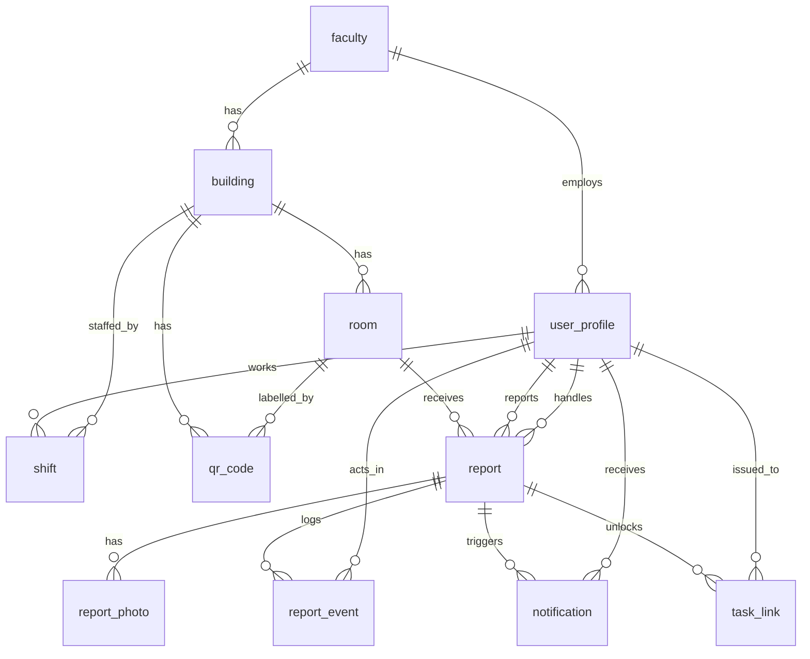
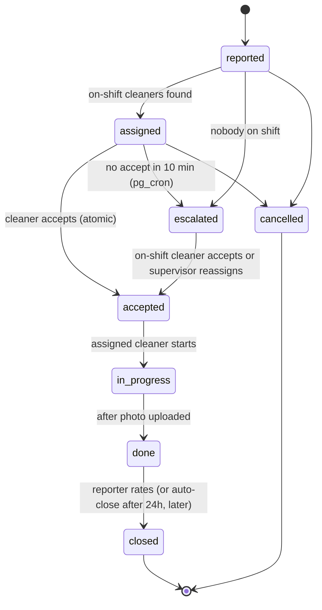

# Campus Clean: Build Blueprint (Prototype v3)

> **Summary.** A mobile web app where anyone on campus, with no login and no app to install, scans a QR sticker on a room door (or a floor sticker, then picks the room) to report a cleaning problem. The right on-shift cleaner is notified and accepts the task, does the work, uploads a proof photo, and the reporter rates it. Faculties see response times. Think "Gojek for campus cleaning": **order → dispatch → status → rating**.

| | |
|---|---|
| Owner | Farid |
| Version | v3: guest reporting (no login), room QR and floor QR through a `qr_code` table (11 tables), WhatsApp one-time links as the cleaner sign-in, WhatsApp contact button for reporters. v2 added the full data-security design and moved escalation into SQL (pg_cron) |
| Status | Design approved. Ready to build the prototype |
| Readers | **Claude Code** (builder) and **Farid** (must be able to explain and defend every part) |

**Ringkasan (Bahasa Indonesia).** Aplikasi web mobile: orang scan QR di pintu ruangan, lapor masalah kebersihan, petugas yang sedang shift diberi notifikasi lalu menerima tugas, mengerjakan, upload foto bukti, dan pelapor memberi rating. Dokumen ini berisi semua yang dibutuhkan Claude Code: tujuan, peran, ERD, keamanan data (bagian 6), struktur folder, dan tahapan build dengan kriteria lulus. **Keamanan dibangun dan dites sebelum UI (Fase 2).** Farid harus bisa menjelaskan tiap bagian, jadi Claude Code wajib memberi ringkasan dua bahasa di akhir tiap fase.

---

## Table of contents

0. How to use this file
1. Product in one page
2. Roles and constraints
3. Architecture decision
4. Data model (ERD v2 and SQL contract)
5. Status flow (state machine)
6. **Data security design**
7. Project structure (work tree)
8. How a report travels through the code
9. Build plan: phases and acceptance criteria
10. Environment and configuration
11. Definition of done and what NOT to build
12. Open decisions to confirm
13. Glossary

---

## 0. How to use this file

### For Farid

1. Create the project folder and put this file at the root as `BLUEPRINT.md`.
2. Create a **short** `CLAUDE.md` next to it (snippet below). Claude Code loads `CLAUDE.md` automatically at the start of every session, so keep it short and let it point to this file for the detail.
3. Open Claude Code in that folder and paste the **starter prompt** below.
4. After each phase, test it yourself using the "How Farid verifies" line, then say "approved, next phase."

### `CLAUDE.md` snippet (copy as is)

```markdown
# Campus Clean (prototype)
Full spec: BLUEPRINT.md. Before starting any phase, re-read the sections that phase names.

## Non-negotiable rules
1. Security before UI. Phase 2 (database security + tests) must pass before any screen is built.
2. The database is the security boundary. UI route guards are convenience only.
3. Clients never write report status directly. All status changes go through the SQL functions in BLUEPRINT.md section 6.
4. The service role key never appears in client code, NEXT_PUBLIC_* variables, logs, or git.
5. Role and faculty come from app_metadata / the user_profile table. Never from user_metadata or request input.
6. Do not silently change the ERD or security rules. If a change is needed, stop, explain why, and update BLUEPRINT.md in the same commit.
7. Migrations are append-only. Never edit an applied migration; add a new one.
8. Check the current official docs for Next.js, Supabase JS, and Supabase Edge Functions before using their APIs. Do not rely on memory.
9. One commit per phase. Run typecheck, lint, and tests before committing.
10. End every phase with a 5-line summary in English AND Bahasa Indonesia: what was built, why, how Farid verifies it, what is next. Explain code in plain language. Farid must be able to defend it.
11. Reporters are guests. Never treat guest input as an identity. Ownership is proven only by the hashed device token. Guest phone numbers (`contact_wa`) never reach cleaners.
```

### Starter prompt (paste as the first message)

```text
Read BLUEPRINT.md completely. Then use plan mode and reply with:
1) a 10-line summary of what you will build,
2) the open decisions in section 12 that you need me to confirm,
3) your plan for Phase 0 only.
Do not write code until I approve.
```

---

## 1. Product in one page

| Item | Decision |
|---|---|
| **Real problem** | When a room is dirty, nobody knows who to tell, the cleaner does not know where to go, and the faculty cannot see how fast problems get fixed. The problem is *accountability and speed*, not "the faculty needs an app". |
| **What we borrow from Gojek** | Order → dispatch → live status → rating. Not maps, not payments. |
| **Location method** | **Two kinds of QR sticker.** A **room QR** on each door (classrooms, labs, toilets, lecturer rooms) opens that room directly: scan, tap Report, done. A **floor QR** (corridor, lobby, lift area) opens a room picker for that floor, with an "Area umum" option for corridors and stairs. For 40 rooms in one building plan about 40 room stickers plus one per floor. No GPS (indoor GPS is inaccurate). |
| **Reporter access** | **No login, no app.** The QR opens a web page. The reporter can also tap a WhatsApp button to reach the on-duty person (WhatsApp is a delivery channel, not the system). Why not only WhatsApp: a chat has no owner, no room, no proof and no timer. |
| **Riskiest assumption** | Cleaning staff will accept and update tasks on their phones. The prototype exists to test this. |
| **Success metric** | Median time from `reported` to `accepted` **under 15 minutes**, and **at least 80%** of reports accepted by a cleaner, both compared with the baseline measured in Week 0. |
| **Pilot size** | 1 building, about 40 rooms, up to about 50 reports per day, up to about 20 users. |

### Scope

| In the prototype | Later (v2) | Never in the MVP |
|---|---|---|
| QR scan (room or floor sticker) → report form (category, note, photo), no login | Auto-reminder at 3 minutes | Live GPS tracking |
| Cleaner queue: accept → in progress → done | WhatsApp provider in production | Payments |
| Proof photo required to finish. WhatsApp one-time link as cleaner sign-in (section 6.6) | Browser push as a free fallback | In-app chat |
| Reporter sees status and rates 1 to 5 | SLA reports, weekly summaries | Native Android/iOS app |
| Supervisor dashboard and reassign | Multi-faculty rollout | AI features |
| Escalation if nobody accepts in 10 minutes | Photo retention job | |
| Notification adapter (console provider for the prototype) | | |

---

## 2. Roles and constraints

### Roles (every role is an access-control decision)

| Role | Who | Can do | Cannot do |
|---|---|---|---|
| `reporter` | Student, lecturer, staff, visitor. **Usually a guest with no account** | Scan QR, create a report, add a "before" photo, see **own** reports (proven by a device token, or by account if signed in), rate own finished report, cancel own early report | See other people's reports, see rooms, QR codes or user lists |
| `cleaner` | Cleaning staff | See reports for buildings they are **on shift** in, accept (atomic), start, finish with "after" photo, see own tasks | See other faculties, see who reported, delete anything |
| `supervisor` | Per-faculty facility lead | See all reports in own faculty, reassign, manage own faculty's shifts, see response-time dashboard | Touch other faculties' data, change roles |
| `admin` | Facility unit | Manage faculties, buildings, rooms, QR codes, users, roles | Edit or delete audit events |

### Environment and constraints

- Runs in a **phone browser** on slow campus Wi-Fi and basic Android phones. Installable as a PWA. No app store.
- Must run on normal hosting (Vercel or Netlify for the web app, managed Supabase for data). It must **not** depend on any AI builder's sandbox.
- No payment system. Free for reporters.
- Timestamps stored in **UTC**, displayed in **WIB (UTC+7)**.
- UI language: **Bahasa Indonesia** for end users (short, plain words). Code, comments, and docs in English.

---

## 3. Architecture decision

### Stack, one language per layer by job

| Layer | Choice | Job |
|---|---|---|
| Database and rules | **SQL on PostgreSQL (Supabase)** | Tables, constraints, row-level security, triggers, atomic accept, scheduled escalation (pg_cron) |
| Web app | **TypeScript + React (Next.js, App Router)**, PWA | Reporter, cleaner, supervisor, admin screens |
| Server jobs | **TypeScript in Supabase Edge Functions** | Send notifications, receive delivery receipts |
| Analytics | **Python (pandas)** in Colab or a notebook | Response and completion time from the same database, read-only |
| Utilities | Python script | Generate a printable QR per room |

### Trade-off (why this stack)

| Criterion | **A: SQL + TypeScript (Next.js + Supabase)** | B: All Python (FastAPI + Postgres) | C: Low-code (AppSheet, Glide) |
|---|---|---|---|
| Server you must run | None (managed) | Yes | None |
| Live status updates | Built in | Extra work | Limited |
| Row-level role security | **Built in (RLS)** | You write it all | Weak |
| Scheduled escalation | pg_cron in the database | Add a scheduler | Hard |
| Notification control | Full | Full | Limited |
| Lock-in | Low (standard Postgres) | Low | **High** |
| Verdict | **Chosen** | Fallback if one language is required | Only for the Week 1 no-code pilot |

**Decision:** Option A, because the rules that must never break (no double-accept, no cross-faculty data access) live in SQL next to the data, there is no server to babysit, and Python still analyses the same database.

### Notification adapter (so the prototype never blocks on a WhatsApp account)

Notifications go through one interface with swappable providers, chosen by `NOTIFY_PROVIDER`:

| Provider | Use | Behaviour |
|---|---|---|
| `console` | **Prototype default** | Writes the `notification` row and prints the message and link to the function logs |
| `whatsapp` | Production | Calls the WhatsApp Business API provider. Use an **official** API only, never an unofficial gateway (risk of the number being banned) |

Message rules: room name first, 5 lines maximum, Bahasa Indonesia, one deep link to the task. **Never include the reporter's name, email, or phone.**

---

## 4. Data model (ERD v2 and SQL contract)

### 4.1 ERD

Eleven tables. `qr_code` maps a printed sticker to a room or to a whole floor. `task_link` is created in Phase 5 (cleaners' WhatsApp sign-in link, section 6.6) but is shown here so the design is complete. `report.reporter_id` is nullable because most reporters are guests. Every other person foreign key (`reporter_id`, `assigned_to`, `actor_id`, `user_id`, `staff_id`, `uploaded_by`) points to `user_profile`.



### 4.2 Design rules baked into the model

| Rule | Why |
|---|---|
| **`report_event` is the truth. `report.status` is a cached copy.** A database trigger writes one event per status change. | No code path can forget to log. Response time = `accepted` event time minus `reported` event time. |
| `report_event` is **append-only** (trigger blocks update and delete) | Audit trail cannot be rewritten. |
| Rating is two columns on `report`, not a table | One report has exactly one rating (1:1). |
| `category` and `status` are **enums** | Do not build a lookup table until an admin truly needs to edit categories. |
| One `user_profile` table with a `role` column | One login system. Role rules enforced by RLS. |
| QR codes live in their own `qr_code` table. Its `token` is a **random string**, not the room id | Nobody can guess another room's link by counting. A damaged sticker is replaced by issuing a new token, with no change to rooms or report history. |
| A QR points to a **room** (`room_id` set) or to a **floor** (`room_id` null, `building_id` + `floor` set) | Floor stickers need far fewer stickers. The report itself always stores a `room_id`, so the cleaner queue and the response-time stats do not change. |
| Common areas are rooms too (`is_common`, for example "Area umum Lantai 2") | Corridors, stairs and lobbies can be reported without a special case. |
| **Soft delete** with `is_active`. Nothing is hard-deleted. | Old reports must still point to a cleaner who has left. |
| UTC timestamps (`timestamptz`) | Avoids time-zone bugs in response-time maths. |

### 4.3 SQL contract (migrations 001 to 003)

Claude Code writes these as numbered migration files. Adjust only if the schema fails to apply, and then update this file.

```sql
-- ===== 001_org_structure.sql =====
create type user_role       as enum ('reporter','cleaner','supervisor','admin');
create type report_category as enum ('toilet','floor','trash','window','furniture','other');
create type report_status   as enum ('reported','assigned','escalated','accepted','in_progress','done','closed','cancelled');
create type photo_kind      as enum ('before','after');
create type notify_channel  as enum ('console','whatsapp','push');

create table faculty (
  id uuid primary key default gen_random_uuid(),
  name text not null unique,
  is_active boolean not null default true
);

create table building (
  id uuid primary key default gen_random_uuid(),
  faculty_id uuid not null references faculty(id),
  name text not null,
  is_active boolean not null default true,
  unique (faculty_id, name)
);

create table room (
  id uuid primary key default gen_random_uuid(),
  building_id uuid not null references building(id),
  name text not null,
  floor smallint not null check (floor between -2 and 60),
  is_common boolean not null default false,               -- corridor, stairs, lobby ("Area umum")
  is_active boolean not null default true,
  unique (building_id, name)
);

-- One row per printed sticker. A room sticker sets room_id. A floor sticker leaves it null.
create table qr_code (
  id uuid primary key default gen_random_uuid(),
  -- 32 hex chars from a CSPRNG-backed uuid = 122 random bits. Not guessable.
  token text not null unique default replace(gen_random_uuid()::text, '-', ''),
  building_id uuid not null references building(id),
  floor smallint not null,
  room_id uuid references room(id),
  is_active boolean not null default true,                -- set false to retire a damaged or lost sticker
  created_at timestamptz not null default now()
);
create unique index on qr_code (building_id, floor) where room_id is null and is_active;  -- one active floor sticker per floor
create index on qr_code (room_id);

-- ===== 002_people_shifts.sql =====
create table user_profile (
  id uuid primary key references auth.users(id) on delete restrict,
  faculty_id uuid references faculty(id),
  name text not null check (char_length(name) between 1 and 100),
  role user_role not null default 'reporter',
  wa_phone text check (wa_phone ~ '^\+[1-9][0-9]{7,14}$'),   -- E.164, staff only
  is_active boolean not null default true,
  created_at timestamptz not null default now()
);

create table shift (
  id uuid primary key default gen_random_uuid(),
  staff_id uuid not null references user_profile(id),
  building_id uuid not null references building(id),
  starts_at timestamptz not null,
  ends_at timestamptz not null,
  check (ends_at > starts_at)
);
create index on shift (building_id, starts_at, ends_at);
create index on shift (staff_id);

-- ===== 003_tickets.sql =====
create table report (
  id uuid primary key default gen_random_uuid(),
  room_id uuid not null references room(id),
  reporter_id uuid references user_profile(id),           -- null for guest reports
  guest_token_hash text,                                  -- SHA-256 of the random device token. Never store the token
  contact_wa text check (contact_wa ~ '^\+[1-9][0-9]{7,14}$'),  -- optional, E.164, supervisors only
  check (reporter_id is not null or guest_token_hash is not null),
  assigned_to uuid references user_profile(id),          -- null until accepted
  category report_category not null,
  note text check (char_length(note) <= 500),
  status report_status not null default 'reported',
  rating smallint check (rating between 1 and 5),
  rating_comment text check (char_length(rating_comment) <= 300),
  created_at timestamptz not null default now(),
  updated_at timestamptz not null default now()
);
create index on report (status, created_at);
create index on report (room_id);
create index on report (reporter_id);
create index on report (guest_token_hash);
create index on report (assigned_to);

create table report_photo (
  id uuid primary key default gen_random_uuid(),
  report_id uuid not null references report(id),
  kind photo_kind not null,
  storage_path text not null unique,                      -- {report_id}/{kind}/{uuid}.jpg
  uploaded_by uuid not null references user_profile(id),
  created_at timestamptz not null default now()
);

create table report_event (
  id bigint generated always as identity primary key,
  report_id uuid not null references report(id),
  actor_id uuid references user_profile(id),              -- null = system
  status report_status not null,
  note text,
  at timestamptz not null default now()
);
create index on report_event (report_id, at);

create table notification (
  id uuid primary key default gen_random_uuid(),
  report_id uuid not null references report(id),
  user_id uuid not null references user_profile(id),
  channel notify_channel not null,
  provider_message_id text,
  sent_at timestamptz,
  delivered_at timestamptz,
  opened_at timestamptz,
  error text,
  created_at timestamptz not null default now()
);
create index on notification (report_id);
create unique index on notification (provider_message_id) where provider_message_id is not null;

-- Phase 5 (cleaners' WhatsApp sign-in link):
-- create table task_link (
--   id uuid primary key default gen_random_uuid(),
--   token_hash text not null unique,                     -- SHA-256 of the token. Never store the token.
--   report_id uuid not null references report(id),
--   user_id uuid not null references user_profile(id),
--   expires_at timestamptz not null,
--   used_at timestamptz,
--   created_at timestamptz not null default now()
-- );
```

### 4.4 Response-time view (read this security note)

By default a Postgres view runs with its **owner's** rights and **bypasses RLS**. Always create views with `security_invoker = true` so each caller only sees what RLS allows.

```sql
create view v_response_times with (security_invoker = true) as
select r.id as report_id, r.room_id,
       min(e.at) filter (where e.status = 'reported') as reported_at,
       min(e.at) filter (where e.status = 'accepted') as accepted_at,
       min(e.at) filter (where e.status = 'done')     as done_at
from report r join report_event e on e.report_id = r.id
group by r.id, r.room_id;
```

---

## 5. Status flow (state machine)



### Allowed transitions (enforced in the database, mirrored in `lib/status.ts` for the UI)

| From → To | Who may trigger | SQL function | Conditions |
|---|---|---|---|
| (new) → `reported` | anyone with a valid QR (guest or signed in) | `create_report` | active QR, room belongs to that QR's room or floor, under rate limit, not a duplicate |
| `reported` → `assigned` / `escalated` | system | `_dispatch_report` | on-shift cleaners exist, or not |
| `assigned` → `escalated` | system (cron) | `escalate_stale_reports` | older than 10 minutes, still unassigned |
| `assigned`/`escalated` → `accepted` | `cleaner` on shift | `accept_report` | **atomic**: only if `assigned_to is null` |
| `assigned`/`escalated`/`accepted` → `accepted` (other cleaner) | `supervisor` of that faculty | `reassign_report` | target cleaner is active and on shift |
| `accepted` → `in_progress` | the assigned cleaner | `start_work` | `assigned_to = auth.uid()` |
| `in_progress` → `done` | the assigned cleaner | `complete_report` | at least one `after` photo exists |
| `done` → `closed` | the reporter (account, or guest device token) | `rate_report` | own report, rating currently null, score 1 to 5 |
| `reported`/`assigned` → `cancelled` | the reporter (account or guest token) or a supervisor | `cancel_report` | own report (or same faculty for supervisor) |

Any other transition raises an exception. The UI never decides this on its own.

---

## 6. Data security design

> **Summary.** The database is the security boundary. Every table has row-level security (RLS). Clients can **read** only what RLS allows and can **write** only by calling vetted SQL functions. Roles come from the server side only. Photos are private. Secrets never leave the server. Every rule below has an automated test in section 6.13.

### 6.1 Principles

| # | Principle | In practice |
|---|---|---|
| 1 | **Deny by default** | RLS enabled on all tables. No policy means no access. |
| 2 | **The database enforces, the UI only guides** | Route guards in Next.js hide screens. RLS and functions protect data. Assume the client is hostile. |
| 3 | **Least privilege** | Each role sees the minimum. Cleaners never see who reported. |
| 4 | **Write only through functions** | No client `INSERT`, `UPDATE`, or `DELETE` on `report`, `report_event`, `report_photo`, `notification`. |
| 5 | **Server-side identity** | Role and faculty live in `user_profile` (set by admin) and `app_metadata`. Never trust `user_metadata` or request bodies for authorization. |
| 6 | **Auditability** | Every status change is an append-only event with actor and time. |
| 7 | **Data minimisation** | Collect only what is needed. Hide personal data from roles that do not need it. |

### 6.2 Data classification

| Data | Sensitivity | Visible to | Retention (confirm with the university) |
|---|---|---|---|
| Reporter name and email | Personal | Self, own-faculty supervisor (via function), admin | Account lifetime |
| Cleaner `wa_phone` | Personal | Self, own-faculty supervisor, admin | Account lifetime |
| Guest `contact_wa` (optional, on the report) | Personal | The notification sender only, own-faculty supervisor (via function), admin. **Never cleaners** | 1 year, then cleared |
| Guest device token | **Secret** | Only the guest's browser. Stored hashed | Report lifetime |
| Report category and note | Low | Reporter, on-shift cleaners (while pending), accepting cleaner, own-faculty supervisor, admin | 1 year |
| Photos | **Medium** (may show people and phone metadata) | Same as the report | 90 days |
| `report_event` | Audit | Same as the report. Append-only | 1 year |
| `notification` | Operational | Recipient, admin | 90 days |
| Task link tokens (Phase 7) | **Secret** | Nobody. Stored hashed. Service role only | 7 days after expiry |
| API keys and secrets | **Secret** | Server environment only | Rotate on suspicion |

Indonesia's personal data protection law (UU PDP, Law No. 27 of 2022) applies to names, phone numbers, and photos. Keep the notice short and honest: what is collected, why, and for how long. This is not legal advice. Confirm retention and consent wording with the university.

### 6.3 Authentication and onboarding

| Who | How they sign in | Notes |
|---|---|---|
| **Reporter (guest)** | **No login, no app.** The QR page works in any browser. The browser creates a random device token and keeps it. Only the SHA-256 hash is saved with the report | A report is accepted only for an active QR. Limits: 5 reports per device token per hour and 20 per IP per hour, plus a bot check (for example Cloudflare Turnstile). The device token is what lets the guest see, rate or cancel their own report. |
| **Reporter (optional account)** | Supabase Auth with **campus email** (magic link or one-time code) | Only for people who want history across devices. Self sign-up allowed **only** if the email domain is on the allowed list (`is_allowed_email`, see 6.5). Default role is `reporter`. |
| **Cleaner** | **Admin-created account.** Admin generates a one-time login link (Supabase admin API) and sends it by WhatsApp | The cleaner opens it once and stays signed in on that phone (long session, about 30 days). No inbox access needed. Check the current Supabase docs for the admin link-generation API before implementing. |
| **Supervisor, admin** | Email + **TOTP multi-factor authentication required** | Enforce MFA in the app for these roles. |

Rules:

- **Role and faculty are assigned only by an admin**, through the service role or an admin-only function. They live in `app_metadata` and `user_profile`.
- **`user_metadata` is user-editable. Never read a role from it.** The signup trigger reads the role only from `raw_app_meta_data`.
- Disabling a user (`is_active = false`) **cuts access at the next request**, even with a valid token, because every helper function checks `is_active`. Also sign the user out through the admin API.
- Lost phone: admin disables the user, then re-enables after re-issuing a login link.

### 6.4 Authorization matrix (RLS)

`R` read, `W` write, `RPC` only through a named SQL function, `none` no access.

| Table | `reporter` | `cleaner` | `supervisor` | `admin` |
|---|---|---|---|---|
| `faculty` | none | R own faculty | R own faculty | R, W |
| `building` | none | R buildings where they have a shift | R own faculty | R, W |
| `room` | none (lookup through `get_qr_target` only) | R rooms in their shift buildings | R own faculty | R, W |
| `qr_code` | none (lookup through `get_qr_target` only) | none | R own faculty | R, W |
| `user_profile` | R self. W **name only** | R self. W name only | R self + cleaners in own faculty. W name only | R all. Role/faculty changes by admin function |
| `shift` | none | R own | R, W own faculty (policy with check) | R, W |
| `report` | R own (signed-in). Guests read through `get_my_report(id, device_token)` | R `assigned`/`escalated` in on-shift buildings, plus own assigned | R own faculty | R |
| `report` writes | RPC | RPC | RPC | RPC |
| `report_photo` | R via parent report. Add via RPC | R via parent. Add via RPC | R via parent | R |
| `report_event` | R via parent. **No client writes** | R via parent | R via parent | R |
| `notification` | R own | R own | R own | R all |
| `task_link` | none | none | none | none (service role only) |

**Visibility chaining:** `report_photo` and `report_event` use `exists (select 1 from report r where r.id = report_id)`. Because RLS also applies to that subquery, they automatically inherit the report's visibility.

**Who sees the reporter's identity:** cleaners never do. `report` exposes only `reporter_id` (an opaque UUID), and `user_profile` RLS stops cleaners resolving it. Supervisors get the reporter name through `get_report_detail(report_id)`, which checks faculty.

### 6.5 Reference SQL (migrations 004 and 005)

Claude Code writes the full migrations following these patterns. Every function sets `search_path` and uses `security definer` deliberately.

```sql
-- ===== 004_security_rls.sql =====

-- Enable RLS on every table
alter table faculty        enable row level security;
alter table building       enable row level security;
alter table room           enable row level security;
alter table qr_code        enable row level security;
alter table user_profile   enable row level security;
alter table shift          enable row level security;
alter table report         enable row level security;
alter table report_photo   enable row level security;
alter table report_event   enable row level security;
alter table notification   enable row level security;

-- Defense in depth: remove default client write privileges on sensitive tables
revoke insert, update, delete on report, report_photo, report_event, notification
  from anon, authenticated;

-- Helper functions (security definer so they can read user_profile without RLS recursion)
create function public.auth_role() returns user_role
language sql stable security definer set search_path = public as $$
  select role from user_profile where id = auth.uid() and is_active
$$;

create function public.auth_faculty() returns uuid
language sql stable security definer set search_path = public as $$
  select faculty_id from user_profile where id = auth.uid() and is_active
$$;

create function public.room_in_my_faculty(p_room uuid) returns boolean
language sql stable security definer set search_path = public as $$
  select exists (select 1 from room r join building b on b.id = r.building_id
                 where r.id = p_room and b.faculty_id = public.auth_faculty())
$$;

create function public.on_shift_for_room(p_room uuid) returns boolean
language sql stable security definer set search_path = public as $$
  select exists (select 1 from room r join shift s on s.building_id = r.building_id
                 where r.id = p_room and s.staff_id = auth.uid()
                   and now() between s.starts_at and s.ends_at)
$$;

revoke execute on function public.auth_role(), public.auth_faculty(),
  public.room_in_my_faculty(uuid), public.on_shift_for_room(uuid) from public, anon;
grant  execute on function public.auth_role(), public.auth_faculty(),
  public.room_in_my_faculty(uuid), public.on_shift_for_room(uuid) to authenticated;

-- Report read policy. The first condition makes disabled users see nothing.
create policy report_read on report for select to authenticated using (
  public.auth_role() is not null and (
       reporter_id = auth.uid()
    or assigned_to = auth.uid()
    or public.auth_role() = 'admin'
    or (public.auth_role() = 'supervisor' and public.room_in_my_faculty(room_id))
    or (public.auth_role() = 'cleaner'
        and status in ('assigned','escalated')
        and public.on_shift_for_room(room_id))
  )
);

-- Chained visibility
create policy photo_read on report_photo for select to authenticated using (
  public.auth_role() is not null
  and exists (select 1 from report r where r.id = report_id)
);
create policy event_read on report_event for select to authenticated using (
  public.auth_role() is not null
  and exists (select 1 from report r where r.id = report_id)
);

create policy notification_read on notification for select to authenticated using (
  public.auth_role() is not null
  and (user_id = auth.uid() or public.auth_role() = 'admin')
);

-- user_profile: read self / supervisor reads own-faculty cleaners / admin reads all
create policy profile_read on user_profile for select to authenticated using (
  public.auth_role() is not null and (
       id = auth.uid()
    or public.auth_role() = 'admin'
    or (public.auth_role() = 'supervisor'
        and faculty_id = public.auth_faculty() and role = 'cleaner')
  )
);
create policy profile_update_self on user_profile for update to authenticated
  using (id = auth.uid()) with check (id = auth.uid());

-- Privilege-escalation guard: users may change ONLY their name.
revoke update on user_profile from authenticated;
grant  update (name) on user_profile to authenticated;

-- Remaining policies (faculty, building, room, shift, admin writes) follow the matrix in 6.4.
-- Every policy gets a test in section 6.13.
```

```sql
-- ===== 005_functions_triggers.sql (security-critical parts) =====

-- Signup guard: role comes ONLY from raw_app_meta_data. Self-signups must use an allowed domain.
create function public.is_allowed_email(p_email text) returns boolean
language sql immutable as $$
  -- TODO(Farid): replace with the real campus domains
  select split_part(lower(p_email), '@', 2) = any (array['replace-me.ac.id'])
$$;

create function public.handle_new_user() returns trigger
language plpgsql security definer set search_path = public as $$
declare v_role user_role := coalesce((new.raw_app_meta_data->>'role')::user_role, 'reporter');
begin
  if (new.raw_app_meta_data->>'role') is null and not public.is_allowed_email(new.email) then
    raise exception 'email_domain_not_allowed';
  end if;
  insert into user_profile (id, name, role, faculty_id)
  values (new.id,
          coalesce(nullif(new.raw_user_meta_data->>'name', ''), split_part(new.email, '@', 1)),
          v_role,
          nullif(new.raw_app_meta_data->>'faculty_id', '')::uuid);
  return new;
end $$;

create trigger on_auth_user_created after insert on auth.users
  for each row execute function public.handle_new_user();

-- Audit trigger: one event per status change. System actions (cron) have a null actor.
create function public.log_report_event() returns trigger
language plpgsql security definer set search_path = public as $$
declare v_actor uuid := coalesce(auth.uid(), nullif(current_setting('app.actor_id', true), '')::uuid);
begin
  if tg_op = 'UPDATE' and new.status = old.status then return new; end if;
  insert into report_event (report_id, actor_id, status) values (new.id, v_actor, new.status);
  return new;
end $$;

create trigger trg_report_event after insert or update of status on report
  for each row execute function public.log_report_event();

-- Append-only audit trail
create function public.forbid_event_changes() returns trigger
language plpgsql as $$ begin raise exception 'report_event is append-only'; end $$;

create trigger trg_event_immutable before update or delete on report_event
  for each row execute function public.forbid_event_changes();

-- Safe lookup of a QR sticker (guests and reporters cannot read room or qr_code directly).
-- Room QR: returns one row. Floor QR: returns every active room on that floor, common areas last.
create function public.get_qr_target(p_token text)
returns table (room_id uuid, room_name text, building_name text, floor smallint, is_common boolean, kind text)
language sql stable security definer set search_path = public as $$
  select r.id, r.name, b.name, r.floor, r.is_common,
         case when q.room_id is null then 'floor' else 'room' end
    from qr_code q
    join building b on b.id = q.building_id and b.is_active
    join room r on r.building_id = q.building_id and r.floor = q.floor and r.is_active
               and (q.room_id is null or r.id = q.room_id)
   where q.token = p_token and q.is_active
   order by r.is_common, r.name
$$;
revoke execute on function public.get_qr_target(text) from public;
grant  execute on function public.get_qr_target(text) to anon, authenticated;   -- guests are anon

-- Create a report. Works for guests (anon) and signed-in users.
-- p_room is required for a floor QR and optional for a room QR. The room must belong to the QR.
-- p_guest_token is a random string made by the browser. Only its hash is stored.
-- The per-IP limit (20 per hour) and the bot check run in the Edge Function that calls this.
create function public.create_report(
  p_qr_token text, p_room uuid, p_category report_category,
  p_note text default null, p_guest_token text default null, p_contact_wa text default null)
returns uuid language plpgsql security definer set search_path = public as $$
declare v_room uuid; v_id uuid; v_recent int; v_hash text;
begin
  if auth.uid() is null and (p_guest_token is null or char_length(p_guest_token) < 32) then
    raise exception 'not_authenticated';                 -- no account and no valid device token
  end if;
  if auth.uid() is not null and public.auth_role() is null then raise exception 'not_authenticated'; end if;
  v_hash := case when p_guest_token is null then null
                 else encode(sha256(convert_to(p_guest_token, 'utf8')), 'hex') end;

  select t.room_id into v_room from public.get_qr_target(p_qr_token) t
   where t.room_id = coalesce(p_room, t.room_id) limit 1;   -- a floor QR cannot reach another floor
  if v_room is null then raise exception 'invalid_room'; end if;

  select count(*) into v_recent from report
   where created_at > now() - interval '1 hour'
     and ((auth.uid() is not null and reporter_id = auth.uid())
       or (v_hash is not null and guest_token_hash = v_hash));
  if v_recent >= 5 then raise exception 'rate_limited'; end if;

  select id into v_id from report                       -- duplicate: same room + category, still open
   where room_id = v_room and category = p_category
     and status not in ('done','closed','cancelled')
     and created_at > now() - interval '30 minutes' limit 1;
  if v_id is not null then return v_id; end if;

  insert into report (room_id, reporter_id, guest_token_hash, contact_wa, category, note)
  values (v_room, auth.uid(), v_hash, nullif(btrim(p_contact_wa), ''), p_category, nullif(btrim(p_note), ''))
  returning id into v_id;

  perform public._dispatch_report(v_id);
  return v_id;
end $$;
revoke execute on function public.create_report(text, uuid, report_category, text, text, text) from public;
grant  execute on function public.create_report(text, uuid, report_category, text, text, text) to anon, authenticated;

-- Note: a guest who files a duplicate gets the existing report id back but cannot read it (it is not theirs).
-- Return a flag from create_report (or a separate "merged" status page) so the UI says "already reported".

-- Dispatch (internal): assigned if on-shift cleaners exist, otherwise escalated at once
create function public._dispatch_report(p_report uuid) returns void
language plpgsql security definer set search_path = public as $$
declare v_building uuid; v_has_staff boolean;
begin
  select rm.building_id into v_building
    from report r join room rm on rm.id = r.room_id where r.id = p_report;
  select exists (select 1 from shift s join user_profile u on u.id = s.staff_id
                  where s.building_id = v_building and u.is_active and u.role = 'cleaner'
                    and now() between s.starts_at and s.ends_at) into v_has_staff;
  update report
     set status = (case when v_has_staff then 'assigned' else 'escalated' end)::report_status,
         updated_at = now()
   where id = p_report;
end $$;
revoke execute on function public._dispatch_report(uuid) from public, anon, authenticated;

-- ATOMIC ACCEPT: the database decides in one step, so two cleaners can never both win.
create function public._accept_report(p_report uuid, p_staff uuid) returns boolean
language plpgsql security definer set search_path = public as $$
declare v_id uuid;
begin
  perform set_config('app.actor_id', p_staff::text, true);       -- actor for the audit trigger
  update report set status = 'accepted', assigned_to = p_staff, updated_at = now()
   where id = p_report and assigned_to is null and status in ('assigned','escalated')
  returning id into v_id;
  return v_id is not null;
end $$;
revoke execute on function public._accept_report(uuid, uuid) from public, anon, authenticated;
grant  execute on function public._accept_report(uuid, uuid) to service_role;

create function public.accept_report(p_report uuid) returns boolean
language plpgsql security definer set search_path = public as $$
declare v_room uuid;
begin
  if public.auth_role() is distinct from 'cleaner' then raise exception 'forbidden'; end if;
  select room_id into v_room from report where id = p_report;
  if v_room is null or not public.on_shift_for_room(v_room) then raise exception 'forbidden'; end if;
  return public._accept_report(p_report, auth.uid());           -- false = someone was faster
end $$;
revoke execute on function public.accept_report(uuid) from public, anon;
grant  execute on function public.accept_report(uuid) to authenticated;

-- Escalation (called by pg_cron every minute; the interval is a parameter so tests can shorten it)
create function public.escalate_stale_reports(p_after interval default interval '10 minutes')
returns int language plpgsql security definer set search_path = public as $$
declare n int;
begin
  update report set status = 'escalated', updated_at = now()
   where status = 'assigned' and created_at < now() - p_after;
  get diagnostics n = row_count;
  return n;
end $$;
revoke execute on function public.escalate_stale_reports(interval) from public, anon, authenticated;
grant  execute on function public.escalate_stale_reports(interval) to service_role;
-- 007_cron.sql: select cron.schedule('escalate-stale', '* * * * *', $$select public.escalate_stale_reports()$$);
```

**Other functions Claude Code must write in the same style** (each `security definer`, each checking role, ownership, status, and `is_active`):
`start_work`, `complete_report` (requires an `after` photo row), `rate_report` (own report, status `done`, rating null), `cancel_report` (`rate_report`, `cancel_report` and `add_report_photo` also accept `p_guest_token` and compare its hash), `get_my_report(p_report, p_guest_token)` (guest read of own report, never returns other people's data), `get_my_reports(p_guest_token)` (the "Laporanku" list), `reassign_report` (supervisor, same faculty, target is an active on-shift cleaner), `add_report_photo`, `get_report_detail` (supervisor and admin see reporter name), and admin-only `set_user_role` and `set_shift`.

### 6.6 Task links (Phase 5, the cleaners' WhatsApp sign-in)

**Prototype default:** cleaners are signed in with a long session. A notification contains a **deep link** such as `/cleaner/task/{report_id}`. The report id is not a secret. RLS decides access, so no token is needed.

**Hardened one-time link (Phase 5).** The WhatsApp message to a cleaner or supervisor carries this link. It is their normal sign-in, so nobody types a password, and it is also the recovery path when a session expires:

| Control | Rule |
|---|---|
| Token | 32 random bytes from a CSPRNG, URL-safe, generated in an Edge Function |
| Storage | Store only the **SHA-256 hash** in `task_link.token_hash` |
| Binding | One token = one cleaner + one report |
| Lifetime | **20 minutes**, then expired |
| Use | **Single use.** It is exchanged once for a normal signed-in session (about 30 days) for that cleaner, then opens the task. After that RLS and the normal functions apply, so the link never bypasses a rule |
| Checks on use | Token valid and unused, user active, report still pending. Then set `used_at` and create the session. Accepting is still done by `accept_report`, which checks on-shift status |
| Page headers | `Referrer-Policy: no-referrer`, `Cache-Control: no-store` |
| Abuse | Rate-limit by IP. Never log the token |

### 6.7 Photos and storage

| Control | Rule |
|---|---|
| Bucket | `report-photos`, **private** |
| Path | `{report_id}/{kind}/{uuid}.jpg` (kind is before or after) |
| Upload policy | `before`: uploader must be the report's `reporter_id` and status in (`reported`,`assigned`,`escalated`). `after`: uploader must be `assigned_to` and status in (`accepted`,`in_progress`) |
| Read policy | Allowed only if the caller can see the parent report (storage policy checks `report` through RLS) |
| Delivery | **Signed URLs** with a short lifetime (5 to 10 minutes). Never public URLs |
| Limits | Bucket-level `file_size_limit` 5 MB. Allowed MIME types `image/jpeg`, `image/png`, `image/webp` |
| Privacy | The client **re-encodes the image to JPEG (max 1280 px)** before upload, which strips EXIF data such as GPS. UI hint: "Photograph the problem, not people." |
| Retention | Delete photos older than 90 days (scheduled job, Phase 7) |

### 6.8 Webhooks, secrets, and server code

| Control | Rule |
|---|---|
| Edge Function JWT | Verification **on** for all functions except `whatsapp-webhook` |
| `whatsapp-webhook` | JWT verification off **only for this function**, replaced by **provider signature verification** (HMAC of the raw body). Invalid signature: respond 401, change nothing |
| Idempotency | Receipts are matched on `provider_message_id` (unique index). Duplicate delivery does nothing |
| Service role key | Server and Edge Function environment only. **Never** in `NEXT_PUBLIC_*`, client bundles, logs, or git |
| Anon key | The only key allowed in the browser. Safe because RLS protects the data |
| Secrets | `.env` is git-ignored. Only `.env.example` (names, no values) is committed. Edge secrets set with the Supabase CLI secrets command. Rotate any key that leaks |
| Logging | Never log phone numbers, tokens, emails, or message bodies |
| SQL | Only parameterised queries and RPC calls. No string-built SQL. Functions set `search_path` |

### 6.9 Abuse controls

| Threat | Control |
|---|---|
| Spam or prank reports | Valid active QR required, **5 reports per device token per hour**, 20 per IP per hour, a bot check on submit, and duplicate reports for the same room and category within 30 minutes collapse into the existing one. Supervisors can retire a QR (`qr_code.is_active = false`) if a sticker is being abused |
| Oversized input | `note` max 500 characters, `rating_comment` max 300, enforced by database `check` constraints |
| QR enumeration | Tokens are 122-bit random. Guests and reporters cannot read the `room` or `qr_code` tables. `get_qr_target` returns only room names, building name and floor. A floor QR can never create a report for another floor or building |
| Cleaner ignoring tasks | Escalation to the supervisor at 10 minutes. Every action is in `report_event` |

### 6.10 Web app hardening (Next.js)

- **Cookies:** use the official Supabase SSR helpers. Session cookies must be `HttpOnly`, `Secure` in production, `SameSite=Lax`.
- **XSS:** React escapes by default. **Never use `dangerouslySetInnerHTML`.** Render `note` as plain text.
- **Security headers** (set in `next.config`): `Content-Security-Policy` (default-src 'self', allow the Supabase project URL for connect and images), `X-Content-Type-Options: nosniff`, `Referrer-Policy: strict-origin-when-cross-origin`, `X-Frame-Options: DENY`, and HTTPS only (HSTS in production).
- **Middleware:** refreshes the session and redirects by role. This is a convenience. The database is the boundary.
- **Dependencies:** commit the lockfile, run `npm audit` before each release, and keep dependencies few.
- **Errors:** show friendly messages. Never expose stack traces, SQL errors, or keys.

### 6.11 Privacy and retention

- Cleaners see room, category, note, and "before" photo. They do **not** see the reporter's identity.
- Notification messages contain no reporter personal data.
- Photos auto-delete after 90 days. Reports and events are kept 1 year (confirm with the university).
- A user can be deactivated without deleting history (soft delete).
- Backups: use the managed daily backups of the chosen Supabase plan and **check what the plan includes**. Export a weekly copy during the pilot.

### 6.12 Threat model

| # | Threat | Control | Test |
|---|---|---|---|
| T1 | Spam or prank reports | Bot check, device and IP rate limits, duplicate collapse, retire a QR | S9, S10 |
| T2 | Privilege escalation (user makes self admin) | Role from `app_metadata`, column-level grant, RPC-only writes | S3, S4 |
| T3 | IDOR (guessing another report's id) | RLS on every table, UUID ids | S1, S2 |
| T4 | QR token enumeration, floor QR used to reach another floor | Random tokens, `room` and `qr_code` unreadable by guests, room checked against the QR | S2, S19, S22 |
| T16 | A guest reads or changes another guest's report | Hashed device token checked in SQL, UUID ids | S20 |
| T17 | Guest phone number reaches a cleaner | `contact_wa` excluded from every cleaner-facing function and view | S21 |
| T5 | Double-accept race | Atomic `UPDATE ... WHERE assigned_to IS NULL` | S8 |
| T6 | Cleaner learns who reported | `user_profile` RLS, opaque `reporter_id` | S16 |
| T7 | Photo leak | Private bucket, path-based policy, short signed URLs | S12 |
| T8 | Webhook spoofing | Signature check, idempotency | S13 |
| T9 | Secret leakage | Server-only env, `.gitignore`, no `NEXT_PUBLIC` for secrets | S14 |
| T10 | History tampering | Append-only trigger, no client write privileges | S4, S5 |
| T11 | Lost or stolen phone | `is_active = false` cuts access immediately | S11 |
| T12 | Forwarded task link (Phase 7) | Bound, short-lived, hashed, on-shift check | S17 |
| T13 | XSS through the note field | React escaping, CSP, no raw HTML | manual review |
| T14 | SQL injection | Parameterised calls only, fixed `search_path` | code review |
| T15 | View bypasses RLS | `security_invoker = true` on all views | S18 |

Out of scope for the prototype: a malicious database administrator, denial-of-service protection beyond platform defaults.

### 6.13 Security tests (must pass before any UI work)

Write these as automated tests in `supabase/tests/` (pgTAP, or a TypeScript script that signs in as different seeded users). Seed at least: 2 faculties, a reporter A and B, a cleaner on shift, a cleaner off shift, a cleaner in another faculty, a supervisor per faculty, an admin.

| ID | Test | Expected |
|---|---|---|
| S1 | Reporter A reads reporter B's report | 0 rows |
| S2 | Reporter reads `room`, `building`, other users' `user_profile` | 0 rows |
| S3 | Any user runs `update user_profile set role = 'admin'` on self | Denied |
| S4 | Direct client `insert/update/delete` on `report`, `report_event`, `report_photo`, `notification` | Denied |
| S5 | `update` or `delete` on `report_event`, even with the service role | Exception "append-only" |
| S6 | Cleaner **not on shift** lists or accepts a pending report | Sees nothing. Accept raises forbidden |
| S7 | Cleaner or supervisor of faculty X reads faculty Y's reports | 0 rows |
| S8 | Two simultaneous `accept_report` calls on one report | Exactly **one** returns true |
| S9 | The same device token (or account) creates a 6th report within an hour | Exception `rate_limited` |
| S10 | (Optional account sign-in) Sign-up with a non-allowed email domain | Fails. User row not created |
| S11 | Deactivated user with a still-valid token queries any table | 0 rows everywhere |
| S12 | Upload to a report that is not yours, a non-image file, or a file over 5 MB | Rejected |
| S13 | Webhook call with a bad signature | 401, no database change |
| S14 | Search the client bundle, `NEXT_PUBLIC_*` variables, and git history for the service role key | Not found |
| S15 | Rate a report that is not `done`, or rate twice | Exception |
| S16 | A cleaner's report payload contains reporter name, email, or phone | Never |
| S17 | (Phase 7) Expired, reused, or other-user task token | Rejected |
| S18 | `v_response_times` queried as reporter A | Only A's own reports |
| S19 | Floor QR for floor 2 used with a room on floor 3, or in another building | Exception `invalid_room` |
| S20 | Guest B reads, rates or cancels guest A's report using B's token | Not found or denied. A's report unchanged |
| S21 | A cleaner's report payload, or any view they can query, contains `contact_wa` or `guest_token_hash` | Never |
| S22 | Report created with a retired (`is_active = false`) QR, or a random unknown token | Exception `invalid_room` |

---

## 7. Project structure (work tree)

```
campus-clean/
├── BLUEPRINT.md                          # this file
├── CLAUDE.md                             # short rules (section 0)
├── README.md                             # how to run, test, deploy
├── .env.example                          # secret NAMES only, never values
├── .gitignore                            # .env*, but not .env.example
│
├── supabase/                             # DATABASE + SERVER JOBS (the rules live here)
│   ├── config.toml                       # function settings (verify_jwt off ONLY for whatsapp-webhook)
│   ├── migrations/                       # numbered, append-only
│   │   ├── 001_org_structure.sql         # enums, faculty, building, room (with floor), qr_code
│   │   ├── 002_people_shifts.sql         # user_profile, shift
│   │   ├── 003_tickets.sql               # report, report_photo, report_event, notification
│   │   ├── 004_security_rls.sql          # enable RLS, helper functions, policies, grants
│   │   ├── 005_functions_triggers.sql    # signup guard, audit trigger, create/accept/... functions
│   │   ├── 006_storage_policies.sql      # private bucket, upload/read policies, limits
│   │   ├── 007_cron.sql                  # pg_cron: escalate_stale_reports every minute
│   │   └── 008_task_link.sql             # Phase 5: cleaners' WhatsApp sign-in link
│   ├── seed.sql                          # faculties, buildings, rooms, shifts
│   ├── tests/                            # security tests S1 to S18
│   └── functions/                        # Edge Functions (TypeScript)
│       ├── notify-staff/index.ts         # on report_event assigned/escalated: pick recipients, send
│       ├── whatsapp-webhook/index.ts     # delivery receipts, signature-verified
│       └── _shared/
│           ├── notify/provider.ts        # interface: send(to, message)
│           ├── notify/console.ts         # prototype provider
│           ├── notify/whatsapp.ts        # production provider
│           └── signature.ts              # HMAC verification
│
├── app/                                  # WEB APP (Next.js App Router)
│   ├── login/page.tsx                    # email magic link / one-time code
│   ├── r/[qrToken]/page.tsx              # REPORTER (guest): QR landing. Room QR shows the room. Floor QR shows a room picker + "Area umum"
│   ├── r/[qrToken]/report/page.tsx       # REPORTER (guest): report form (category, note, photo, optional WhatsApp number)
│   ├── report/[id]/page.tsx              # REPORTER (guest): status, photos, rating, cancel, WhatsApp contact button. Proven by device token
│   ├── cleaner/page.tsx                  # CLEANER: my queue (realtime)
│   ├── cleaner/task/[id]/page.tsx        # CLEANER: task detail, accept/start/done (deep link target)
│   ├── supervisor/page.tsx               # SUPERVISOR: dashboard, reassign
│   ├── admin/page.tsx                    # ADMIN: structure, users, roles, QR codes
│   └── layout.tsx
├── middleware.ts                         # refresh session, redirect by role (convenience only)
├── components/                           # ReportForm, TaskCard, StatusBadge, PhotoUpload
├── lib/
│   ├── supabase/client.ts                # browser client (anon key only)
│   ├── supabase/server.ts                # server client (cookie session)
│   ├── auth.ts                           # role helpers for UI
│   ├── status.ts                         # allowed transitions, mirrors section 5
│   └── image.ts                          # re-encode to JPEG 1280 px (strips EXIF)
├── types/db.ts                           # generated from the schema, never hand-edited
│
├── analytics/
│   └── response_time.ipynb               # Python: response and completion time (read-only DB user)
├── scripts/
│   ├── seed-users.ts                     # creates test users with app_metadata (local only)
│   └── make_qr_codes.py                  # printable sticker sheet: one QR per room and one per floor, labelled (A-201.png, Lantai-2.png)
└── docs/
    ├── decisions.md                      # why each choice was made
    └── pilot-week0.md                    # interviews, baseline measurement
```

---

## 8. How a report travels through the code

| # | Step | Who | Starts in | What runs | Tables touched |
|---|---|---|---|---|---|
| 1 | Open the QR link (no login) | Reporter (guest) | `app/r/[qrToken]` | `get_qr_target`. Room QR: show the room. Floor QR: show the room picker. Browser creates a device token | `room`, `qr_code` (read via function) |
| 2 | Submit | Reporter | `ReportForm` | `create_report` (rate limit, duplicate check, `_dispatch_report`) | `report`, `report_event` |
| 3 | Add "before" photo | Reporter | `PhotoUpload` | Storage upload, then `add_report_photo` | storage, `report_photo` |
| 4 | Notify | System | DB webhook → `notify-staff` | Pick on-shift cleaners, provider send | `notification` |
| 5 | Receipts | Provider | `whatsapp-webhook` | Verify signature, update by `provider_message_id` | `notification` |
| 6 | Accept | Cleaner | `cleaner/task/[id]` | `accept_report` (atomic) | `report`, `report_event` |
| 7 | Start | Cleaner | same page | `start_work` | `report`, `report_event` |
| 8 | Finish | Cleaner | same page | Upload "after" photo, `complete_report` | `report_photo`, `report`, `report_event` |
| 9 | Rate | Reporter | `report/[id]` | `rate_report` | `report`, `report_event` |
| 10 | Escalate | pg_cron | `007_cron.sql` | `escalate_stale_reports` at 10 min, then `notify-staff` alerts the supervisor | `report`, `report_event`, `notification` |
| 11 | Dashboard | Supervisor | `supervisor/page` | Read `v_response_times`, `reassign_report` | `report_event` (aggregated) |

Realtime: the cleaner queue subscribes to `report` changes. RLS still filters what each user receives. Guests have no session, so their status page polls `get_my_report` every 10 seconds. Fall back to polling for everyone if realtime is unreliable.

---

## 9. Build plan: phases and acceptance criteria

Work **one phase at a time**. Use plan mode, propose the plan, wait for Farid's approval, build, test, commit, summarise in English and Bahasa Indonesia.

| Phase | Name | Sections to re-read | Gate |
|---|---|---|---|
| 0 | Scaffold | 3, 7, 10 | App and local database run |
| 1 | Schema and seed | 4 | Database resets cleanly |
| 2 | **Security core (no UI)** | 6 | **Security tests green** |
| 3 | Reporter flow | 5, 8 | Reporter can file and track a report |
| 4 | Cleaner flow | 5, 8 | Double-accept impossible |
| 5 | Notifications and escalation | 6.8, 8 | Notification logged, escalation works |
| 6 | Supervisor and admin | 4.4, 6.3 | Dashboard numbers correct |
| 7 | Hardening and extras | 6.6, 6.10 | Headers, retention, README, deploy |

### Phase 0: Scaffold

- Create the Next.js app (TypeScript, App Router, ESLint) in the current folder **without deleting `BLUEPRINT.md` or `CLAUDE.md`**. Add `@supabase/supabase-js` and `@supabase/ssr`. Add the Supabase CLI as a dev dependency and run `supabase init`.
- Add `.gitignore` (`.env*` except `.env.example`), `.env.example`, a README stub. `git init`, first commit.
- **Accept when:** the dev server shows a page, the local Supabase stack starts (Docker must be running), and the first commit exists.
- **How Farid verifies:** open the app in the browser and open the local Supabase Studio.

### Phase 1: Schema and seed

- Write migrations 001 to 003 from section 4.3. Write `seed.sql` (2 faculties, 3 buildings, 10 rooms, shifts around "now"). Write `scripts/seed-users.ts` to create one user per role plus extras listed in 6.13, using the service role locally and `app_metadata` for roles. Generate types into `types/db.ts`.
- **Accept when:** a full database reset succeeds with no errors, and the seed data is visible.
- **How Farid verifies:** open the tables in Supabase Studio and read the seeded rows.

### Phase 2: Security core (no UI)

- Write migrations 004, 005, 006 from section 6, including every function listed in 6.5. Write tests S1 to S11, S15, S16, S18 to S22 and a single command (for example `npm run test:db`) that runs them and prints pass or fail per test.
- **Accept when:** **every listed test passes.** **No UI is built until this is green.**
- **How Farid verifies:** run the test command. Then deliberately remove one policy, run again, and watch a test fail. Restore it. (This teaches what each rule protects.)

### Phase 3: Reporter flow

- No login. `app/r/[qrToken]` with the room landing (Report button plus a "Hubungi petugas jaga via WhatsApp" button) and the floor room picker (with "Area umum"). `ReportForm` (category, note up to 500 characters, optional WhatsApp number, photo re-encoded client-side), device token in the browser, `create_report`, photo upload, status page that polls every 10 seconds, rating, cancel, "Laporanku" list kept on that device. Bot check on submit. All user-facing text in short Bahasa Indonesia. Friendly messages for `rate_limited`, `invalid_room`, `not_authenticated`.
- **Accept when:** a guest files a report from a room QR in 3 taps or fewer, files one from a floor QR after picking the room, sees status change when it is advanced by SQL, and tests S9, S12, S19, S20 and S22 pass.
- **How Farid verifies:** open a room QR and a floor QR on a phone (same network or preview deploy) and file a report from each.

### Phase 4: Cleaner flow

- Cleaner sign-in through an admin-issued one-time link (a dev script generates one), `app/cleaner` queue, task detail, accept, start, finish (requires an "after" photo). Show "Already taken" when `accept_report` returns false.
- **Accept when:** S6, S7, S8 pass, and two browsers pressing Accept at once produce exactly one winner and one "Already taken".
- **How Farid verifies:** open two browser windows as two cleaners and click Accept together.

### Phase 5: Notifications and escalation

- Cleaner and supervisor WhatsApp sign-in link (migration 008, section 6.6) with test S17. `notify-staff` Edge Function triggered by a database webhook on `report_event` rows with status `assigned` or `escalated`. Provider adapter (`console` default, `whatsapp` stub). `whatsapp-webhook` with signature verification and idempotency. Migration 007 schedules escalation. If `pg_cron` is unavailable locally, provide an equivalent scheduled Edge Function and note it.
- **Accept when:** filing a report writes a `notification` row and prints the message and link in the function logs. A test calls `escalate_stale_reports('5 seconds')` and the supervisor is notified. S13 passes.
- **How Farid verifies:** file a report, read the logged message, wait for the escalation test, and check the supervisor notification.

### Phase 6: Supervisor and admin

- Supervisor dashboard: open tasks by status, response-time table from `v_response_times`, median response time, percentage accepted, reassign. Admin: manage faculties, buildings, rooms, printable QR codes, invite users with a one-time link, set role and faculty, deactivate users. Enforce TOTP MFA for supervisor and admin.
- **Accept when:** the dashboard median matches a manual calculation on seed data, a QR image opens the correct report form, and a deactivated user loses access at once.
- **How Farid verifies:** calculate one median by hand from the events table and compare.

### Phase 7: Hardening and extras

- Security headers and CSP, photo retention job, task-link rate limits and abuse review (6.6), sticker sheet generator for room and floor QR (`make_qr_codes.py`), README, deploy preview (Vercel or Netlify) plus a production Supabase project with environment variables set.
- **Accept when:** headers appear in a `curl -I` response, S14 and S17 pass, and Farid can run the project from scratch using only the README.

---

## 10. Environment and configuration

`.env.example` (names only):

```bash
NEXT_PUBLIC_SUPABASE_URL=
NEXT_PUBLIC_SUPABASE_ANON_KEY=
SUPABASE_SERVICE_ROLE_KEY=        # server only. NEVER prefix with NEXT_PUBLIC
APP_BASE_URL=http://localhost:3000
NOTIFY_PROVIDER=console           # console | whatsapp
WHATSAPP_API_TOKEN=               # Edge Function secret
WHATSAPP_WEBHOOK_SECRET=          # Edge Function secret, for signature verification
WHATSAPP_SENDER_ID=               # Edge Function secret
```

Common commands (confirm against the current Supabase and Next.js docs before relying on them):

| Task | Command |
|---|---|
| Run the web app | `npm run dev` |
| Start local Supabase (Docker running) | `npx supabase start` |
| Reset the database from migrations and seed | `npx supabase db reset` |
| New migration file | `npx supabase migration new <name>` |
| Regenerate types | `npx supabase gen types typescript --local > types/db.ts` |
| Serve Edge Functions locally | `npx supabase functions serve` |
| Run database security tests | `npm run test:db` |

---

## 11. Definition of done and what NOT to build

### Prototype is done when

- [ ] All security tests S1 to S22 pass
- [ ] The 5-step demo below works on a phone
- [ ] The service role key appears nowhere in client code or git
- [ ] The README lets Farid run everything from scratch
- [ ] Farid can explain, without help: the ERD, the atomic accept, why RLS is the boundary, and why `report_event` is the truth

### Demo script (5 steps)

1. A guest scans a room QR (no login) and files "Toilet kotor" with a photo. Then scans a floor QR, picks the room, and files a second report.
2. An on-shift cleaner sees it in the queue (the console notification shows the link) and accepts it. A second cleaner's Accept shows "Already taken".
3. The cleaner starts, uploads an "after" photo, and finishes.
4. The reporter sees "Done" and rates 5 stars.
5. The supervisor dashboard shows the response and completion time. A second report left untouched escalates to the supervisor.

### Do NOT build

Payments, live GPS, in-app chat, a native mobile app, AI features, multi-university tenancy, a custom auth system, or any public reading of other people's reports. Guests may read only their own report, proven by their device token.

---

## 12. Open decisions to confirm

Claude Code: list these back to Farid in your first reply and proceed with the default only after he confirms.

| # | Decision | Default assumption | Impact if wrong |
|---|---|---|---|
| 1 | How cleaners sign in | Admin-issued one-time link, then a long session | If phones are shared, each person needs their own login or PIN, and notifications must reach the right person |
| 2 | Allowed email domains (only for the optional reporter account) | **Placeholder. Must be replaced** in `is_allowed_email`. Guests need no email | Optional sign-up fails or is too open |
| 3 | WhatsApp provider | `console` provider for the prototype | Production notifications need an official provider account |
| 4 | Do cleaners have WhatsApp on their own phones | Yes | If shared phones, redesign recipient mapping |
| 5 | Retention periods | Photos 90 days, reports and events 1 year | Must match university policy and law |
| 6 | Supervisor per faculty and escalation contact | One supervisor per faculty with a reachable number | Escalation has nobody to alert |
| 7 | Pilot building | One building, about 40 rooms | Seed data and QR printing depend on it |
| 8 | Week 0 baseline | Measured manually before launch | Without it, the success metric cannot prove improvement |
| 9 | QR layout | Room QR for classrooms, labs, toilets and offices. Floor QR for corridors and as a backup. About 40 room stickers plus one per floor per building | If rooms are renamed or merged often, rely more on floor QR |
| 10 | WhatsApp contact button | One on-duty coordinator number (or one per building) | Without a staffed number the button leads nowhere. Decide who answers and when |
| 11 | Guests from outside campus | Allowed, with the bot check and rate limits | If the university wants campus-only reporting, add a campus-email check before the form |

---

## 13. Glossary

| Term | Meaning |
|---|---|
| **ERD** | Entity Relationship Diagram: a map of tables and how they connect |
| **PK / FK** | Primary key (unique row id) / foreign key (column pointing to another table's PK) |
| **Enum** | A column limited to a fixed list of values |
| **RLS** | Row-Level Security: the database filters rows per user on every query |
| **RPC** | Calling a SQL function from the app (the only way clients write sensitive data here) |
| **Security definer** | A function that runs with its owner's rights, so it must check permissions itself |
| **Trigger** | SQL that runs automatically when data changes (used for the audit log) |
| **Atomic** | Happens fully in one step. The accept update cannot be split by a competing request |
| **Append-only** | Rows can be added but never changed or deleted |
| **JWT** | The signed token a signed-in user carries. Contains who they are |
| **Anon key** | Public key safe in the browser because RLS protects the data |
| **Service role key** | Master key that bypasses RLS. Server only |
| **`app_metadata` / `user_metadata`** | Server-controlled / user-editable profile data. Roles come only from the first |
| **Edge Function** | Small server-side TypeScript function managed by Supabase |
| **pg_cron** | Scheduler inside Postgres (runs escalation every minute) |
| **Idempotent** | Doing it twice has the same effect as doing it once |
| **Signed URL** | A temporary link to a private file that expires |
| **PWA** | A website that can be installed on a phone's home screen |
| **EXIF** | Hidden photo metadata (can include GPS) that we strip before upload |
| **IDOR** | Reading someone else's data by guessing an id. RLS prevents it |
| **Guest** | A reporter with no account. Identified only by a random device token stored in their browser |
| **Device token** | Random string made by the browser. Only its SHA-256 hash is stored on the report. Proves "this is my report" |
| **Room QR / floor QR** | A sticker that opens one room, or a sticker that opens a picker for every room on a floor |

---

## Appendix: changes from the earlier chat draft

| Earlier | Now | Why |
|---|---|---|
| 9 tables, no security tables | **10 tables** (`task_link` added, Phase 7) | Hardened no-login links need hashed tokens |
| `rating` as a separate table | Two columns on `report` | 1:1 relationship |
| `escalate` Edge Function | **pg_cron + SQL function** | Fewer moving parts. Testable with a short interval |
| "Role security" as one bullet | Full section 6 with RLS matrix, SQL, threat model, 18 tests | Security was missing as a design |
| No-login task links by default | Deep link + long session by default. Token links in Phase 7 | Simpler and safer to start |
| WhatsApp required | `console` provider for the prototype | Build is never blocked by an external account |
| Reporters sign in with campus email | **Guests, no login.** Optional account only | Lecturer feedback: "why not just use WhatsApp?" Login is the biggest barrier to reporting |
| One QR per room (`room.qr_token`) | `qr_code` table: room QR and floor QR | Fewer stickers where needed, replaceable stickers, same report data |
| Task links in Phase 7 | Task links in Phase 5 as the cleaners' sign-in | WhatsApp delivers the link, so nobody types a password |
| 18 security tests | 22 (S19 to S22 added) | New guest and floor-QR risks |
