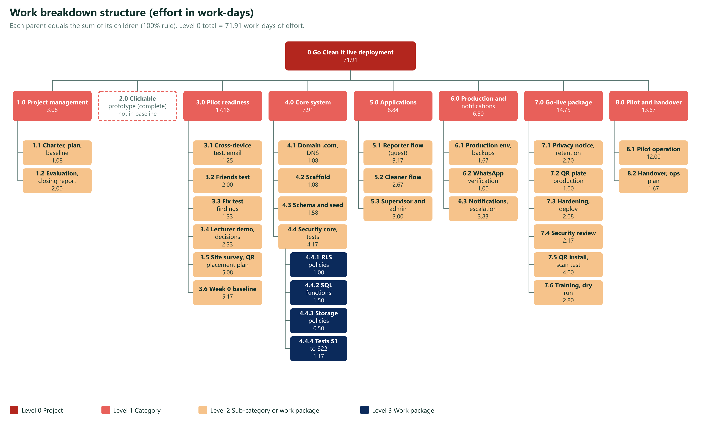
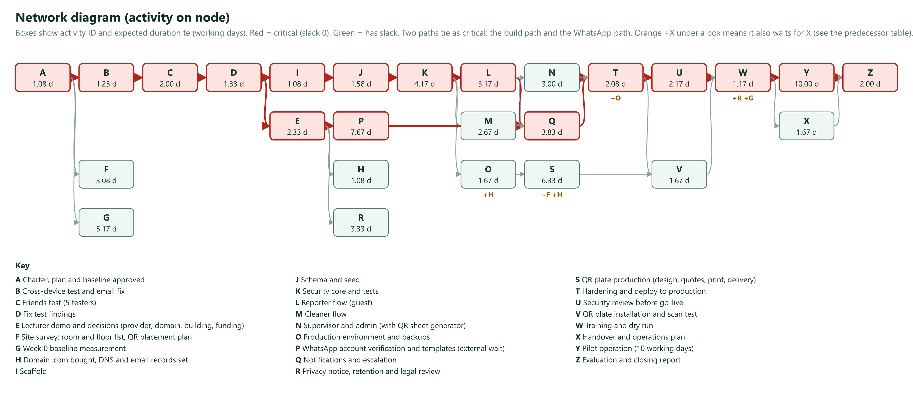
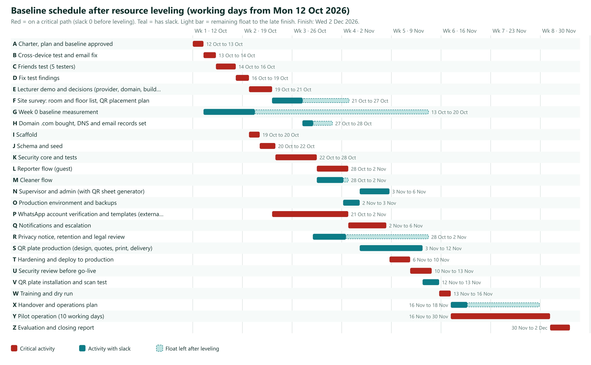
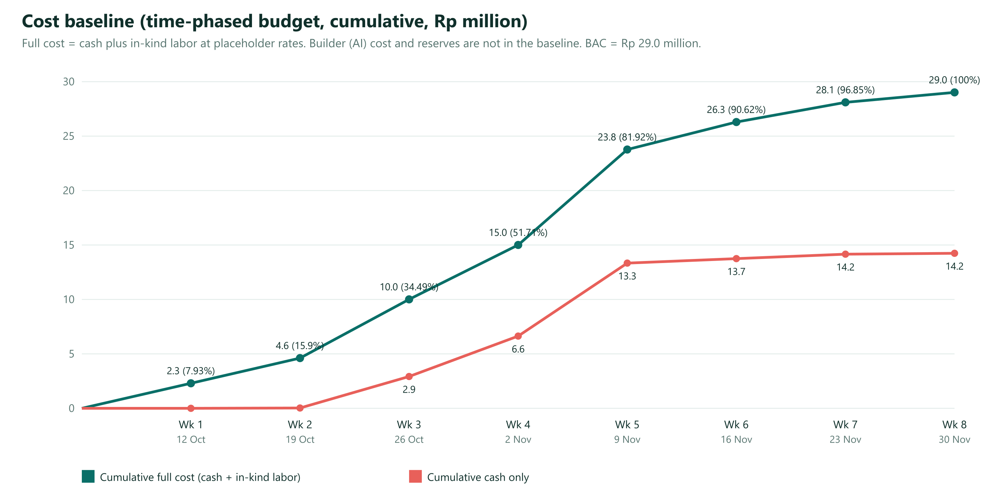
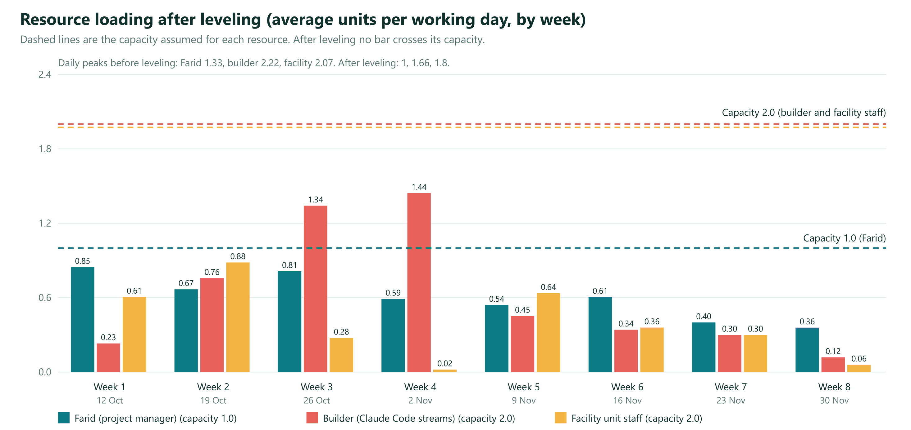
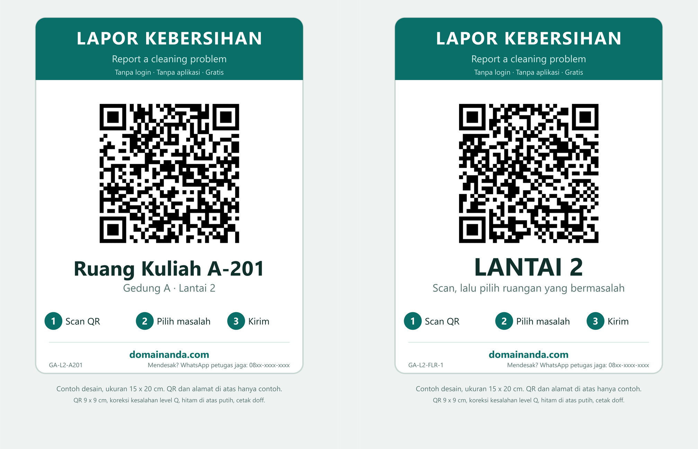
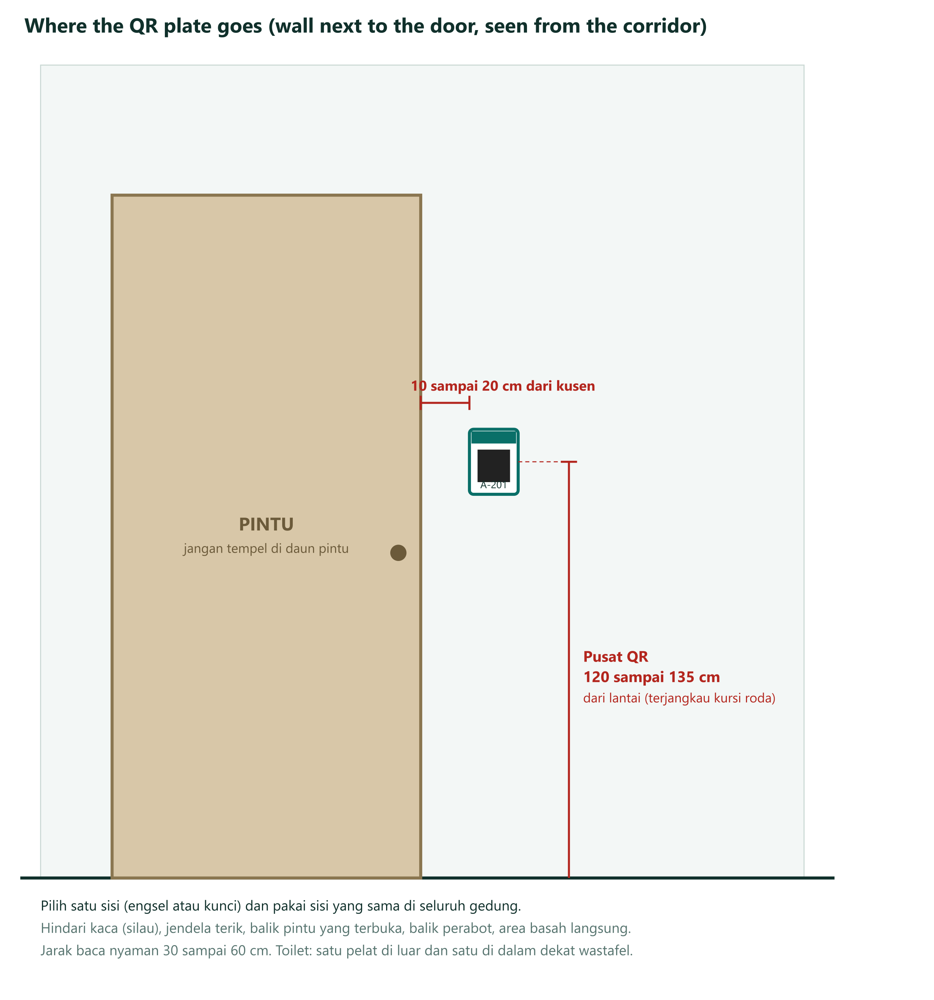

# Go Clean It: Project Management Plan

Structured on the PMBOK process groups and knowledge areas used in the Manajemen Proyek course (EBI 4E3).
Owner and project manager: Farid · Version 2.0, live deployment baseline · Prepared 15 October 2026 · Replaces version 1.0 of 12 October 2026

Related files: [PROJECT-PLAN.md](PROJECT-PLAN.md) (weekly tracker and health check) · [BLUEPRINT.md](BLUEPRINT.md) (technical spec) · [DESIGN-UPDATE.md](DESIGN-UPDATE.md) · [index.html](../index.html) (clickable prototype)

**What changed from version 1.0.** Version 1.0 planned a prototype test: free services, no labor cost, and QR stickers as one printing task. Version 2.0 plans the live system. It adds the .com domain, a production database with backups, WhatsApp onboarding, a privacy notice, a security review, physical QR plates for every room and floor, and a plan for who runs and pays for the system afterwards. The budget now includes labor, running costs and a 12-month cost of ownership, with real prices checked on 15 October 2026 (Appendix C).

Unit used for effort: **work-days** (one person working one day). Money is in rupiah. Dollar prices are converted at **Rp 17,900 per US$** (Bank Indonesia JISDOR on 6 Oct 2026 was Rp 17,917). The baseline starts Monday 12 Oct 2026. Indonesian public holidays are not modelled.

## Audit of version 1.0 (against the class materials and live-deployment needs)

Version 1.0 was checked against the slides in your Drive (Week 1 to 3, 5, 6, 7 and the two class briefs) and against what a real deployment needs. The slides for quality, risk, communications, procurement and stakeholders are not in the folder yet, so those areas follow standard PMBOK practice and the process mapping slide in Week 3. Re-check them when the slides are shared.

### Findings and fixes

| ID | Finding in v1.0 | Reference | Fix in v2.0 | Section |
|---|---|---|---|---|
| A1 | Labor was valued at zero and the cash budget was close to Rp 0 | Week 5: most project cost is often labor; direct and indirect costs | Full cost: cash plus in-kind labor at stated rates, with builder cost shown separately | 2.6 |
| A2 | Estimate type and accuracy not stated | Week 5: ROM −50% to +100%, budgetary −10% to +25%, definitive −5% to +10% | Every cost line has a type and a low, base and high value | 2.6 |
| A3 | Estimating did not follow the 7 steps or use the full technique list | Week 5: 7 steps; expert judgment, analogous, parametric, bottom-up, three-point, reserve analysis, cost of quality, vendor bid analysis | Steps applied in order. Vendor quotes, parametric (price per message, per plate) and analogous (marketplace prices) added. Basis of estimate on each line | 2.6 |
| A4 | No cost management plan content | Week 5: accuracy and units, procedure links, control thresholds, performance rules, report format, process description | Added as a table | 2.6 |
| A5 | EAC and ETC written in a different form. No time forecast | Week 5: ETC = (BAC − EV) ÷ CPI, EAC = AC + ETC, TE formula | Slide formulas used, with a time forecast | 4.2 |
| A6 | Reserve was a schedule number only. No contingency or expected monetary value | Week 5: reserve analysis. Week 3 mapping: quantitative risk analysis | Contingency 15% checked against expected monetary value (EMV) of cost risks. Management reserve from the schedule uncertainty | 2.6, 2.10 |
| A7 | Schedule assumed unlimited people and treated effort as equal to duration | Week 6: resource-limited scheduling, loading, leveling. Week 7: effort is not duration | Effort and duration separated. Resource breakdown, loading histogram, leveling and capacity scenarios | 2.5, 2.8 |
| A8 | Schedule confidence used 2σ and called it 95% | Statistics | One-sided 95% uses 1.645σ. Probability of the committed date is stated | 2.5 |
| A9 | Charter lacked statement of work, agreements, environmental factors, process assets, go/no-go criteria and project category | Week 3: charter inputs and the three criteria for a project | Added | 1.1 |
| A10 | Six constraints (scope, time, cost, quality, resources, risk) not applied | Week 1: triple constraint extended to six | Constraint priority table: what is fixed and what may flex | 1.1 |
| A11 | Change control had no board and no rule for urgent changes | Week 3: change control board, 48-hour policy | Change control board and 48-hour rule | 2.13 |
| A12 | Project management plan overview missing | Week 3: overview, organization, management and technical processes, work, schedule, budget | Added | 2.0 |
| A13 | Closing had no retrospective or transition to operations | Week 3: closing outputs, retrospective questions | Added, with ownership transfer for domain, accounts and QR register | 5 |
| A14 | Risk register had probability and impact scores only | Week 3 mapping: qualitative and quantitative analysis | EMV added for cost risks. Live-system risks added | 2.10 |
| A15 | Prototype services assumed: free tiers, Vercel Hobby plan, Web3Forms email, an open database table | Reality of a live system | Production stack, plans and prices (Supabase Pro, Vercel Pro, own .com, WhatsApp Cloud API) | 2.6, 2.11 |
| A16 | No domain, production database plan, backup and restore test, monitoring, privacy notice, security review or support plan | Reality of a live system | New work packages 4.1, 6.1, 7.1, 7.3, 7.4, 8.2 and new risks | 2.4, 2.10 |
| A17 | QR stickers treated as one printing task | Reality and request: QR for each floor and each room, on the wall | QR deployment plan: plate types, quantities per floor, specification, placement, register, installation, scan test, maintenance | 2.14 |
| A18 | QR codes would point to the prototype web address | Reality: a printed QR cannot be changed | Own .com bought and live before any plate is printed. Plate production waits for the domain and the production database | 2.5, 2.14 |
| A19 | Risk shown in Initiating and Executing in the process map | Week 3 slide: risk maps to Planning and Controlling | Map aligned. PMBOK 6 adds "implement risk responses" in Executing, noted in Appendix A | A |
| A20 | WBS mixed phases with deliverables | Week 3 scope: WBS is deliverable-oriented | Kept two phase-type packages (3.0 and 8.0), with a note on how they would split | 2.4 |

### Coverage of the class slides

| Class material | Topic | Where it is in this plan |
|---|---|---|
| Week 1 | Project concept, triple constraint extended to six, PMBOK framework | 1.1 (constraint priority), Appendix A |
| Week 2 | Five process groups, ten knowledge areas, ITTO scheme | Appendix A (map), Appendix B (ITTO of the main processes) |
| Week 3 (charter) | Integration: charter, project management plan, direct and manage, monitor and control, change control, close | 1.1, 2.0, 2.13, 3, 4, 5 |
| Week 3 (scope) | Scope management, requirements, scope statement, WBS and 100% rule, validate and control scope | 2.1 to 2.4, 4.3 |
| Week 5 | Cost: estimating techniques and 7 steps, estimate types, budget, cost control, EVM | 2.6, 4.2 |
| Week 6 | Resources: resource types, loading, leveling, resource-limited scheduling | 2.8, 2.5 |
| Week 7 | Schedule: network, CPM, PERT, crashing, fast tracking | 2.5 |
| Not yet available | Quality, risk, communications, procurement, stakeholders | 2.7, 2.9, 2.10, 2.11, 2.12 (standard PMBOK practice) |

## 1. INITIATING (Inisiasi)

### 1.1 Project charter

| Item | Content |
|---|---|
| Project name | Go Clean It: live deployment of the campus room cleaning report and dispatch system |
| Project manager | Farid, with authority over scope and schedule inside this charter |
| Sponsor | The lecturer (master user) |
| Customer | The facility unit of the pilot building |
| Project category | Problem and opportunity (Week 3 categories). Priority: high for the faculty pilot. Needed: by the end of the term |
| Business case | When a room is dirty nobody knows who to tell, cleaners do not know where to go, and nobody can see how fast problems are fixed. A QR plate on every room and floor lets anyone report with no login. The right on-shift cleaner is notified, accepts, finishes with a photo, and the reporter rates it |
| Statement of work (summary) | Deliver a secured web system on its own .com domain, notifications by WhatsApp, QR plates installed in one building (about 40 rooms, 4 floors), training for cleaners and supervisors, a 10-working-day pilot, and an evaluation report |
| MOV (measurable organizational value) | Median time from report to accept under 15 minutes and at least 80% of reports accepted, compared with the Week 0 baseline. Cost per report is tracked (planned about Rp 2,300 in the recommended scenario, section 2.6) |
| Objectives (SMART) | 1) By 10 Nov 2026 the secured system is live on the project's own .com and passes all 22 security tests. 2) By 13 Nov every QR plate is installed and scan-tested. 3) A 10-working-day pilot runs from 16 to 30 Nov. 4) By 2 Dec the evaluation report compares pilot and Week 0 numbers |
| Summary milestones | Charter approved 13 Oct · Friends test done 16 Oct · Decisions done 21 Oct · Domain live 28 Oct · Security core green 28 Oct · Production environment 3 Nov · WhatsApp verified 2 Nov · Deployed 10 Nov · Security review done 13 Nov · Plates installed 13 Nov · Dry run done 16 Nov · Pilot 16 Nov to 30 Nov · Evaluation report 2 Dec |
| Summary budget | Cash to the end of the pilot Rp 14.24 million (range Rp 9.51 million to Rp 23.89 million). In-kind labor Rp 14.78 million. Baseline (BAC) Rp 29.02 million. Contingency Rp 2.14 million and management reserve Rp 1.56 million bring the authorized budget to Rp 32.71 million. Running cost after the pilot: Rp 1.39 million to Rp 3.38 million per month, recommended Rp 2.10 million (section 2.6) |
| Go/no-go criteria (Week 3: need, funding, commitment) | Need: reported problem and sponsor request. Funding: the faculty approves the year-1 running cost (Rp 25.22 million recommended scenario) before the pilot (decision D14). Commitment: the facility unit names a coordinator, installs the plates and answers the contact number |
| Agreements | Letter or message from the facility unit confirming staff time, building access and the contact number. Vendor terms of service (Vercel, Supabase, Meta, registrar). A data processing note with the university (decision D5) |
| Enterprise environmental factors | Personal data law (UU PDP). Campus Wi-Fi coverage. WhatsApp business policies and rate cards that change quarterly. Vendor terms (Vercel Hobby plan is for personal, non-commercial use). Exchange rate |
| Organizational process assets | Blueprint with 11 tables and 22 security tests. Clickable prototype and its lessons. Version 1.0 plan. University procurement and legal rules (to be obtained) |
| Assumptions | One building of about 40 rooms on 4 floors. Up to 50 reports a day. 9 cleaners and 2 supervisors. Cleaners own a phone with WhatsApp. One builder works on the project. Farid is available full time on weekdays (capacity 1.0) |
| High-level risks | Cleaners do not use the app. WhatsApp verification is slow. Nobody answers the contact number. Domain or database lost. QR plates damaged or misplaced. The system has no owner after the pilot |
| Approval | Sponsor signature or written yes (date: ____). Facility unit (date: ____). Project manager (date: ____) |

**Constraint priority (Week 1: six constraints).** Changing one constraint moves at least one other.

| Constraint | Priority | Rule |
|---|---|---|
| Quality and security | Fixed | No go-live unless all 22 security tests pass and the security review is done |
| Scope | Flexible | Cut optional features first: browser push, second language, extra dashboard charts. The plate print file generator is not optional |
| Time | Flexible up to the reserve | The committed finish may slip inside the management reserve. Beyond it, the sponsor decides |
| Cost | Capped | The authorized budget is the cap. Contingency needs the project manager. Management reserve needs the sponsor |
| Resources | Fixed | One builder, one project manager, facility staff as agreed. Over-allocation is resolved by leveling, not overtime |
| Risk | Accepted within appetite | Risks with score 12 or more need a named owner and a response |

### 1.2 Stakeholder register

| Stakeholder | Interest in project | Power | Interest | Engagement strategy |
|---|---|---|---|---|
| Farid (project manager) | Delivery and learning | High | High | Manage closely |
| Lecturer (sponsor) | Idea proven and defensible | High | High | Manage closely. Demo in week 2, evaluation report on 2 Dec |
| Facility unit | Faster, visible cleaning | High | High | Manage closely. Owns decisions D1, D4, D6, D9, D10 and the plate installation |
| Faculty (budget holder) | Year-1 running cost | High | Medium | Keep satisfied. One-page cost summary before the pilot |
| University finance and procurement | Payment method for dollar services, vendor rules | Medium | Low | Keep informed. Needed for decision D15 |
| University IT and legal | Data protection, retention, security review | High | Low | Keep satisfied. Send data classification and privacy notice draft |
| Supervisors | Escalations and dashboard | Medium | High | Keep informed. Involve in the dry run |
| Cleaners | Easy tasks, no blame | Low | High | Keep informed. Test with 2 to 3 real cleaners before launch |
| Reporters (students, lecturers, staff) | Report in seconds | Low | Medium | Keep informed through the plate text and the status page |
| Friends (early testers) | Help a friend | Low | Medium | Monitor. One test round, one thank-you |
| Suppliers: registrar, Vercel, Supabase, Meta WhatsApp, plate printer | Paid services | Medium | Low | Monitor limits and price changes (section 2.11) |

## 2. PLANNING (Perencanaan): the mapping plan

### 2.0 Project management plan overview

| Element (Week 3) | Content |
|---|---|
| Introduction | Live deployment of Go Clean It in one building, with a 10-working-day pilot and a handover to operations |
| How the project is organized | Sponsor (lecturer) approves scope and budget. Project manager (Farid) runs the plan and accepts work. The builder (Claude Code, directed by Farid) builds and tests. The facility unit supplies staff, data and installs the plates. University IT and legal review security and privacy. Change control board in 2.13 |
| Management processes | This plan: scope, schedule, cost, quality, resource, communication, risk, procurement, stakeholder and change management, with a weekly review every Friday |
| Technical processes | Phased build. Security before screens. Migrations are append-only. One commit per phase. Bilingual summary at the end of each phase. Separate development and production environments |
| Work to be done | WBS in 2.4 (71.91 work-days of effort) |
| Schedule | Baseline in 2.5. Committed finish Wed 2 Dec 2026 |
| Budget | Cost baseline in 2.6 |
| Subsidiary plans | 2.1 scope, 2.5 schedule, 2.6 cost, 2.7 quality, 2.8 resource, 2.9 communication, 2.10 risk, 2.11 procurement, 2.12 stakeholder, 2.13 change, 2.14 QR deployment |

### 2.1 Scope management plan

| Question | Answer |
|---|---|
| How is scope defined? | Scope statement (2.3) plus WBS (2.4) plus WBS dictionary. Together they form the **scope baseline** |
| How is the WBS created and kept? | Deliverable-oriented. Built by the people who do the work. Checked against the 100% rule at every change |
| How are requirements collected and traced? | Interviews with the lecturer and facility unit, the blueprint, the prototype test. Each requirement is traced to a work package and an acceptance criterion (2.2) |
| How is scope formally accepted? | Each deliverable has acceptance criteria and a named accepter (4.3). Control Quality comes first, then Validate Scope |
| How are changes handled? | Change request, board review and the 48-hour rule (2.13). Verbal requests are logged, not built |
| How is creep measured? | Scope variance % = (current requirements − baseline requirements) ÷ baseline requirements × 100% |

### 2.2 Requirements and traceability matrix (RTM)

| ID | Requirement | Source | WBS package | Acceptance criterion | Status |
|---|---|---|---|---|---|
| REQ-01 | A guest reports with no login and no app | Lecturer | 5.1 | Filed in 3 taps or fewer from a QR scan, by 5 testers | Prototype done |
| REQ-02 | Room QR and floor QR both work | Farid | 5.1, 5.3, 7.2 | Floor QR cannot reach another floor (S19). Retired QR rejected (S22) | Prototype done |
| REQ-03 | A cleaner sees only reports in buildings where they are on shift | Blueprint | 4.4, 5.2 | S6 and S7 pass | Todo |
| REQ-04 | Only one cleaner can accept a report | Blueprint | 4.4, 5.2 | S8 passes: two simultaneous accepts, one winner | Prototype done (open table) |
| REQ-05 | Proof photo is required to finish | Facility unit | 5.2 | Finish is refused without an "after" photo | Prototype done |
| REQ-06 | Reporter can rate and cancel own report | Blueprint | 5.1 | S15 passes | Prototype done |
| REQ-07 | Cleaners get a WhatsApp message with a one-time link | Lecturer | 6.2, 6.3 | Real message received and link opens the task (S17) | Todo |
| REQ-08 | Report escalates to the supervisor after 10 minutes | Blueprint | 6.3 | Test with a 5-second interval, supervisor notified | Prototype done (simulated) |
| REQ-09 | Supervisor sees median response time and percent accepted | Facility unit | 5.3 | Dashboard equals a hand calculation | Prototype done (sample data) |
| REQ-10 | Admin generates QR plates and deactivates users | Facility unit | 5.3 | Deactivated user loses access at once (S11). Plate PDF opens with the right room | Prototype done (no PDF) |
| REQ-11 | Database enforces security: RLS, no direct writes, append-only audit | Blueprint | 4.4 | S1 to S5 pass | Todo |
| REQ-12 | Reporter's phone number never reaches a cleaner | Blueprint | 4.4, 5.2 | S16 and S21 pass | Todo |
| REQ-13 | Bahasa Indonesia, mobile first, clear loading states | Farid | 5.1, 5.2, 5.3 | Friends test: no tester needs help for the main flow | Prototype done |
| REQ-14 | Week 0 baseline is measured and compared | Lecturer | 3.6, 8.1 | Baseline file holds real numbers | Todo |
| REQ-15 | Reporter can reach a person on WhatsApp from the QR page | Lecturer | 5.1 | Button opens WhatsApp with the room name typed | Prototype done |
| REQ-16 | The system runs on the project's own .com with HTTPS, and every QR points to it | Farid | 4.1, 7.2 | Domain resolves with a valid certificate. 100% of plates open the production site | Todo |
| REQ-17 | Daily database backups and a tested restore | Farid | 6.1 | A restore drill recovers a test copy within 1 hour | Todo |
| REQ-18 | Uptime and error alerts reach a named person | Farid | 7.3 | A test outage sends an alert within 10 minutes | Todo |
| REQ-19 | Privacy notice in Bahasa Indonesia and a retention job (photos 90 days, reports 1 year) | University | 7.1 | Notice reviewed by university legal. Retention job deletes a test photo after 90 days | Todo |
| REQ-20 | Every room and floor has a durable wall plate, registered and scan-tested | Lecturer | 3.5, 7.2, 7.5 | 100% of plates registered with photo. Scan test passes on 3 phone models | Todo |
| REQ-21 | A named person supports the system after the pilot, with a runbook | Facility unit | 8.2 | Runbook reviewed in a dry run. Support rota signed | Todo |

Check in both directions: every requirement has a work package, and every package serves a requirement. Packages 1.0 and 8.1 serve the charter objectives.

### 2.3 Scope statement

**Scope in context: from the first state to the next state.** Scope answers WHAT is needed, HOW it is done through processes and organization, and WHAT the business gets in the end.

| Element | Go Clean It |
|---|---|
| First state (current situation) | Cleaning problems are reported by phone, chat or word of mouth. Nobody owns a request, cleaners guess the room, nobody measures response time, and there is no record or proof of work |
| Business goals and priorities (input) | Median report-to-accept time under 15 minutes. At least 80% accepted. Visible response times for the faculty. Proof of work |
| Constraints (input) | Slow campus Wi-Fi and basic Android phones. UI in Bahasa Indonesia. Personal data law (UU PDP). Approved budget. One builder. Security before screens |
| Processes and organization (input) | Facility unit, supervisors, on-shift cleaners and reporters. QR scan, dispatch to on-shift cleaners, accept, work, photo proof, rating, escalation after 10 minutes |
| Next state (goals for change) | Every report reaches an on-shift cleaner within minutes, has one owner and a status, is backed by a photo, and is measured. Every room and floor has a working QR plate |
| Prioritized improvements | 1) Report by QR with no login (REQ-01, 02, 15, 20). 2) One owner per report: atomic accept and proof photo (REQ-04, 05). 3) Notification and escalation (REQ-07, 08). 4) Visibility: supervisor dashboard (REQ-09). 5) Control and keep it running: security, backups, support (REQ-11, 17, 18, 21) |
| Potential business scope and impact | One building, about 40 rooms, up to 50 reports a day, about 20 users. Impact is measured against the Week 0 baseline and by cost per report |

| WHAT (what is needed) | HOW (processes and organization) | WHAT (what the business gets) |
|---|---|---|
| Anyone can report a dirty room, and it gets fixed fast | QR scan → dispatch to on-shift cleaners → accept → work → photo proof → rating. Escalation to the supervisor after 10 minutes. Roles: reporter, cleaner, supervisor, admin | Faster response, one owner per request, evidence of work, and numbers for the faculty |

**Product scope:** a secured web system (guest report page, cleaner queue, supervisor dashboard, admin) on its own .com domain, with WhatsApp notification and daily backups, running in one pilot building with QR plates on every room and floor.

**Deliverables:** secured database with tests · reporter, cleaner, supervisor and admin screens · notification and escalation service · production environment with backups and monitoring · domain and DNS · QR plates (room, toilet, floor, lobby), register and scan-test record · privacy notice and retention job · security review report · training notes and guide cards · runbook and support plan · pilot data · evaluation report · project documents (this plan, weekly logs, change log, closing report).

**Acceptance criteria:** see 2.2 and the accepter column in 4.3.

**Boundaries (exclusions):** no payment by users · no GPS or indoor positioning · no in-app chat · no native Android or iOS app · no AI features · only one building in the pilot · no servers run by the project (managed services only) · no SMS · no integration with the university's other systems · WhatsApp sending needs a verified Meta business account. If verification is late, the pilot runs with email and the in-app queue.

### 2.4 Work breakdown structure (WBS)

Levels follow the class scheme: 0 Project, 1 Category, 2 Sub-category, 3 Work package. Effort is in work-days (it can be larger than the duration of an activity when several people work in parallel). Package 2.0 (clickable prototype) is finished before the baseline date and is a sunk cost. It is not counted in the budget.



Text version of the same WBS:

```
0      Go Clean It live deployment                                  71.91
├─ 1.0   Project management                                          3.08
│  ├─ 1.1   Charter, plan, baseline approved                         1.08
│  └─ 1.2   Evaluation and closing report                            2.00
├─ 2.0   Clickable prototype (complete, outside baseline)            0.00
├─ 3.0   Pilot readiness                                            17.16
│  ├─ 3.1   Cross-device test and email fix                          1.25
│  ├─ 3.2   Friends test, 5 testers                                  2.00
│  ├─ 3.3   Fix test findings                                        1.33
│  ├─ 3.4   Lecturer demo and decisions                              2.33
│  ├─ 3.5   Site survey, room and floor list, QR placement plan      5.08
│  └─ 3.6   Week 0 baseline measurement                              5.17
├─ 4.0   Core system                                                 7.91
│  ├─ 4.1   Domain .com, DNS and email records                       1.08
│  ├─ 4.2   Scaffold                                                 1.08
│  ├─ 4.3   Schema and seed                                          1.58
│  └─ 4.4   Security core and tests                                  4.17
│        ├─ 4.4.1  RLS policies and helper functions                 1.00
│        ├─ 4.4.2  SQL functions and triggers                        1.50
│        ├─ 4.4.3  Storage policies                                  0.50
│        └─ 4.4.4  Security tests S1 to S22                          1.17
├─ 5.0   Applications                                                8.84
│  ├─ 5.1   Reporter flow (guest)                                    3.17
│  ├─ 5.2   Cleaner flow                                             2.67
│  └─ 5.3   Supervisor and admin, with QR sheet generator and plate check page   3.00
├─ 6.0   Production and notifications                                6.50
│  ├─ 6.1   Production environment and backups                       1.67
│  ├─ 6.2   WhatsApp verification and templates                      1.00
│  └─ 6.3   Notifications and escalation                             3.83
├─ 7.0   Go-live package                                            14.75
│  ├─ 7.1   Privacy notice, retention and legal review               2.70
│  ├─ 7.2   QR plate production                                      1.00
│  ├─ 7.3   Hardening, monitoring and deploy to production           2.08
│  ├─ 7.4   Security review                                          2.17
│  ├─ 7.5   QR plate installation and scan test                      4.00
│  └─ 7.6   Training and dry run                                     2.80
└─ 8.0   Pilot and handover                                         13.67
   ├─ 8.1   Pilot operation, 10 working days                        12.00
   └─ 8.2   Handover and operations plan                             1.67
```

**100% rule check (parent = sum of children):**

| Parent | Children | Sum | Parent value | Result |
|---|---|---|---|---|
| 1.0 | 1.08 + 2.00 | 3.08 | 3.08 | OK |
| 3.0 | 1.25 + 2.00 + 1.33 + 2.33 + 5.08 + 5.17 | 17.16 | 17.16 | OK |
| 4.0 | 1.08 + 1.08 + 1.58 + 4.17 | 7.91 | 7.91 | OK |
| 4.4 | 1.00 + 1.50 + 0.50 + 1.17 | 4.17 | 4.17 | OK |
| 5.0 | 3.17 + 2.67 + 3.00 | 8.84 | 8.84 | OK |
| 6.0 | 1.67 + 1.00 + 3.83 | 6.50 | 6.50 | OK |
| 7.0 | 2.70 + 1.00 + 2.08 + 2.17 + 4.00 + 2.80 | 14.75 | 14.75 | OK |
| 8.0 | 12.00 + 1.67 | 13.67 | 13.67 | OK |
| Project | sum of all categories | 71.91 | 71.91 | OK |

**Note on deliverable orientation.** The class slides ask for a WBS built around deliverables, not around activities or departments. Most level 1 categories are deliverables (core system, applications, production and notifications, go-live package). Two are phases (3.0 Pilot readiness and 8.0 Pilot and handover). They are kept because the facility unit and the lecturer manage them as separate stages. If a pure deliverable view is required, 3.0 splits into test report, decision list, site survey and baseline dataset, and 8.0 into pilot dataset, runbook and evaluation report.

**WBS dictionary (examples):**

| Field | 4.1 Domain .com, DNS | 6.1 Production environment | 7.2 QR plate production |
|---|---|---|---|
| Responsible | Farid (account owner decision D13) | Builder, accepted by Farid | Farid, accepted by facility unit |
| Description | Buy the .com, set DNS to Vercel, email records (SPF, DKIM, DMARC), HTTPS, registrar 2-factor login, auto-renew | Supabase Pro project for production, separate from development. Secrets, migrations, daily backups, weekly export, restore drill | Design plates, generate tokens in the production database, get 3 quotes, print samples, order, inspect delivery |
| Deliverable | Live domain with valid certificate. Registrar account with two admins | Production database and web app. Restore drill report | Plates delivered and counted. Print files archived |
| Acceptance | REQ-16 met. Domain renews automatically for at least 1 year | REQ-17 met. Service role key only on the server | Sample plates pass the scan test on 3 phone models. 100% of plates counted and checked against the register |
| Depends on | 3.4 (domain name decision) | 4.4 and 4.1 | 6.1, 4.1, 3.5 |
| Effort | 1.08 | 1.67 | 1.00 |
| Risk | Name taken, payment method, registrar account owner | Wrong key exposed, backup not tested | Misprint, wrong token, long delivery |

### 2.5 Schedule management

**Estimating durations (Week 7).** Duration is calendar working time and is not the same as effort. Example: the site survey takes about 3 days but uses 2 facility staff, so it costs about 5 work-days of effort. Three-point estimate: `te = (o + 4m + p) ÷ 6` and `σ = (p − o) ÷ 6`. Dependency type: M mandatory, D discretionary, E external.

| ID | Activity | WBS | Predecessors (type) | o | m | p | te | σ | Effort | Effort by role |
|---|---|---|---|---|---|---|---|---|---|---|
| A | Charter, plan and baseline approved | 1.1 | none | 0.5 | 1 | 2 | 1.08 | 0.25 | 1.08 | PM 1.08 |
| B | Cross-device test and email fix | 3.1 | A (M) | 0.5 | 1 | 3 | 1.25 | 0.42 | 1.25 | PM 0.60, DEV 0.65 |
| C | Friends test (5 testers) | 3.2 | B (M) | 1 | 2 | 3 | 2.00 | 0.33 | 2.00 | PM 1.50, TST 0.50 |
| D | Fix test findings | 3.3 | C (M) | 1 | 1 | 3 | 1.33 | 0.33 | 1.33 | DEV 1.00, PM 0.33 |
| E | Lecturer demo and decisions (provider, domain, building, funding) | 3.4 | D (D), people available (E) | 1 | 2 | 5 | 2.33 | 0.67 | 2.33 | PM 1.00, LEC 0.50, FAC 0.83 |
| F | Site survey: room and floor list, QR placement plan | 3.5 | A (M), facility staff (E) | 1.5 | 3 | 5 | 3.08 | 0.58 | 5.08 | FAC 4.00, PM 1.08 |
| G | Week 0 baseline measurement. Observation by the facility unit | 3.6 | A (M), facility staff (E) | 5 | 5 | 6 | 5.17 | 0.17 | 5.17 | FAC 4.00, PM 1.17 |
| H | Domain .com bought, DNS and email records set | 4.1 | E (M) | 0.5 | 1 | 2 | 1.08 | 0.25 | 1.08 | PM 0.50, DEV 0.58 |
| I | Scaffold | 4.2 | D (D) | 0.5 | 1 | 2 | 1.08 | 0.25 | 1.08 | DEV 0.80, PM 0.28 |
| J | Schema and seed | 4.3 | I (M) | 1 | 1.5 | 2.5 | 1.58 | 0.25 | 1.58 | DEV 1.20, PM 0.38 |
| K | Security core and tests | 4.4 | J (M) | 3 | 4 | 6 | 4.17 | 0.50 | 4.17 | DEV 3.20, PM 0.97 |
| L | Reporter flow (guest) | 5.1 | K (M) | 2 | 3 | 5 | 3.17 | 0.50 | 3.17 | DEV 2.40, PM 0.77 |
| M | Cleaner flow | 5.2 | K (M) | 2 | 2.5 | 4 | 2.67 | 0.33 | 2.67 | DEV 2.00, PM 0.67 |
| N | Supervisor and admin (with QR sheet generator) | 5.3 | L, M (M) | 2 | 3 | 4 | 3.00 | 0.33 | 3.00 | DEV 2.30, PM 0.70 |
| O | Production environment and backups | 6.1 | K, H (M) | 1 | 1.5 | 3 | 1.67 | 0.33 | 1.67 | DEV 1.20, PM 0.47 |
| P | WhatsApp account verification and templates (external wait) | 6.2 | E (M), Meta review (E) | 3 | 7 | 15 | 7.67 | 2.00 | 1.00 | PM 0.50, LEG 0.50 |
| Q | Notifications and escalation | 6.3 | L, M (M), P (E) | 3 | 3.5 | 6 | 3.83 | 0.50 | 3.83 | DEV 2.90, PM 0.93 |
| R | Privacy notice, retention and legal review | 7.1 | E (M), university legal (E) | 2 | 3 | 6 | 3.33 | 0.67 | 2.70 | PM 1.20, LEG 1.00, DEV 0.50 |
| S | QR plate production (design, quotes, print, delivery) | 7.2 | O, F, H (M), printer (E) | 4 | 6 | 10 | 6.33 | 1.00 | 1.00 | PM 0.80, FAC 0.20 |
| T | Hardening and deploy to production | 7.3 | Q, N, O (M) | 1.5 | 2 | 3 | 2.08 | 0.25 | 2.08 | DEV 1.50, PM 0.58 |
| U | Security review before go-live | 7.4 | T (M) | 1 | 2 | 4 | 2.17 | 0.50 | 2.17 | PM 0.70, DEV 0.90, LEG 0.57 |
| V | QR plate installation and scan test | 7.5 | S, T (M) | 1 | 1.5 | 3 | 1.67 | 0.33 | 4.00 | FAC 3.00, PM 1.00 |
| W | Training and dry run | 7.6 | U, V, R, G (M) | 1 | 1 | 2 | 1.17 | 0.17 | 2.80 | PM 0.50, FAC 0.50, CLN 1.50, SUP 0.30 |
| X | Handover and operations plan | 8.2 | W (M) | 1 | 1.5 | 3 | 1.67 | 0.33 | 1.67 | PM 1.00, DEV 0.50, FAC 0.17 |
| Y | Pilot operation (10 working days) | 8.1 | W (M) | 10 | 10 | 10 | 10.00 | 0.00 | 12.00 | PM 4.00, DEV 3.00, FAC 3.00, SUP 2.00 |
| Z | Evaluation and closing report | 1.2 | Y, X (M) | 1 | 2 | 3 | 2.00 | 0.33 | 2.00 | PM 1.40, DEV 0.30, LEC 0.30 |

Role codes: PM Farid, DEV builder (Claude Code), FAC facility unit staff, CLN cleaners, SUP supervisors, TST testers, LEC lecturer, LEG university legal or IT.

**Network diagram (activity on node).**



**Critical path method.** Forward pass: ES = largest EF of predecessors, EF = ES + te. Backward pass: LF = smallest LS of successors, LS = LF − te. Slack = LS − ES. The last two columns show the baseline after resource leveling (2.8).

| ID | te | ES | EF | LS | LF | Slack | Critical | Early start to end | Leveled start to end |
|---|---|---|---|---|---|---|---|---|---|
| A | 1.08 | 0.00 | 1.08 | 0.00 | 1.08 | 0.00 | Yes | 12 Oct to 13 Oct | 12 Oct to 13 Oct |
| B | 1.25 | 1.08 | 2.33 | 1.08 | 2.33 | 0.00 | Yes | 13 Oct to 14 Oct | 13 Oct to 14 Oct |
| C | 2.00 | 2.33 | 4.33 | 2.33 | 4.33 | 0.00 | Yes | 14 Oct to 16 Oct | 14 Oct to 16 Oct |
| D | 1.33 | 4.33 | 5.66 | 4.33 | 5.66 | 0.00 | Yes | 16 Oct to 19 Oct | 16 Oct to 19 Oct |
| E | 2.33 | 5.66 | 7.99 | 5.66 | 7.99 | 0.00 | Yes | 19 Oct to 21 Oct | 19 Oct to 21 Oct |
| F | 3.08 | 1.08 | 4.16 | 12.66 | 15.74 | 11.58 | No | 13 Oct to 16 Oct | 21 Oct to 27 Oct |
| G | 5.17 | 1.08 | 6.25 | 18.57 | 23.74 | 17.49 | No | 13 Oct to 20 Oct | 13 Oct to 20 Oct |
| H | 1.08 | 7.99 | 9.07 | 12.99 | 14.07 | 5.00 | No | 21 Oct to 23 Oct | 27 Oct to 28 Oct |
| I | 1.08 | 5.66 | 6.74 | 5.66 | 6.74 | 0.00 | Yes | 19 Oct to 20 Oct | 19 Oct to 20 Oct |
| J | 1.58 | 6.74 | 8.32 | 6.74 | 8.32 | 0.00 | Yes | 20 Oct to 22 Oct | 20 Oct to 22 Oct |
| K | 4.17 | 8.32 | 12.49 | 8.32 | 12.49 | 0.00 | Yes | 22 Oct to 28 Oct | 22 Oct to 28 Oct |
| L | 3.17 | 12.49 | 15.66 | 12.49 | 15.66 | 0.00 | Yes | 28 Oct to 2 Nov | 28 Oct to 2 Nov |
| M | 2.67 | 12.49 | 15.16 | 12.99 | 15.66 | 0.50 | No | 28 Oct to 2 Nov | 28 Oct to 2 Nov |
| N | 3.00 | 15.66 | 18.66 | 16.49 | 19.49 | 0.83 | No | 2 Nov to 5 Nov | 3 Nov to 6 Nov |
| O | 1.67 | 12.49 | 14.16 | 14.07 | 15.74 | 1.58 | No | 28 Oct to 30 Oct | 2 Nov to 3 Nov |
| P | 7.67 | 7.99 | 15.66 | 7.99 | 15.66 | 0.00 | Yes | 21 Oct to 2 Nov | 21 Oct to 2 Nov |
| Q | 3.83 | 15.66 | 19.49 | 15.66 | 19.49 | 0.00 | Yes | 2 Nov to 6 Nov | 2 Nov to 6 Nov |
| R | 3.33 | 7.99 | 11.32 | 20.41 | 23.74 | 12.42 | No | 21 Oct to 27 Oct | 28 Oct to 2 Nov |
| S | 6.33 | 14.16 | 20.49 | 15.74 | 22.07 | 1.58 | No | 30 Oct to 9 Nov | 3 Nov to 12 Nov |
| T | 2.08 | 19.49 | 21.57 | 19.49 | 21.57 | 0.00 | Yes | 6 Nov to 10 Nov | 6 Nov to 10 Nov |
| U | 2.17 | 21.57 | 23.74 | 21.57 | 23.74 | 0.00 | Yes | 10 Nov to 12 Nov | 10 Nov to 13 Nov |
| V | 1.67 | 21.57 | 23.24 | 22.07 | 23.74 | 0.50 | No | 10 Nov to 12 Nov | 12 Nov to 13 Nov |
| W | 1.17 | 23.74 | 24.91 | 23.74 | 24.91 | 0.00 | Yes | 12 Nov to 13 Nov | 13 Nov to 16 Nov |
| X | 1.67 | 24.91 | 26.58 | 33.24 | 34.91 | 8.33 | No | 13 Nov to 17 Nov | 16 Nov to 18 Nov |
| Y | 10.00 | 24.91 | 34.91 | 24.91 | 34.91 | 0.00 | Yes | 13 Nov to 27 Nov | 16 Nov to 30 Nov |
| Z | 2.00 | 34.91 | 36.91 | 34.91 | 36.91 | 0.00 | Yes | 27 Nov to 1 Dec | 30 Nov to 2 Dec |

**Result**

- **Two critical paths tie.** Build path: A → B → C → D → I → J → K → L → Q → T → U → W → Y → Z. WhatsApp path: A → B → C → D → E → P → Q → T → U → W → Y → Z. Both finish at day 15.66 and feed notifications (Q). Waiting for Meta verification is as critical as writing the code.
- **Time-only project duration:** 36.91 working days, finish 1 Dec.
- **After resource leveling (2.8):** 37.98 working days. **Committed finish: Wed 2 Dec 2026.** Leveling uses 1.07 days of the reserve.
- **Schedule uncertainty:** σ of the longer critical path is 2.37 days (the WhatsApp path, because verification can take 3 to 15 working days). One-sided 95% confidence uses 1.645σ, which gives 40.80 days, about 7 Dec. The chance of finishing by the committed date is about 67% (z = 0.45). Version 1.0 used 2σ and called it 95%.
- **Decisions are due by 21 Oct.** Activity E has no slack because the WhatsApp path is critical. A decision delayed by one day delays the pilot by one day.
- **Domain before plates.** A printed QR cannot be changed, so plate production (S) waits for the domain (H) and for the production database (O) that creates the tokens.
- **Long poles outside our control:** E (people's calendars), P (Meta review), S (printer lead time), G and F (facility unit time).



**Schedule compression.** Crashing adds effort to shorten an activity on the critical path. Slope = (crash effort cost − normal effort cost) ÷ (normal time − crash time). Pick the cheapest slope first, only on the critical path, and recompute after each cut. Costs use the placeholder labor rates in 2.6 and are planning assumptions.

| Activity | Cut (days) | Extra cost | Slope (Rp per day saved) | How it is bought |
|---|---|---|---|---|
| C Friends test (5 testers) | 1.00 | Rp 200,000 | Rp 200,000 | All 5 testers test on the same day |
| B Cross-device test and email fix | 0.50 | Rp 200,000 | Rp 400,000 | Test during the same session as the email fix |
| U Security review before go-live | 0.67 | Rp 250,000 | Rp 373,134 | Reviewer starts reading code while hardening is finishing |
| T Hardening and deploy to production | 0.58 | Rp 300,000 | Rp 517,241 | Second review pass in parallel with deployment checks |
| P WhatsApp account verification and templates (external wait) | 2.00 | Rp 700,000 | Rp 350,000 | Prepare Meta business documents before the decision meeting and pay for assisted onboarding (Rp 500,000) |
| K Security core and tests | 1.00 | Rp 900,000 | Rp 900,000 | Second review pass in parallel with writing tests |
| L Reporter flow (guest) | 0.50 | Rp 450,000 | Rp 900,000 | Reuse prototype screens |
| S QR plate production (design, quotes, print, delivery) | 2.00 | Rp 500,000 | Rp 250,000 | Express printing and courier (Rp 300,000) and a pre-approved design |

| Step | Cut | Project duration | Days saved | Extra cost | Cumulative extra cost |
|---|---|---|---|---|---|
| 0 | Baseline | 36.91 |  | Rp 0 | Rp 0 |
| 1 | C by 1.00 d | 35.91 | 1.00 | Rp 200,000 | Rp 200,000 |
| 2 | S by 2.00 d (no gain: not on the critical path now) | 35.91 | 0.00 | Rp 0 | Rp 200,000 |
| 3 | P by 2.00 d (no gain: not on the critical path now) | 35.91 | 0.00 | Rp 0 | Rp 200,000 |
| 4 | U by 0.67 d | 35.41 | 0.50 | Rp 250,000 | Rp 450,000 |
| 5 | B by 0.50 d | 34.91 | 0.50 | Rp 200,000 | Rp 650,000 |
| 6 | T by 0.58 d | 34.33 | 0.58 | Rp 300,000 | Rp 950,000 |
| 7 | K by 1.00 d (no gain: not on the critical path now) | 34.33 | 0.00 | Rp 0 | Rp 950,000 |
| 8 | L by 0.50 d (no gain: not on the critical path now) | 34.33 | 0.00 | Rp 0 | Rp 950,000 |

Two paths are critical, so cutting only the build path (K or L) or only the WhatsApp path (P) saves nothing. Both must be cut together, which doubles the price of a saved day:

| Combination | Project duration | Cumulative extra cost |
|---|---|---|
| C, U, B, T (steps above) | 34.33 | Rp 950,000 |
| plus P and K together | 33.33 | Rp 2,550,000 |
| plus P, K and L together | 32.83 | Rp 3,000,000 |

**Fast tracking** (parallel work, no extra effort, more risk). Starting the scaffold (I) right after the charter instead of after the friends test saves nothing alone, because the WhatsApp path is also critical. Starting WhatsApp verification (P) right after the charter, before the decision meeting, also saves nothing alone. Doing **both** saves **4.58 days** (finish about 32.33 days). Risk: if the lecturer or facility unit chooses a different provider or building, the verification work is lost and the scaffold may need rework. Recommended: start the Meta business verification paperwork now (cost: Farid's time only), and keep the scaffold after the friends test.

The committed baseline stays at Wed 2 Dec until the board approves the change as CR-06 (section 2.13).

### 2.6 Cost management

#### 2.6.1 Cost management plan (Week 5)

| Element | Plan |
|---|---|
| Level of accuracy and unit of measure | Units: rupiah and work-days. Items priced from published rates or quotes are **budgetary (−10% to +25%)**. Placeholder items without a quote are **ROM (−50% to +100%)** and are replaced by a quote or in-kind support before purchase. After quotes the estimate becomes **definitive (−5% to +10%)** |
| Organizational procedure links | University procurement rules and payment approval (to be obtained, decision D15). Vendor terms of service |
| Control thresholds | CPI and SPI bands in 4.1. Contingency is released by the project manager. Management reserve is released by the sponsor. Any item over +25% of its estimate goes to the change board |
| Rules of performance measurement | Earned value is credited only when a work package is accepted (0% or 100%). Actual cost is cash paid plus work-days spent valued at the stated rates |
| Reporting format | Weekly table in 4.2 every Friday. Monthly cash report to the faculty after go-live |
| Process description | Plan cost management, estimate costs, determine budget, control costs (2.6 to 4.3) |

#### 2.6.2 The seven steps of estimating (Week 5)

| Step | What was done here |
|---|---|
| 1. Define the work and environment | Live deployment, one building, about 40 rooms, up to 50 reports a day, rupiah budget, dollar services converted at Rp 17,900 |
| 2. Divide the work into elements | WBS levels 1 to 3 (2.4). Estimates are made per work package |
| 3. Select estimating techniques | Bottom-up for effort. Three-point (PERT) for durations. Parametric for messages (price per message × messages per report) and plates (price per plate × count). Analogous for marketplace prices. Vendor bid analysis: 3 quotes for plates and for a message provider if one is needed. Reserve analysis. Cost of quality (2.7) |
| 4. Calculate and check | Totals below are summed by line and checked against the S-curve baseline |
| 5. Document the calculation | Basis of estimate on each line. Price sources and dates in Appendix C |
| 6. Assess risk in the estimate | Low and high values per line. Expected monetary value of cost risks (2.10). Contingency (2.6.7) |
| 7. Allow for support overhead | Support and maintenance people and indirect costs are listed in 2.6.9. Plates, domain and cloud renewals are in the running cost |

#### 2.6.3 Cost classification (Week 5)

| Class | Items in this project |
|---|---|
| Direct costs (can be assigned to a work package) | Domain, cloud services, WhatsApp messages, plates and mounting kit, guide cards, SIM card, builder and project effort |
| Indirect costs (supervision, administration, overhead) | Project manager supervision, facility unit administration, university legal and IT review, finance approval. They grow with time: a shorter project costs less |
| Tangible benefits | Median response time, share of reports accepted, cost per report, cleaner time saved |
| Intangible benefits | Transparency, trust of reporters, a record of work, faculty visibility |
| Sunk cost (spent, not recoverable) | Clickable prototype and version 1.0 plan. They are not counted in the baseline |

#### 2.6.4 Cash estimates to the end of the pilot, with basis of estimate

| WBS | Item | Type | Range | Low | Base | High | Basis of estimate |
|---|---|---|---|---|---|---|---|
| H | Domain .com, first year | Budgetary | -10% / +25% | Rp 180,000 | Rp 200,000 | Rp 250,000 | Cloudflare about US$10.46 (rising to about US$11.2 after 1 Nov 2026) or Indonesian registrar promo Rp 121,900 and renewal Rp 195,000. Budget at Rp 200,000 |
| O | Supabase Pro, 2 months (production database, 7-day backups) | Definitive | -5% / +10% | Rp 850,250 | Rp 895,000 | Rp 984,500 | US$25 per month from supabase.com/pricing, 8 GB database, 250 GB egress, 100 GB storage, US$10 compute credit included |
| O | Vercel Pro, 2 months (1 seat, commercial use) | Definitive | -5% / +10% | Rp 680,200 | Rp 716,000 | Rp 787,600 | US$20 per month per seat from vercel.com/pricing. The Hobby plan is for personal, non-commercial use only |
| P | Dedicated phone number (SIM) for WhatsApp, 2 months | Budgetary | -10% / +25% | Rp 99,000 | Rp 110,000 | Rp 137,500 | Prepaid SIM Rp 50,000 plus Rp 30,000 per month to stay active. Number must not be registered in a normal WhatsApp app |
| R | Legal and privacy review (if not done in kind by the university) | ROM | -50% / +100% | Rp 1,500,000 | Rp 3,000,000 | Rp 6,000,000 | ROM placeholder. Replace with a quote or university legal office time |
| S | QR plates: 61 pieces at Rp 50,000 | Budgetary | -10% / +25% | Rp 2,745,000 | Rp 3,050,000 | Rp 3,812,500 | Marketplace listings: acrylic sign 15x20 cm Rp 30,000 to 40,000, UV-printed acrylic Rp 10,000 to 50,000. Budget 3 mm acrylic, UV print, mounting tape at Rp 50,000 each. Get 3 quotes |
| S | Plate delivery and mounting kit (tape, screws, wipes) | Budgetary | -10% / +25% | Rp 315,000 | Rp 350,000 | Rp 437,500 | Estimate. Needs vendor quote |
| U | Independent security review (if not done by university IT in kind) | ROM | -50% / +100% | Rp 2,500,000 | Rp 5,000,000 | Rp 10,000,000 | ROM placeholder. Replace with a quote or university IT time |
| W | Printed guide cards for cleaners and supervisors, 20 pieces | Budgetary | -10% / +25% | Rp 90,000 | Rp 100,000 | Rp 125,000 | Estimate at Rp 5,000 per laminated A5 card |
| Y | WhatsApp messages in the pilot (Meta utility rate), about 30 reports a day for 14 calendar days | Budgetary | -10% / +25% | Rp 330,294 | Rp 366,993 | Rp 458,741 | Rp 356.65 per utility message (Meta rate card for Indonesia, effective 1 Jan 2026) x 2.45 messages per report |
| Y | Data allowance for cleaners during the pilot (optional, 9 people) | ROM | -50% / +100% | Rp 225,000 | Rp 450,000 | Rp 900,000 | Assumption Rp 50,000 per person if campus Wi-Fi does not cover work areas |

Total cash: low Rp 9,514,744, **base Rp 14,237,993**, high Rp 23,893,341. Cloud services are counted for 2 months (the pilot month plus one month of preparation). Items marked ROM are placeholders. If the university legal office and IT do the reviews in kind, cash falls by about Rp 8,000,000.

#### 2.6.5 Labor (in-kind) at placeholder rates

Rates are placeholders to be replaced with the institution's rates. Labor is shown because most of a project's cost is often labor (Week 5).

| Role | Work-days | Rate per day | Value |
|---|---|---|---|
| Farid (PM) | 24.11 | Rp 400,000 | Rp 9,644,000 |
| Builder | 24.93 | Rp 600,000 | Not cash. Builder is Claude Code under the existing plan. Equivalent human cost Rp 14,958,000 |
| Facility staff | 15.70 | Rp 200,000 | Rp 3,140,000 |
| Cleaners | 1.50 | Rp 180,000 | Rp 270,000 |
| Supervisors | 2.30 | Rp 300,000 | Rp 690,000 |
| Testers | 0.50 | Rp 0 | Rp 0 |
| Lecturer | 0.80 | Rp 0 | Rp 0 |
| Univ. legal/IT | 2.07 | Rp 500,000 | Rp 1,035,000 |
| In-kind labor in the baseline (all roles except the builder) |  |  | Rp 14,779,000 |

#### 2.6.6 Budget summary

| Line | Amount | Note |
|---|---|---|
| Cash to the end of the pilot (base) | Rp 14,237,993 | Range Rp 9,514,744 to Rp 23,893,341 |
| In-kind labor (PM, facility, cleaners, supervisors, legal) | Rp 14,779,000 | Placeholder rates |
| **Cost baseline (BAC)** | **Rp 29,016,994** | Used for earned value |
| Contingency (15% of cash, reserve analysis) | Rp 2,135,699 | Known risks. Released by the project manager |
| Management reserve (schedule uncertainty) | Rp 1,556,000 | 3.89 work-days × Rp 400,000. Released by the sponsor |
| **Authorized budget** | **Rp 32,708,693** | Cap for the project phase |
| Builder (Claude Code), not in the baseline | Rp 14,958,000 equivalent | Cash Rp 0 under the existing plan. Shown so the real effort is visible |
| Authorized budget if a paid developer did the build | Rp 47,666,693 | For comparison |

#### 2.6.7 Reserve analysis

Contingency is a percentage based on risk and complexity (Week 5). A 15% rate on cash gives Rp 2,135,699. A cross-check by expected monetary value of the main cost risks gives Rp 1,925,373 (below). The two are close, so 15% is kept.

| Cost risk | Probability | Impact | EMV (P × impact) |
|---|---|---|---|
| Plates need partial reprint (misprint, wrong token, damage) | 25% | Rp 1,220,000 | Rp 305,000 |
| WhatsApp direct onboarding fails, a provider (BSP) is needed for 2 months | 30% | Rp 1,500,000 | Rp 450,000 |
| Independent reviewer finds issues, 3 extra builder days (human-equivalent) | 40% | Rp 1,800,000 | Rp 720,000 |
| Message volume 2.5 times higher than planned during the pilot | 20% | Rp 550,489 | Rp 110,098 |
| Exchange rate +5% on dollar-priced items (2 months) | 50% | Rp 80,550 | Rp 40,275 |
| Domain or DNS mistake delays plate order by 1 week (extra labor) | 15% | Rp 2,000,000 | Rp 300,000 |
| **Total EMV** |  |  | **Rp 1,925,373** |

The management reserve covers schedule uncertainty only: the difference between the one-sided 95% duration and the expected duration (40.80 − 36.91 = 3.89 work-days).

#### 2.6.8 Cost baseline (time-phased budget)

The WBS is the input and the output is the cost baseline: the time-phased budget used to measure cost performance. Cost is spread over each activity's leveled dates.



| Week | Starts | Cash in week | Labor in week | Total in week | Cumulative (PV) | % of BAC |
|---|---|---|---|---|---|---|
| 1 | 12 Oct | Rp 0 | Rp 2,299,920 | Rp 2,299,920 | Rp 2,299,920 | 7.93% |
| 2 | 19 Oct | Rp 28,827 | Rp 2,284,324 | Rp 2,313,151 | Rp 4,613,071 | 15.9% |
| 3 | 26 Oct | Rp 2,893,330 | Rp 2,501,244 | Rp 5,394,574 | Rp 10,007,645 | 34.49% |
| 4 | 2 Nov | Rp 3,712,272 | Rp 1,285,126 | Rp 4,997,398 | Rp 15,005,043 | 51.71% |
| 5 | 9 Nov | Rp 6,702,811 | Rp 2,061,565 | Rp 8,764,376 | Rp 23,769,419 | 81.92% |
| 6 | 16 Nov | Rp 412,192 | Rp 2,112,421 | Rp 2,524,613 | Rp 26,294,032 | 90.62% |
| 7 | 23 Nov | Rp 408,497 | Rp 1,400,000 | Rp 1,808,497 | Rp 28,102,529 | 96.85% |
| 8 | 30 Nov | Rp 80,065 | Rp 834,400 | Rp 914,465 | Rp 29,016,994 | 100% |

#### 2.6.9 What it costs to keep it running (12 months)

The project budget ends after the pilot. A live system keeps costing money every month. The faculty must approve this before the pilot (decision D14). Messages per report: 2.45 (2 cleaners notified first, 15% escalated to a supervisor, 30% of reporters get one update). Meta utility rate Rp 356.65 per message.

| Scenario | Reports per month | Messages per month | Supabase Pro | Vercel Pro | Domain, SIM, plate upkeep | WhatsApp (Meta) | Provider fee | Cleaner data | Per month | Per year |
|---|---|---|---|---|---|---|---|---|---|---|
| Lean (direct Meta API, no data allowance) | 600 | 1,470 | Rp 447,500 | Rp 358,000 | Rp 59,375 | Rp 524,275 | Rp 0 | Rp 0 | Rp 1,389,150 | Rp 16,669,800 |
| Recommended (direct Meta API, data allowance) | 900 | 2,205 | Rp 447,500 | Rp 358,000 | Rp 59,375 | Rp 786,413 | Rp 0 | Rp 450,000 | Rp 2,101,288 | Rp 25,215,456 |
| High volume (provider fee, 50 reports a day) | 1,500 | 3,675 | Rp 447,500 | Rp 358,000 | Rp 59,375 | Rp 1,310,689 | Rp 750,000 | Rp 450,000 | Rp 3,375,564 | Rp 40,506,768 |

Support and maintenance by people (not cash unless paid): 2 maintainer days and 1 builder day each month, about Rp 1,400,000 per month or Rp 16,800,000 per year at the placeholder rates.

| First-year total | Lean | Recommended | High volume |
|---|---|---|---|
| One-time cash (plates, kit, reviews, cards) | Rp 11,500,000 | Rp 11,500,000 | Rp 11,500,000 |
| 12 months of running cost (cash) | Rp 16,669,800 | Rp 25,215,456 | Rp 40,506,768 |
| **First-year cash needed** | **Rp 28,169,800** | **Rp 36,715,456** | **Rp 52,006,768** |
| Plus support by people at placeholder rates | Rp 16,800,000 | Rp 16,800,000 | Rp 16,800,000 |

Unit costs in the recommended scenario: about **Rp 52,532 per room per month** and **Rp 2,335 per report**. Compare these with the Week 0 baseline of what a late or lost cleaning request costs today.

#### 2.6.10 Cost levers

| Choice | Effect on cost | Trade-off |
|---|---|---|
| WhatsApp through Meta Cloud API directly instead of a provider (BSP) | Saves about Rp 750,000 per month (provider platform fee, third-party figure, unverified) | We maintain the integration and the template approvals ourselves |
| Notify 2 cleaners first, then all after 3 minutes, instead of everyone at once | Each extra message per report costs about Rp 320,985 per month at 900 reports | Slightly slower pickup in busy moments |
| Vercel Hobby instead of Pro | Saves Rp 358,000 per month | Hobby is for personal, non-commercial use. Confirm with the vendor before using it for an institution |
| Point-in-time recovery for the database | Adds about Rp 1,790,000 per month | Not needed for the pilot. Daily backups and a weekly export are enough at this size |
| Vinyl stickers instead of acrylic plates | Saves about Rp 2,318,000 once (estimated unit price Rp 12,000 against Rp 50,000) | Peel off, tear and get picked at. More replacements and re-inspection |
| Exchange rate moves ±10% | Cloud cost moves about Rp 80,550 per month | Review quarterly. Meta also changes rates quarterly |
| Cleaners use campus Wi-Fi only | Saves Rp 450,000 per month | Needs Wi-Fi coverage in corridors and toilets. Check in the site survey |

### 2.7 Quality management

| Item | Plan |
|---|---|
| Quality objectives | All 22 security tests pass. No tester needs help for the main flow. 100% of plates scan on 3 phone models. Uptime 99% or better. Health checks healthy |
| Quality assurance (process) | One phase at a time. Security before screens. Separate development and production environments. Migrations are append-only. A second person verifies each plate installation |
| Quality control (product) | `npm run test:db` for the database. Friends test for usability. Plate samples scanned before bulk print. Security review before go-live. Weekly health check |
| Validate Scope vs Control Quality | Control Quality asks "does it meet the specification" (tests, internal). Validate Scope asks "will the customer sign it" (4.3, external). Control Quality comes first |
| Plate acceptance test | Sample plates scan in under 2 seconds at 30 to 60 cm on 3 phone models (2 low-end Android, 1 iPhone) in corridor light. Adhesion holds for 48 hours. 50 wipe cycles with water and a common disinfectant leave the print intact |
| Metrics | Test pass rate, defects per phase, scan success rate, time to file a report, taps to file, uptime, error rate |
| Cost of quality | Prevention: tests first, sample plates, written procedures. Appraisal: friends test, scan tests, security review, restore drill. Failure: reprint, rework, outage. Budgeted lines: security review, plate samples, guide cards |

### 2.8 Resource management (Week 6)

Resource management has six processes: plan resource management, estimate activity resources, acquire resources, develop team, manage team and control resources. A resource is anything scarce that an activity needs. The class lists the 4Ms (men, machines, money, material) and other items such as services, space and time.

#### 2.8.1 Resource list

| Type | Resource | Quantity and availability | Cost treatment |
|---|---|---|---|
| Men (people) | Farid, project manager and product owner | 1, full time on weekdays (capacity 1.0) | In kind at placeholder rate |
| Men (people) | Builder: Claude Code streams directed by Farid | Up to 2 parallel streams (capacity 2.0), limited by Farid's review time | No incremental cash. Equivalent human cost shown |
| Men (people) | Facility unit staff (survey, baseline, installation) | 2 people, part time (capacity 2.0) | In kind |
| Men (people) | Cleaners (9) and supervisors (2) | Training sessions and the pilot | In kind |
| Men (people) | Lecturer, university legal and IT, 5 friend testers | Short sessions | Lecturer and testers free. Legal and IT in kind or ROM cash |
| Machines (equipment) | Farid's laptop, 3 test phones, cleaners' own phones, stepladder and drill (facility unit) | Available | Owned. Data allowance optional |
| Materials (consumed) | 61 QR plates, mounting tape and screws, 20 guide cards, SIM card | Bought | Cash (2.6.4) |
| Services | Domain registrar, Vercel, Supabase, Cloudflare DNS, WhatsApp Cloud API, email sending | Subscriptions | Cash (2.6.4 and 2.6.9) |
| Space | Facility unit room for training | Available | Free |
| Time | The most rigid resource | 34.7 to 38 working days | Reserve in 2.5 |
| Money (secondary resource) | Authorized budget | Rp 32,708,693 | Controlled in 4.2 |

#### 2.8.2 Resource breakdown structure (RBS)

```
Go Clean It resources
├─ Project team
│   ├─ Farid (project manager)
│   └─ Builder (Claude Code streams)
├─ Customer side
│   ├─ Facility unit (staff, supervisors, cleaners)
│   ├─ Lecturer (sponsor)
│   └─ University legal, IT, finance
├─ Test users (5 friends, 2 to 3 cleaners)
├─ Equipment (laptop, phones, tools)
├─ Materials (plates, tape, cards, SIM)
└─ Services
    ├─ Domain and DNS
    ├─ Hosting (Vercel) and database (Supabase)
    └─ Messaging (WhatsApp Cloud API, email)
```

#### 2.8.3 Resource estimates per activity

| ID | Activity | Duration te | Effort | PM | DEV | FAC | CLN | SUP | TST | LEC | LEG |
|---|---|---|---|---|---|---|---|---|---|---|---|
| A | Charter, plan and baseline approved | 1.08 | 1.08 | 1.08 |  |  |  |  |  |  |  |
| B | Cross-device test and email fix | 1.25 | 1.25 | 0.60 | 0.65 |  |  |  |  |  |  |
| C | Friends test (5 testers) | 2.00 | 2.00 | 1.50 |  |  |  |  | 0.50 |  |  |
| D | Fix test findings | 1.33 | 1.33 | 0.33 | 1.00 |  |  |  |  |  |  |
| E | Lecturer demo and decisions (provider, domain, building, funding) | 2.33 | 2.33 | 1.00 |  | 0.83 |  |  |  | 0.50 |  |
| F | Site survey: room and floor list, QR placement plan | 3.08 | 5.08 | 1.08 |  | 4.00 |  |  |  |  |  |
| G | Week 0 baseline measurement | 5.17 | 5.17 | 1.17 |  | 4.00 |  |  |  |  |  |
| H | Domain .com bought, DNS and email records set | 1.08 | 1.08 | 0.50 | 0.58 |  |  |  |  |  |  |
| I | Scaffold | 1.08 | 1.08 | 0.28 | 0.80 |  |  |  |  |  |  |
| J | Schema and seed | 1.58 | 1.58 | 0.38 | 1.20 |  |  |  |  |  |  |
| K | Security core and tests | 4.17 | 4.17 | 0.97 | 3.20 |  |  |  |  |  |  |
| L | Reporter flow (guest) | 3.17 | 3.17 | 0.77 | 2.40 |  |  |  |  |  |  |
| M | Cleaner flow | 2.67 | 2.67 | 0.67 | 2.00 |  |  |  |  |  |  |
| N | Supervisor and admin (with QR sheet generator) | 3.00 | 3.00 | 0.70 | 2.30 |  |  |  |  |  |  |
| O | Production environment and backups | 1.67 | 1.67 | 0.47 | 1.20 |  |  |  |  |  |  |
| P | WhatsApp account verification and templates (external wait) | 7.67 | 1.00 | 0.50 |  |  |  |  |  |  | 0.50 |
| Q | Notifications and escalation | 3.83 | 3.83 | 0.93 | 2.90 |  |  |  |  |  |  |
| R | Privacy notice, retention and legal review | 3.33 | 2.70 | 1.20 | 0.50 |  |  |  |  |  | 1.00 |
| S | QR plate production (design, quotes, print, delivery) | 6.33 | 1.00 | 0.80 |  | 0.20 |  |  |  |  |  |
| T | Hardening and deploy to production | 2.08 | 2.08 | 0.58 | 1.50 |  |  |  |  |  |  |
| U | Security review before go-live | 2.17 | 2.17 | 0.70 | 0.90 |  |  |  |  |  | 0.57 |
| V | QR plate installation and scan test | 1.67 | 4.00 | 1.00 |  | 3.00 |  |  |  |  |  |
| W | Training and dry run | 1.17 | 2.80 | 0.50 |  | 0.50 | 1.50 | 0.30 |  |  |  |
| X | Handover and operations plan | 1.67 | 1.67 | 1.00 | 0.50 | 0.17 |  |  |  |  |  |
| Y | Pilot operation (10 working days) | 10.00 | 12.00 | 4.00 | 3.00 | 3.00 |  | 2.00 |  |  |  |
| Z | Evaluation and closing report | 2.00 | 2.00 | 1.40 | 0.30 |  |  |  |  | 0.30 |  |

| Role | Total work-days |
|---|---|
| Farid (PM) | 24.11 |
| Builder | 24.93 |
| Facility staff | 15.70 |
| Cleaners | 1.50 |
| Supervisors | 2.30 |
| Testers | 0.50 |
| Lecturer | 0.80 |
| Univ. legal/IT | 2.07 |
| **All roles** | **71.91** |

#### 2.8.4 Resource loading and leveling

Resource loading is the amount of each resource a schedule needs in each period. The table shows average units per working day by week, before leveling (early start schedule) and after leveling. Capacity: Farid 1.0, builder 2.0, facility staff 2.0. Daily peaks matter more than weekly averages.

| Week | Farid before | Farid after | Builder before | Builder after | Facility before | Facility after | Supervisors before | Supervisors after |
|---|---|---|---|---|---|---|---|---|
| Wk 1 (12 to 16 Oct) | 1.06 | 0.85 | 0.23 | 0.23 | 1.41 | 0.61 | 0.00 | 0.00 |
| Wk 2 (19 to 23 Oct) | 0.77 | 0.67 | 0.93 | 0.76 | 0.36 | 0.88 | 0.00 | 0.00 |
| Wk 3 (26 to 30 Oct) | 0.64 | 0.81 | 1.42 | 1.34 | 0.01 | 0.28 | 0.00 | 0.00 |
| Wk 4 (2 to 6 Nov) | 0.53 | 0.59 | 1.24 | 1.44 | 0.03 | 0.02 | 0.00 | 0.00 |
| Wk 5 (9 to 13 Nov) | 0.56 | 0.54 | 0.42 | 0.45 | 0.71 | 0.64 | 0.06 | 0.01 |
| Wk 6 (16 to 20 Nov) | 0.59 | 0.61 | 0.39 | 0.34 | 0.33 | 0.36 | 0.20 | 0.21 |
| Wk 7 (23 to 27 Nov) | 0.41 | 0.40 | 0.30 | 0.30 | 0.29 | 0.30 | 0.20 | 0.20 |
| Wk 8 (30 Nov to 4 Dec) | 0.27 | 0.36 | 0.06 | 0.12 | 0.00 | 0.06 | 0.00 | 0.04 |

| Daily peak (units per day) | Capacity | Before leveling | After leveling |
|---|---|---|---|
| Farid | 1.0 | 1.33 | 1.00 |
| Builder | 2.0 | 2.22 | 1.66 |
| Facility staff | 2.0 | 2.07 | 1.80 |



**Leveling steps (Week 6):** (1) network diagram and CPM, (2) table of resources per activity (2.8.3), (3) time-phased loading table (above), (4) find conflicts: Farid peaks at 1.33 per day in week 1, the builder at 2.22 when reporter flow, cleaner flow and production setup overlap, facility staff at 2.07 in week 1, (5) smooth by shifting activities inside their float.

| Activity | Early start (day, date) | Leveled start (day, date) | Reason |
|---|---|---|---|
| F Site survey: room and floor list, QR placement plan | 1.08, 13 Oct | 7.98, 21 Oct | Facility staff and Farid are busy with the baseline and tests in week 1. Slack is large |
| H Domain .com bought, DNS and email records set | 7.99, 21 Oct | 11.04, 27 Oct | Farid is overloaded in week 2. Domain is still ready well before production setup |
| N Supervisor and admin (with QR sheet generator) | 15.66, 2 Nov | 16.81, 3 Nov | Builder capacity: reporter and cleaner flows finish first |
| O Production environment and backups | 12.49, 28 Oct | 15.14, 2 Nov | Builder capacity during reporter and cleaner flows |
| R Privacy notice, retention and legal review | 7.99, 21 Oct | 12.09, 28 Oct | Farid capacity in weeks 2 and 3. Large slack |
| S QR plate production (design, quotes, print, delivery) | 14.16, 30 Oct | 16.81, 3 Nov | Waits for production environment (tokens) and builder capacity |
| T Hardening and deploy to production | 19.49, 6 Nov | 19.81, 6 Nov | Builder capacity (follows N) |
| U Security review before go-live | 21.57, 10 Nov | 21.89, 10 Nov | Follows T |
| V QR plate installation and scan test | 21.57, 10 Nov | 23.14, 12 Nov | Facility staff availability and plates delivered |
| W Training and dry run | 23.74, 12 Nov | 24.81, 13 Nov | Follows U and V |
| X Handover and operations plan | 24.91, 13 Nov | 25.98, 16 Nov | Follows W |
| Y Pilot operation (10 working days) | 24.91, 13 Nov | 25.98, 16 Nov | Follows W |
| Z Evaluation and closing report | 34.91, 27 Nov | 35.98, 30 Nov | Follows Y |

**Result:** after leveling the project finishes in 37.98 working days (2 Dec), 1.07 days after the time-only schedule. No daily load is above capacity. This uses part of the management reserve.

**Resource-limited alternatives (builder capacity):** capacity 2.0 gives 37.98 days. If Farid can review only one build stream at a time (capacity 1.0), the project takes 45.33 days and finishes about 14 Dec. The plan assumes capacity 2.0. Confirm Farid's availability (decision D18).

#### 2.8.5 Responsibility assignment matrix

R does the work, A is accountable, C is consulted, I is informed. Each WBS item has one accountable person.

| WBS package | Farid | Builder | Lecturer | Facility unit | Cleaners | Testers | Univ. legal/IT |
|---|---|---|---|---|---|---|---|
| 1.1 Charter and plan | A, R | C | A (approves) | I |  |  |  |
| 3.1 to 3.3 Tests and fixes | A | R |  |  |  | R (3.2) |  |
| 3.4 Demo and decisions | R | C | A | C |  |  |  |
| 3.5 Site survey and QR plan | A | I |  | R | C |  |  |
| 3.6 Baseline | A | I | I | R |  |  |  |
| 4.1 Domain | A, R | C | I |  |  |  |  |
| 4.2 to 4.4 Core system | A | R |  |  |  |  |  |
| 5.0 Applications | A | R |  | C | C | C |  |
| 6.1 Production environment | A | R |  |  |  |  | C |
| 6.2 WhatsApp verification | A, R | C | C | C |  |  | C |
| 6.3 Notifications | A | R | C | C |  |  |  |
| 7.1 Privacy and legal | A, R | C | C |  |  |  | R |
| 7.2 QR plate production | A, R | C |  | C |  |  |  |
| 7.3 Deploy and 7.4 Security review | A | R | I |  |  |  | R (review) |
| 7.5 Plate installation | A | I |  | R | C |  |  |
| 7.6 Training and dry run | A, R | R | I | R | R |  |  |
| 8.1 Pilot operation | A | C | I | R | R |  |  |
| 8.2 Handover | A, R | R | A (accepts) | R |  |  | C |
| 1.2 Evaluation report | A, R | R | A (approves) | C |  |  |  |

**Team development and management:** onboarding each cleaner with a one-time link and a 15-minute walk-through, a guide card, and a named contact. Control resources: track hours against the estimates every Friday and re-level when a role goes over capacity.

### 2.9 Communication management

| What | Audience | Owner | How often | Channel |
|---|---|---|---|---|
| Weekly status (tracker, S-curve in rupiah, risks, decisions needed) | Lecturer, facility unit | Farid | Every Friday | Message with a link to the tracker |
| Demo | Lecturer, facility unit | Farid | Week 2 and after go-live | Live on a phone |
| Decision request with a date | Decision owner | Farid | When due (2.10) | Written |
| Change request outcome | Requester | Farid | Within 3 working days | Message |
| Monthly cost report | Faculty | Farid | Monthly after go-live | One-page summary |
| Go-live notice and how to report | All reporters | Facility unit | Before the pilot | Notice board and the plate text |
| Pilot instructions | Cleaners, supervisors | Facility unit and Farid | Before the pilot | Guide card, 15-minute walk-through, WhatsApp message |
| Incident notice (system down, data problem) | Facility unit, lecturer | Farid or maintainer | Within 30 minutes of detection | Phone call or message |
| Broken or missing plate report | Supervisor | Cleaners | Weekly round | Supervisor list |
| Evaluation report | Lecturer, facility unit, faculty, university IT | Farid | 2 Dec | Document |

### 2.10 Risk management

Process (Week 3 mapping): plan risk management, identify risks, qualitative analysis, quantitative analysis, plan responses, control risks. Scoring: probability P and impact I from 1 to 5. Score = P × I. Threat responses: avoid, transfer, mitigate, accept, escalate. Opportunity responses: exploit, share, enhance, accept. R1 to R10 carry over from version 1.0 (R3, R5 and R9 rewritten for a live system). R11 (prototype mistaken for the finished system) is closed. L1 to L9 are new risks of running a live system.

| ID | Risk | P | I | Score | Response | Plan | Trigger | Owner |
|---|---|---|---|---|---|---|---|---|
| R1 | Cleaners do not accept or update tasks on phones | 3 | 5 | 15 | Mitigate | Test with 2 to 3 real cleaners before launch. Make the WhatsApp link the only step they need. Guide card | A cleaner needs help in the dry run | Facility unit |
| R2 | Nobody answers the coordinator number | 3 | 4 | 12 | Mitigate | Name a person and hours. Escalation covers the gap | Contact button unanswered in test | Facility unit |
| R3 | WhatsApp verification is slow or rejected (3 to 15 working days, on the critical path) | 4 | 4 | 16 | Mitigate, then Accept | Start Meta paperwork now. Use the institution's documents. Fallback: email, in-app queue and browser push | No verification by 2 Nov | Farid |
| R4 | Personal data mishandled (names, numbers, photos) | 2 | 5 | 10 | Mitigate | Privacy notice, RLS, retention job, no cleaner access to reporter data, security review | Real data in the open prototype table | Farid |
| R5 | Open prototype table abused | 3 | 2 | 6 | Accept | Replaced by the secured system. Tell testers it is public | Odd rows appear | Farid |
| R6 | Decision-makers unavailable (decisions due 21 Oct) | 3 | 4 | 12 | Mitigate | Book dates now. Every decision has a default (2.10 list) | No answer by 19 Oct | Farid |
| R7 | Security core takes longer (p = 6 days) | 3 | 3 | 9 | Mitigate | Start early, reserve, crash option in 2.5 | K not done by 28 Oct | Builder |
| R8 | Spam or prank reports once plates are public | 3 | 3 | 9 | Mitigate | Rate limits, bot check, retire a QR | Report spike | Farid |
| R9 | Running cost higher than planned (message volume, exchange rate) | 3 | 3 | 9 | Mitigate | Notify 2 cleaners first. Monthly cost report. Budget range in 2.6 | Month over 25% above plan | Farid |
| R10 | University wants campus-only reporting | 2 | 3 | 6 | Avoid | Ask in D11. Add a campus email check if required | Answer is yes | Lecturer |
| L1 | Domain expires or the registrar account is lost, so every plate stops working | 2 | 5 | 10 | Mitigate | Register under an institutional email with 2 admins, 2-factor login, auto-renew, calendar alerts 60 and 30 days before expiry, 3-year registration if allowed | Renewal notice not handled 30 days before | Facility unit and Farid |
| L2 | Database outage or data loss | 2 | 5 | 10 | Mitigate | Supabase Pro daily backups, weekly export, restore drill, monitoring | Alert or failed restore drill | Builder |
| L3 | Plates stolen, peeled, damaged or lost after renovation | 4 | 3 | 12 | Mitigate | Acrylic plates, 10% spares, weekly round, register with photos, replace within 3 working days, retire old tokens | Plate missing at a round | Facility unit |
| L4 | A plate is installed in the wrong place or carries the wrong token | 3 | 4 | 12 | Mitigate | Two-person install, scan test per plate, register photo, 10% inspection before install | Scan opens the wrong room | Facility unit |
| L5 | WhatsApp number restricted or banned | 2 | 4 | 8 | Mitigate | Official Cloud API, approved templates, consent, no bulk marketing, quality monitoring | Quality rating drops | Farid |
| L6 | Only one person can maintain the system after the pilot | 3 | 4 | 12 | Mitigate | Handover, runbook, second admin on every account, code in an institutional GitHub organization | Farid leaves the project | Lecturer and facility unit |
| L7 | Poor Wi-Fi or mobile signal at the plate location | 3 | 3 | 9 | Mitigate | Test signal during the site survey. Lightweight page. Data allowance if needed | Slow load at a plate | Facility unit |
| L8 | Reporters photograph people | 3 | 3 | 9 | Mitigate | Hint on the form. EXIF stripped. 90-day photo retention | A photo with a face is found | Farid |
| L9 | Payment method for dollar services is not available (international card) | 3 | 3 | 9 | Mitigate | Institutional virtual card (decision D15). Prepay one quarter | Card declined | Faculty finance |
| O1 | Opportunity: facility unit adopts the QR flow earlier than planned | 2 | 4 | 8 | Enhance | Give them the sticker sheets and a short guide early | Facility unit asks for plates | Farid |

7 threats score 12 or more, so the risk indicator in 4.1 starts at red. Review the register every Friday. The cost effect of the main risks is in the EMV table (2.6.7).

**Decisions with dates (these are risk responses).** The default applies if nobody answers by the date.

| # | Question | Needed by | Decision owner | Default if no answer | Answer |
|---|---|---|---|---|---|
| D1 | How cleaners sign in | 21 Oct | Facility unit | One-time WhatsApp link, long session |  |
| D2 | Allowed email domains (optional reporter account only) | Before 28 Oct | Farid | No optional accounts in the pilot |  |
| D3 | WhatsApp route: Meta Cloud API directly or a provider (BSP), and who pays | 21 Oct | Lecturer and facility unit | Meta Cloud API directly, paid by the faculty |  |
| D4 | Do cleaners have WhatsApp and data on their own phones | 21 Oct | Facility unit | Yes, with a data allowance |  |
| D5 | Retention: photos 90 days, reports 1 year | 2 Nov | University | As written in the blueprint |  |
| D6 | One supervisor per faculty with a reachable number | 21 Oct | Facility unit | Facility unit coordinator |  |
| D7 | Pilot building, number of floors and rooms | 21 Oct | Lecturer | Gedung A, 4 floors, 40 places |  |
| D8 | Week 0 baseline measured manually | Starts 13 Oct | Facility unit | Start with notes on paper |  |
| D9 | QR layout: room, toilet (outside and inside), floor and lobby plates | 21 Oct | Facility unit and Farid | Table in 2.14 |  |
| D10 | One coordinator number or one per building | 21 Oct | Facility unit | One number |  |
| D11 | Guests from outside campus allowed | 21 Oct | Lecturer | Yes, with limits |  |
| D12 | Email address for notifications | Now | Farid | Farid's address |  |
| D13 | Domain name (.com), registrar, and which email owns the registrar account | 21 Oct | Farid and lecturer | Institutional email, two admins |  |
| D14 | Who pays the year-1 running cost and from which budget line | Before 6 Nov | Faculty | Recommended scenario, Rp 25.22 million |  |
| D15 | Payment method for dollar services (institutional virtual card) | 27 Oct | Faculty finance | Prepay by the faculty |  |
| D16 | Who maintains the system after the pilot, and support hours | 13 Nov | Facility unit and lecturer | Facility coordinator plus Farid until handover |  |
| D17 | Dedicated SIM number for the WhatsApp business number: owner and top-up | 21 Oct | Facility unit | Facility unit buys and owns it |  |
| D18 | Farid's weekly availability (full time assumed) | 16 Oct | Farid | Full time on weekdays |  |

### 2.11 Procurement management

Processes (Week 3 mapping): plan procurement, conduct procurement, control procurement, close procurement. Method: vendor bid analysis. Collect written quotes, compare on the criteria below, record the choice and the reason.

| Item | Make or buy | Options | Selection criteria | Contract type | Lead time | Decide by | Owner |
|---|---|---|---|---|---|---|---|
| .com domain | Buy | Cloudflare Registrar (about US$10.46 a year, rising slightly after 1 Nov), Rumahweb (promo Rp 121,900, renewal Rp 195,000), DomaiNesia (about Rp 139,000), Namecheap (renewal about US$18.7) | Price including renewal, local payment option, privacy protection, 2-factor login, easy transfer, no lock-in | Annual subscription | Same day | 21 Oct | Farid |
| Hosting (web) | Buy | Vercel Pro (US$20 per seat per month) | Commercial use allowed, deploy from GitHub, uptime | Monthly subscription | Same day | 27 Oct | Farid |
| Database | Buy | Supabase Pro (US$25 per month, 7-day daily backups) | Daily backups, Singapore region, standard Postgres, no lock-in | Monthly subscription | Same day | 27 Oct | Farid |
| WhatsApp sending | Buy | Meta WhatsApp Cloud API directly (no platform fee, per-message charges) or a provider such as Qontak (about Rp 750,000 per month plus messages, unverified) | Total monthly cost, template approval support, ease of integration, support in Bahasa | Pay per message (plus provider fee if any) | 3 to 15 working days for verification | 21 Oct | Farid |
| Business phone number (SIM) | Buy | Any Indonesian prepaid operator | Not registered in a normal WhatsApp app, stays active | Prepaid | 1 day | 21 Oct | Facility unit |
| QR plates | Buy | Local acrylic and UV print shops (3 quotes). Marketplace sellers for samples | Unit price at 61 pieces, UV print durability, QR contrast, sample before order, delivery time, reprint policy, accepts vector files, tape included | Fixed price per order | 4 to 10 working days | 3 Nov | Farid |
| Security review | Buy or in kind | University IT, an independent reviewer | Experience with web apps and Postgres row-level security, written report, availability | Fixed fee or in kind | 1 to 4 working days | 6 Nov | Farid |
| Legal and privacy review | In kind or buy | University legal office, external lawyer | Knows UU PDP, Bahasa Indonesia notice | In kind or fixed fee | 2 to 6 working days | 2 Nov | Lecturer |
| Email sending | Buy | Resend free plan (3,000 emails a month, 100 a day) or Web3Forms free plan | Own domain authentication (SPF, DKIM, DMARC), volume | Free tier | Same day | 27 Oct | Farid |
| Build and test | Make | Farid and Claude Code | n/a | Internal | n/a | n/a | Farid |

**Account ownership rule:** every vendor account is created with an institutional email, has at least two admins, uses 2-factor login, and is documented in the runbook. Payments use the institutional card or a prepaid budget (D15). This protects the system if one person leaves.

**Control and close:** check each invoice against the quote. Keep quotes, invoices and sample photos with the plan. At close, cancel services that are not needed, record final costs, and confirm that renewals are on calendar.

### 2.12 Stakeholder engagement plan

See 1.2. Targets: lecturer and facility unit from supportive to leading by the pilot start. Faculty from neutral to supportive after the one-page cost summary. Cleaners from unaware to supportive: involve 2 to 3 of them in the dry run and ask what they would change. University IT and legal receive the privacy notice and the data classification before the pilot. Finance receives the payment request (D15) early.

### 2.13 Integration management and change control

**Baselines:** scope baseline (2.3 and 2.4), schedule baseline (2.5), cost baseline (2.6). Work performed is the approved plan plus approved changes. Baselines change only through an approved change request.

**Change control board (CCB):** Farid (chair), the lecturer, and the facility unit coordinator. Two of three members must agree. Decisions are recorded in the change log.

| Step | Who | What |
|---|---|---|
| 1 | Anyone | Writes a change request: what, why, who asked, date |
| 2 | Farid | Logs it and checks the effect on scope, schedule, cost, risk and quality |
| 3 | Farid | Decides alone if the effect is under 0.5 work-day, under Rp 500,000, and no critical activity moves. Otherwise the board decides |
| 4 | Board | Approves, rejects or asks for more information, normally within 3 working days |
| 5 | Farid | Updates the affected baseline and the blueprint if the data model or security rules change |
| 6 | Farid | Tells the requester and everyone affected |

**48-hour policy (Week 3):** for time-sensitive changes the project manager may decide and then has 48 hours to get board approval or reverse the decision. Delegate small changes to the lowest level but tell everyone.

| ID | Date | Change | Requested by | Impact | Decision |
|---|---|---|---|---|---|
| CR-01 | 9 Oct | Guests report without login. QR for floors | Lecturer | Added REQ-01, 02, 15 and tests S19 to S22 | Approved, in prototype |
| CR-02 | 10 Oct | Shared data through an open table for the prototype | Farid | Added known gaps G1 to G3 | Approved for the prototype only |
| CR-03 | 15 Oct | Version 2.0: live deployment baseline replaces version 1.0 | Farid | Adds domain, production, QR plates, privacy, support. Budget now includes labor and running cost | Pending approval |
| CR-04 | 15 Oct | Notify 2 on-duty cleaners first, all after 3 minutes, to limit message cost | Farid | Small change to the notify function | Pending approval |
| CR-05 | 15 Oct | Admin "plate check" page that shows the room without creating a report | Farid | About 0.3 work-day inside package 5.3 | Pending approval |
| CR-06 | 15 Oct | Start WhatsApp verification before the decision meeting (fast tracking) | Farid | Saves up to 4.6 days with the scaffold. Risk if the provider choice changes | Pending approval |
| CR-07 | 15 Oct | Several plates may point to one room (inside and outside a toilet) in the plate table | Farid | No schema change. The table already allows it | Pending approval |

### 2.14 QR deployment plan (physical plates)

This plan covers a QR code for every room, every toilet and every floor, mounted on the wall, with a register so each plate can be found, checked and replaced.

#### 2.14.1 Principles

1. **One plate, one token.** The QR holds a random token, not the room number. The database maps the token to a room or a floor. A plate can be replaced without touching report history.
2. **Our own .com on the plate.** The QR holds `https://<domain>/r/<32-character token>`. The domain is bought and live before any plate is printed, because a printed QR cannot be changed.
3. **Human-readable fallback.** Every plate also prints the room name, floor, domain and the urgent contact line, so a failed scan does not block a report.
4. **Registered and tested.** Every plate is in the register with a photo and a scan-test result before it counts as installed.
5. **Spares and upkeep.** 10% spare plates. A weekly visual check and a monthly register audit.

#### 2.14.2 Plate types and quantities (pilot building, replace with the site survey result)

| Plate type | Where | Points to | Count |
|---|---|---|---|
| Room plate | Wall beside the door of each classroom, lab, office and toilet | That room | 40 |
| Toilet inside plate | Inside the toilet near the washbasin or exit. Separate token, same room | The toilet room | 6 |
| Floor plate | Lift lobby and stair landing on each floor (2 per floor) | The floor (room picker with "Area umum") | 8 |
| Entrance lobby plate | Main entrance | Ground floor picker | 1 |
| Spares (10%, rounded up) | Facility unit store | Unassigned tokens, activated when used | 6 |
| **Total** |  |  | **61** |

| Floor | Rooms | Toilets | Room plates (rooms + toilets) | Toilet inside | Floor plates | Lobby | Plates on floor |
|---|---|---|---|---|---|---|---|
| 1 | 9 | 2 | 11 | 2 | 2 | 1 | 16 |
| 2 | 8 | 2 | 10 | 2 | 2 | 0 | 14 |
| 3 | 9 | 1 | 10 | 1 | 2 | 0 | 13 |
| 4 | 8 | 1 | 9 | 1 | 2 | 0 | 12 |
| **Total** | 34 | 6 | 40 | 6 | 8 | 1 | 55 |

The floor split is an assumption. The site survey (package 3.5) replaces it with the real list.

#### 2.14.3 Plate options and recommendation

| Option | Unit cost (estimate) | Good for | Weak points |
|---|---|---|---|
| Laminated vinyl sticker (A5) | Rp 8,000 to 15,000 (ROM, from Rp 99,000 per square meter print) | Cheap trial, flat clean walls | Peels, tears, picked at, hard to clean. More replacements |
| **Acrylic plate 15 x 20 cm, 3 mm, UV print (recommended)** | Rp 35,000 to 75,000, budget Rp 50,000 (marketplace listings Rp 10,000 to 50,000 for smaller or thinner items) | Walls, toilets, offices | Can crack if hit. Needs tape and screws in public corridors |
| Aluminum composite plate with UV print | Rp 75,000 to 150,000 (ROM) | Wet or vandal-prone places | Costs more. Heavier |

#### 2.14.4 Plate specification

| Item | Specification | Reason |
|---|---|---|
| Size and material | 15 x 20 cm portrait, 3 mm acrylic, UV print, matte or anti-glare face | Big enough to read from a corridor. Durable and wipeable |
| QR size | 9 x 9 cm including a quiet zone of at least 4 modules (about 1 cm) | A 37 x 37 module code gives about 2.4 mm per module. Scans at 30 to 60 cm |
| QR content | `https://<domain>/r/` plus a 32-character random token (about 58 characters, QR version 5) | Not guessable (122 bits). Short enough for a clean code |
| Error correction | Level Q (25%) | Survives scratches and dirt |
| Colors | Pure black QR on white. No gradients, no logo inside the code | Maximum contrast for low-end cameras |
| Text | Bahasa Indonesia first, short English line. Room name in large type. Building and floor. Plate ID. Domain. Urgent contact line | Readable fallback, no personal data |
| Mounting | 3M foam tape and 2 corner screws, or tamper-resistant adhesive. Edges sealed | Resist peeling and theft |
| Height and position | QR center 120 to 135 cm from the floor, 10 to 20 cm from the door frame, same side in the whole building | Reachable from a wheelchair. Easy to learn |
| Durability tests | 48-hour adhesion. 50 wipe cycles with water and a common disinfectant | Cleaning staff wipe walls |





#### 2.14.5 Plate register

The register is the `qr_code` table in the production database plus an exported sheet for the facility unit. One row per physical plate (several plates may point to one room).

| Field | Example | Purpose |
|---|---|---|
| Plate ID | GA-L2-A201 | Printed small on the plate. Matches the register |
| Token | (32 random characters) | In the QR. Treated as semi-secret |
| Type | Room, toilet inside, floor, lobby | Behavior of the page |
| Building, floor, room | Gedung A, 2, Ruang Kuliah A-201 | Where it points |
| Location note | Left of door, QR center 130 cm | To find and replace it |
| Installed date and by | 13 Nov, two named staff | Accountability |
| Photo | Wall photo after install | Proof and later comparison |
| Scan test | Pass on 3 phone models, date | Acceptance |
| Status | Active, damaged, retired | Retired tokens stop working (S22) |
| Replaced by | New plate ID | History |
| Scan count (first week) | Number | A plate with zero scans in week 1 is checked |

#### 2.14.6 Procedure

| Step | Who | When | Output |
|---|---|---|---|
| 1. Site survey: walk each floor with the floor plan, list every place, mark the plate spot, photograph it, check phone signal | Facility unit, Farid | 21 Oct to 27 Oct | Room and floor list, placement plan, signal notes |
| 2. Buy the domain, set DNS, deploy production | Farid, builder | 27 Oct to 3 Nov | Live domain with HTTPS. Production database |
| 3. Generate tokens in the production database and the print files named by plate ID | Builder | from 3 Nov | Print files, register rows (status "planned") |
| 4. Print 3 sample plates and test them on 5 phones in corridor light, plus adhesion and wipe tests | Farid, facility unit | first 2 days of plate production | Sample test record |
| 5. Order with 3 quotes. Inspect delivery: count, spelling, QR contrast, 10% random token check against the register | Farid, facility unit | 3 Nov to 12 Nov | Inspection record |
| 6. Install in pairs, one mounts and one scans and records. Start with one floor, then the rest | Facility staff | 12 Nov to 13 Nov | Register rows (status "active"), photos |
| 7. Scan check with the admin plate check page. It shows the room name and does not create a report or alert cleaners | Facility staff | During install | Pass or fail per plate |
| 8. Announce "QR live" with a notice at the entrance | Facility unit | 13 Nov | Notice posted |
| 9. Watch scan counts in the first week and check plates with zero scans | Farid | First week of the pilot | Check list |

#### 2.14.7 Maintenance and misuse

| Topic | Rule |
|---|---|
| Weekly round | Cleaners look at plates during their round and report missing or damaged ones to the supervisor |
| Monthly audit | Supervisor checks 20% of plates against the register. All plates once a year |
| Replacement | Within 3 working days from spares. The old token is retired and a new token is issued. The new plate is scan-tested |
| Renovation or renaming | Rename the room in the admin screen. Plates keep working. If rooms are split or merged, issue new plates and retire the old tokens |
| Stock | Keep 10% spares. Reorder when spares fall below 5% |
| Photographed or shared QR | Rate limits and the bot check apply. A misused token can be retired at once |
| Privacy | Plates carry no personal data. Scan logs hold no personal data |

## 3. EXECUTING (Pelaksanaan): the execute plan

**Rules while executing**

1. One phase at a time. Re-read the matching sections of the blueprint before starting.
2. Security before screens: package 4.4 must be green before 5.1 to 5.3 begin.
3. One commit per phase after typecheck, lint and tests pass. Development and production are separate environments.
4. End every phase with a 5-line summary in English and Bahasa Indonesia: what was built, why, how Farid verifies it, what is next.
5. Do not change the data model or security rules without updating the blueprint in the same commit.
6. Keep the service role key out of client code, logs and git. Production secrets live only in the vendor dashboards.
7. No QR plate is printed before the domain is live and the tokens exist in the production database.
8. Direct and manage work with the PMIS: GitHub (code and docs), the tracker file, and this plan.

**Week-by-week execution plan** (leveled dates)

| Week | Dates | Activities in progress | Done when (proof) |
|---|---|---|---|
| 1 | 12 to 16 Oct | A, B, C, D, G | Plan approved. Email works. Test sheets filled. Baseline observation started |
| 2 | 19 to 23 Oct | D, E, F, G, I, J, K, P | Findings fixed. Demo held. Decisions answered by 21 Oct. WhatsApp verification started. Scaffold and schema. Baseline done |
| 3 | 26 to 30 Oct | F, H, K, L, M, P, R | Site survey and placement plan done. Domain live. Security tests green. Privacy notice drafted |
| 4 | 2 to 6 Nov | L, M, N, O, P, Q, R, S, T | Production environment and restore drill. Guest, cleaner, supervisor and admin screens. WhatsApp verified. Notifications and escalation. Sample plates passed, plates ordered |
| 5 | 9 to 13 Nov | S, T, U, V, W | Deployed on the .com. Security review done. Plates delivered, installed and scan-tested. Dry run started |
| 6 | 16 to 20 Nov | W, X, Y | Dry run done. Pilot running from 16 Nov. Handover plan drafted |
| 7 | 23 to 27 Nov | Y | Pilot running. Weekly status with counts |
| 8 | 30 Nov to 4 Dec | Y, Z | Pilot ends 30 Nov. Evaluation report accepted 2 Dec |

**Conduct procurement:** book the domain on 27 Oct; order the plates after samples pass (3 Nov); start Meta verification on 21 Oct; confirm Vercel, Supabase and the payment method before 2 Nov.

**Quality assurance in execution:** friends test, sample plates, restore drill, security review, dry run, weekly health check ([PROJECT-PLAN.md](PROJECT-PLAN.md) section 5.3).

**Managing the team and stakeholders:** one phase per builder session with the blueprint and this plan as inputs. Farid reviews each summary before the next phase. Friday status message. Weekly 15-minute check with the facility unit.

## 4. MONITORING AND CONTROLLING (Pemantauan dan Pengendalian): the evaluation plan

### 4.1 What is measured, how often, and what is healthy

| Area | Measure | Formula | Frequency | Green | Amber | Red |
|---|---|---|---|---|---|---|
| Schedule | Schedule performance index | SPI = EV ÷ PV | Weekly | 0.95 or more | 0.85 to 0.94 | Below 0.85 |
| Cost | Cost performance index | CPI = EV ÷ AC | Weekly | 0.95 or more | 0.85 to 0.94 | Below 0.85 |
| Critical path | Slack used | Re-run the CPM table | Weekly | Critical paths unchanged | A third path becomes critical | Finish beyond 7 Dec |
| Scope | Scope variance | (current requirements − 21) ÷ 21 × 100% | Weekly | 0 to 7% | 7 to 15% | Over 15% |
| Quality | Security tests passing | passing ÷ 22 | Each phase from 4.4 | 100% | n/a | Any failing |
| Quality | Plates scan-tested | passed ÷ installed | During install | 100% | 95 to 99% | Below 95% |
| Operations | Uptime | from the uptime monitor | Daily | 99% or more | 98 to 99% | Below 98% |
| Operations | Health checks H1 to H9 | healthy ÷ 9 | Weekly | All | 1 failing | 2 or more failing |
| Risk | Open threats scoring 12 or more | count | Weekly | 3 or fewer | 4 to 5 | 6 or more, or a trigger fired |
| Cost (running) | Monthly cost against plan | actual ÷ plan | Monthly | Within 10% | 10 to 25% over | Over 25% |
| Pilot (MOV) | Median time reported to accepted | median of accepted − reported | Daily in the pilot | Under 15 min | 15 to 20 min | Over 20 min |
| Pilot (MOV) | Reports accepted | accepted ÷ reports | Daily in the pilot | 80% or more | 70 to 79% | Below 70% |
| Pilot | Average rating | mean of ratings 1 to 5 | Daily | 4.0 or more | 3.5 to 3.9 | Below 3.5 |
| Pilot | Cost per report | monthly cost ÷ reports | Monthly | At or below Rp 2,568 (plan + 10%) | Up to 25% above plan | More than 25% above plan |

### 4.2 Earned value management (EVM)

Planned value PV comes from the time-phased baseline in 2.6.8. Earned value EV is the budgeted cost of packages that are fully accepted. Actual cost AC is cash paid plus work-days spent valued at the stated rates. Formulas follow the Week 5 slides.

| Metric | Formula | Meaning |
|---|---|---|
| PV | Budget planned up to today | What should be done |
| EV | Budget of accepted work | What is done |
| AC | Money and work actually spent | What it cost |
| SV | EV − PV | Negative means behind |
| CV | EV − AC | Negative means over budget |
| SPI | EV ÷ PV | 1 on time, below 1 late |
| CPI | EV ÷ AC | 1 on budget, below 1 over budget |
| ETC | (BAC − EV) ÷ CPI (progress above 50%) | Estimate of cost to finish if the trend continues |
| EAC | AC + ETC | Estimate of total cost at completion |
| VAC | BAC − EAC | Expected over or under budget at the end |
| TE | ATE + (OD − ATE × SPI) ÷ SPI | Estimated total time. ATE actual time spent, OD original duration |
| TCPI | (BAC − EV) ÷ (BAC − AC) | Efficiency needed from now to stay in budget |

**Worked example (illustration only, not real data).** End of week 5: PV = Rp 23,769,419, BAC = Rp 29,016,994. Suppose accepted work is worth EV = Rp 22,000,000 and Rp 24,000,000 has been spent.

- SV = Rp 22,000,000 − Rp 23,769,419 = **−Rp 1,769,419**. CV = Rp 22,000,000 − Rp 24,000,000 = **−Rp 2,000,000**.
- SPI = 0.93 (amber, behind). CPI = 0.92 (amber, over budget).
- Progress is 76% (above 50%), so ETC = (Rp 29,016,994 − Rp 22,000,000) ÷ 0.92 = **Rp 7,627,167**. EAC = AC + ETC = Rp 24,000,000 + Rp 7,627,167 = **Rp 31,627,167**. VAC = Rp 29,016,994 − Rp 31,627,167 = **−Rp 2,610,173**. TCPI = 1.40.
- Time: ATE = 25 working days, OD = 37.98. TE = 25 + (37.98 − 25 × 0.93) ÷ 0.93 = **40.84 working days**, about 2.86 days late.
- Reading: the project is about 7% behind and 8% over budget. The forecast overrun of Rp 2,610,173 is larger than the contingency of Rp 2,135,699. The board would choose between crashing (2.5), cutting a requirement, or accepting a later finish.

**Weekly tracking table (fill every Friday):**

| Week | PV (cumulative) | EV | AC | SV | CV | SPI | CPI | ETC | EAC | Status |
|---|---|---|---|---|---|---|---|---|---|---|
| 1 | Rp 2,299,920 |  |  |  |  |  |  |  |  |  |
| 2 | Rp 4,613,071 |  |  |  |  |  |  |  |  |  |
| 3 | Rp 10,007,645 |  |  |  |  |  |  |  |  |  |
| 4 | Rp 15,005,043 |  |  |  |  |  |  |  |  |  |
| 5 | Rp 23,769,419 |  |  |  |  |  |  |  |  |  |
| 6 | Rp 26,294,032 |  |  |  |  |  |  |  |  |  |
| 7 | Rp 28,102,529 |  |  |  |  |  |  |  |  |  |
| 8 | Rp 29,016,994 |  |  |  |  |  |  |  |  |  |

### 4.3 Validate scope, control scope, control schedule

**Validate scope (formal acceptance).** After Control Quality passes, the accepter signs. A deliverable rejected here becomes a change request, not a defect.

| Deliverable | Accepter | Date due | Signed (date) |
|---|---|---|---|
| Approved charter and plan (1.1) | Lecturer | 13 Oct |  |
| Friends test report (3.2, 3.3) | Farid | 19 Oct |  |
| Decisions list answered (3.4) | Lecturer and facility unit | 21 Oct |  |
| Site survey and QR placement plan (3.5) | Facility unit | 27 Oct |  |
| Domain live with HTTPS (4.1) | Farid | 28 Oct |  |
| Security core with 22 tests green (4.4) | Farid | 28 Oct |  |
| Reporter, cleaner, supervisor, admin screens (5.0) | Facility unit | 6 Nov |  |
| Production environment and restore drill (6.1) | Farid | 3 Nov |  |
| WhatsApp verified and templates approved (6.2) | Farid | 2 Nov |  |
| Notifications and escalation (6.3) | Facility unit | 6 Nov |  |
| Privacy notice and retention (7.1) | University legal | 2 Nov |  |
| QR plates delivered and checked (7.2) | Facility unit | 12 Nov |  |
| Deployed system with monitoring (7.3) | Farid | 10 Nov |  |
| Security review report (7.4) | University IT | 13 Nov |  |
| QR plates installed and scan-tested (7.5) | Facility unit and supervisors | 13 Nov |  |
| Training and dry run (7.6) | Facility unit and supervisors | 16 Nov |  |
| Runbook and support plan (8.2) | Facility unit and lecturer | 18 Nov |  |
| Pilot data and evaluation report (8.1, 1.2) | Lecturer | 2 Dec |  |

**Control scope.** Look for sources of change before they arrive. Likely sources: the lecturer wants a new view, the facility unit wants a new category, cleaners ask for chat, someone asks for a second building. Each goes through 2.13. Example: if requirements grow from 21 to 24, scope variance = (24 − 21) ÷ 21 × 100% = 14.3% (amber).

**Control schedule.** Every Friday re-run the CPM table with actual dates. Note which slack was used. If a third path becomes critical, tell the sponsor. Use compression only after checking the new critical paths.

**Control costs.** Compare AC with EV. Release contingency only through a logged decision. Check each invoice against its quote. Report monthly after go-live.

**Control resources.** Track hours against the estimates and re-level when a role goes over capacity.

**Control risks.** Update the register every Friday. Close risks that cannot happen any more. Add new risks as they appear.

**Control procurement and communications.** Check the Friday message went out, open decisions have answers by their dates, and vendor accounts have two admins.

### 4.4 Evaluation of the pilot (results, not just process)

| Item | Plan |
|---|---|
| Question | Does the QR and WhatsApp flow make cleaning requests faster and more visible than the current way, and at what cost per report? |
| Baseline | Week 0 (3.6): for 5 working days note for each cleaning request the time asked, the time a cleaner started, and the time finished |
| Pilot data | The `report_event` table: reported, accepted and done timestamps, plus ratings and plate scan counts |
| Primary result | Median reported to accepted under 15 minutes and at least 80% accepted, compared with Week 0 |
| Secondary results | Median accepted to done, escalations per day, average rating, reports per day, cleaner adoption, reports with an after-photo, QR scan success, uptime, cost per report |
| Qualitative | 15-minute talk with 3 cleaners, 2 supervisors, 5 reporters. What was confusing, what would they change |
| Decision rule | Both primary results met and cost per report within plan: recommend expanding to more buildings and fund year 1. One met: fix the cause and extend 2 weeks. Neither met: stop and review the assumption about cleaners and phones |
| Data hygiene | Remove personal data before sharing. Follow the retention decision |

### 4.5 Project evaluation (how well did we manage the project)

At the end compare plan and actual: duration (37.98 planned working days), effort (71.91 work-days), cost (baseline Rp 29,016,994), scope (21 requirements), number of change requests, risks that happened, and decisions that were late. Record the lessons in the closing report.

## 5. CLOSING (Penutupan)

Closing finalizes all activities and transfers the completed or cancelled work to the right people. Main outputs (Week 3): final product transition and updates to organizational process assets.

| Step | Output | Owner | Due |
|---|---|---|---|
| Final acceptance of all deliverables | Signed table in 4.3 | Lecturer | 2 Dec |
| Transfer ownership of the domain, registrar account, Vercel, Supabase, Meta business account, SIM and GitHub organization to the institution | Accounts with two institutional admins. 2-factor login set. Passwords and keys rotated | Farid and facility unit | 18 Nov |
| Hand over the system and QR register | Admin access, runbook, how to add rooms and cleaners, how to print and replace plates, register export | Farid | 18 Nov |
| Confirm the support rota and the budget line for year 1 | Signed rota and approved budget (D14, D16) | Facility unit and faculty | 2 Dec |
| Close procurement | Final invoices matched to quotes. Unneeded services cancelled. Renewal dates on calendar | Farid | 2 Dec |
| Release resources | Thank testers and cleaners. Release the facility unit contact | Farid | 2 Dec |
| Archive | Plan, logs, change log, risk register, quotes, evaluation report kept in the repository | Farid | 2 Dec |
| Final cost reconciliation | Planned versus actual by line, and variance explanation | Farid | 2 Dec |
| Retrospective | Two questions: what went well that we should continue, and what could we do differently | Team | 2 Dec |
| Lessons learned and closing report | Planned vs actual (4.5) and pilot result (4.4) | Farid | 2 Dec |
| Next step decision | Expand, extend, or stop (rule in 4.4) | Lecturer, facility unit and faculty | After the report |

**Lessons learned template**

| Area | What happened | What we would do next time |
|---|---|---|
| Scope |  |  |
| Schedule |  |  |
| Cost and effort |  |  |
| Quality |  |  |
| People and communication |  |  |
| Risks |  |  |
| Tools and suppliers |  |  |
| QR plates and installation |  |  |

## Appendix A. Process groups × knowledge areas (where each cell lives in this document)

Follows the Week 3 mapping slide. Risk is mapped to Planning and Controlling on the slide. PMBOK 6 also has "implement risk responses" in Executing, shown in brackets.

| Knowledge area | Initiating | Planning | Executing | Monitoring and Controlling | Closing |
|---|---|---|---|---|---|
| Integration | 1.1 Charter | 2.0, 2.13 Plan and change process | 3 Direct and manage work | 4.3 Monitor and control, integrated change control | 5 Close project |
| Scope |  | 2.1 to 2.4 |  | 4.3 Validate and control scope | 5 Final acceptance |
| Schedule |  | 2.5 |  | 4.2, 4.3 Control schedule |  |
| Cost |  | 2.6 Estimate, budget |  | 4.2 EVM, 4.3 Control costs | 5 Cost reconciliation |
| Quality |  | 2.7 Plan quality | 3 Manage quality | 4.1 Control quality |  |
| Resources |  | 2.8 Plan, estimate resources | 3 Acquire, develop, manage team | 4.3 Control resources | 5 Release resources |
| Communications |  | 2.9 | 3 Manage communications | 4.3 Control communications |  |
| Risk |  | 2.10 Identify, analyze, plan responses | [3 Implement responses] | 4.3 Control risks | 5 Lessons |
| Procurement |  | 2.11 Plan procurement | 3 Conduct procurement | 4.3 Control procurement | 5 Close procurement |
| Stakeholders | 1.2 Identify | 2.12 Plan engagement | 3 Manage engagement | 4.3 Control engagement |  |

## Appendix B. ITTO of the main processes (input, tools and techniques, output)

Items from the class slides and briefs. Items marked (PMBOK 6) are standard practice that is not on the slides.

| Process | Inputs | Tools and techniques | Outputs |
|---|---|---|---|
| Develop project charter | Statement of work, business case, agreements, environmental factors, process assets | Expert judgment, meetings | Signed project charter (PMBOK 6: assumption log) |
| Define scope | Charter, scope management plan, requirements documentation, assumption log, risk register | Expert judgment, analysis (PMBOK 6) | Project scope statement |
| Create WBS | Scope statement, requirements | Decomposition (PMBOK 6) | Scope baseline: scope statement, WBS, WBS dictionary |
| Develop schedule | Activity list, durations, dependencies, resources | CPM, PERT, leveling, crashing, fast tracking | Schedule baseline, network diagram, Gantt chart |
| Estimate costs | Scope baseline, project schedule, human resource plan, environmental factors (market, vendors), process assets (lessons, files) | Expert judgment, analogous, parametric, bottom-up, three-point, reserve analysis, cost of quality, estimating software, vendor bid analysis | Activity cost estimates, basis of estimate, project document updates |
| Determine budget | WBS, cost estimates | Aggregation, reserve analysis (PMBOK 6) | Cost baseline (time-phased budget) |
| Control costs | Cost baseline, work performance data | Earned value management | Revised estimates, budget updates, modified cost information |
| Validate scope | Scope baseline, requirements documentation, RTM, validated deliverables, work performance data | Inspection, group decision making | Accepted deliverables, change requests, work performance information |
| Perform integrated change control | Change requests, project plan, performance reports | Change control system, change control board, meetings | Approved or rejected changes, plan updates |
| Close project | Accepted deliverables, plan, records | Meetings, retrospective | Final product transition, process asset updates |

## Appendix C. Price sources and assumptions (checked 15 October 2026)

Prices change. Re-quote before buying. Where sources disagree the conservative (higher) figure is used.

| Item | Value used | Source and note |
|---|---|---|
| Exchange rate | Rp 17,900 per US$ | [Bank Indonesia JISDOR via Journal Arta](https://journalarta.com/news/2026/10/06/rupiah-hari-ini-6-oktober-2026/): Rp 17,917 on 6 Oct 2026 |
| .com domain | Rp 200,000 per year | [Cloudflare at cost about US$10.46](https://www.bluehost.com/blog/?p=279253), registry fee rises from US$10.26 to US$10.97 on 1 Nov 2026. Namecheap renewal about US$18.48 plus US$0.20. [Rumahweb promo Rp 121,900, renewal Rp 195,000](https://www.whtop.com/id/plans/rumahweb.com/82985) (listing without a date). [DomaiNesia Rp 139,000](https://www.whtop.com/id/plans/domainesia.com/105653) |
| Database | US$25 per month (Supabase Pro) | [supabase.com/pricing](https://supabase.com/pricing): 8 GB database, 250 GB egress, 100 GB storage, 7-day backups, US$10 compute credit (one Micro instance). Point-in-time recovery US$100 per month. Free projects pause after 1 week of inactivity |
| Hosting | US$20 per seat per month (Vercel Pro) | [vercel.com/pricing](https://vercel.com/pricing): Hobby is for personal, non-commercial use. Pro includes 1 TB bandwidth |
| WhatsApp message rates (Indonesia) | Utility Rp 356.65. Marketing Rp 586.33. Authentication Rp 356.65 | [Rate card in IDR effective 1 Jan 2026 (published by a Meta provider)](https://www.gupshup.ai/resources/wp-content/uploads/2025/12/IDR_Jan2026.pdf). Meta changes rates quarterly. Check [Meta pricing](https://developers.facebook.com/docs/whatsapp/pricing) before launch |
| WhatsApp free messages | Planned as billable (conservative) | Meta's page says utility templates inside an open 24-hour window are free. A provider article says they become billable from 1 Oct 2026. The conservative reading is used |
| WhatsApp provider fee | Rp 750,000 per month (only in the high scenario) | Third-party comparison for Qontak, unverified. Direct Meta Cloud API has no platform fee but needs our own integration |
| Email sending | Rp 0 | [Resend free plan](https://resend.com/pricing): 3,000 emails per month, 100 per day, 3 domains. Pro US$20 per month |
| QR plates | Rp 50,000 each (budgetary) | Marketplace listings: [vinyl print Rp 99,000 per square meter](https://www.tokopedia.com/beedecal/cetak-stiker-vinyl-print), [acrylic QR signs Rp 10,000 to 50,000](https://www.tokopedia.com/find/qris-akrilik-a5), acrylic sign 15 x 20 cm with vinyl Rp 30,000 to 40,000. No 2026 quote for 15 x 20 cm UV-printed plates was found. Get 3 quotes |
| SIM card and top-up | Rp 50,000 plus Rp 30,000 per month | Estimate |
| Labor rates (placeholders) | Farid Rp 400,000, builder Rp 600,000 (not cash), facility staff Rp 200,000, cleaners Rp 180,000, supervisors Rp 300,000, university legal Rp 500,000 per day | Assumptions. Replace with the institution's rates |
| Legal and security review | Rp 3,000,000 and Rp 5,000,000 | ROM placeholders. Replace with quotes or university time |
| Messages per report | 2.45 | Assumption: 2 cleaners notified, 15% escalated, 30% of reporters get an update |
| Reports per month | 600 lean, 900 recommended, 1,500 high | Assumption. High equals 50 reports a day |

## Appendix D. Terms used (as in the class slides)

Work package: lowest level of the WBS with owner, duration and cost. 100% rule: a parent equals the sum of its children. Scope baseline: scope statement plus WBS plus WBS dictionary. RTM: table tracing each requirement to the deliverable that meets it. Critical path: longest path, shortest possible project time. Slack: LS − ES. PERT: (o + 4m + p) ÷ 6. Crashing: add resources to shorten a critical activity, chosen by slope. Fast tracking: do tasks in parallel that were planned in sequence, which adds risk. Resource loading: amount of a resource needed per period. Resource leveling: shifting activities inside their float to smooth the load. ROM, budgetary, definitive: estimate types with accuracy bands of −50/+100, −10/+25 and −5/+10 percent. Contingency: reserve for known risks. Management reserve: reserve for unknown risks, released by the sponsor. EVM: earned value management using PV, EV and AC. Sunk cost: money already spent that cannot be recovered. CCB: change control board.

