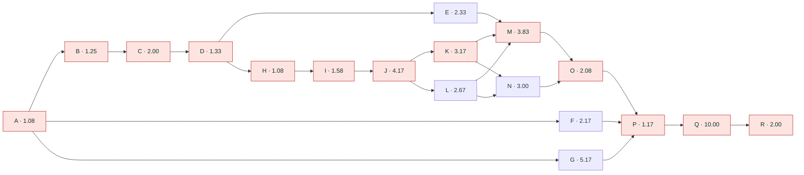
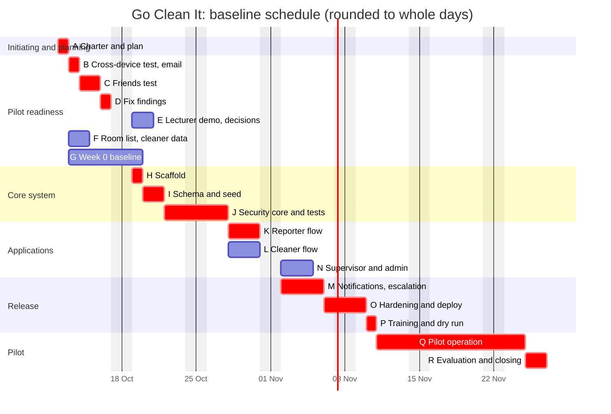

# Go Clean It: Project Management Plan

Structured on the PMBOK process groups and knowledge areas used in the Manajemen Proyek course (EBI 4E3).
Owner and project manager: Farid · Prepared: 12 Oct 2026 · Version 1.0 (baseline proposal, awaiting approval)

Related files: [PROJECT-PLAN.md](PROJECT-PLAN.md) (weekly tracker and health check) · [BLUEPRINT.md](BLUEPRINT.md) (technical spec) · [DESIGN-UPDATE.md](DESIGN-UPDATE.md) · [index.html](../index.html) (prototype)

**How the course language maps to this document**

| What you called it | PMBOK process group | Section |
|---|---|---|
| (start) | Initiating (Inisiasi) | 1 |
| Mapping plan | Planning (Perencanaan) | 2 |
| Execute plan | Executing (Pelaksanaan) | 3 |
| Evaluation plan | Monitoring and Controlling (Pemantauan dan Pengendalian) | 4 |
| (end) | Closing (Penutupan) | 5 |

Unit used for effort and cost in this plan: **work-days** (one person working one day). Money is shown separately where it exists. Every number in sections 2.5 and 2.6 is computed from the three-point estimates in the activity table. The baseline starts Monday 12 Oct 2026. Indonesian public holidays are not modelled.

---

## 1. INITIATING (Inisiasi)

### 1.1 Project charter

| Item | Content |
|---|---|
| Project name | Go Clean It: campus room cleaning report and dispatch system (pilot) |
| Project manager | Farid, with full authority over scope and schedule inside this charter |
| Sponsor | The lecturer (master user) |
| Customer | The facility unit of the pilot building |
| Business case | When a room is dirty nobody knows who to tell, cleaners do not know where to go, and nobody can see how fast problems are fixed. A QR sticker per room (or floor) lets anyone report with no login. The right on-shift cleaner is notified, accepts, finishes with a photo, and the reporter rates it |
| MOV (measurable organizational value) | Median time from `reported` to `accepted` **under 15 minutes** and **at least 80%** of reports accepted by a cleaner, both compared with the Week 0 baseline |
| Objectives (SMART) | 1) By 10 Nov 2026 the secured system passes all 22 security tests. 2) By 25 Nov 2026 a 10-working-day pilot has run in one building of about 40 rooms. 3) By 27 Nov 2026 an evaluation report compares pilot and Week 0 numbers |
| High-level requirements | See the traceability matrix in 2.2 (15 requirements) |
| Summary scope | Report by QR with no login, cleaner queue with atomic accept, proof photo, rating, supervisor dashboard and escalation at 10 minutes, admin QR and users, WhatsApp notifications |
| Out of scope | Payments, live GPS, in-app chat, native app, AI features, multi-university rollout |
| Summary milestones | Charter approved 13 Oct · Friends test done 16 Oct · Security core done 28 Oct · Apps done 5 Nov · Notifications done 6 Nov · Deployed 10 Nov · Pilot 11 to 25 Nov · Evaluation report 27 Nov |
| Summary budget | 50.08 work-days of effort plus 2.5 work-days management reserve. Cash cost near Rp 0 on free tiers. WhatsApp provider cost is not yet quoted |
| Assumptions | Facility unit provides cleaners, shifts and a room list. Free tiers of Vercel and Supabase are enough for about 50 reports per day. Cleaners own a phone with WhatsApp. One builder works on the project |
| Constraints | Slow campus Wi-Fi and basic Android phones. UI in Bahasa Indonesia. Personal data law (UU PDP) applies to names, phone numbers and photos. Security tests must pass before any screen is built (blueprint rule) |
| High-level risks | Cleaners do not use the app. Nobody answers the coordinator number. WhatsApp approval takes long. Personal data mishandled |
| Approval | Sponsor signature or written yes (date: ____). Project manager (date: ____) |

### 1.2 Stakeholder register

| Stakeholder | Interest in project | Power | Interest | Engagement strategy |
|---|---|---|---|---|
| Farid (project manager) | Delivery and learning | High | High | Manage closely |
| Lecturer (sponsor) | Idea proven and defensible | High | High | Manage closely. Demo on 19 to 21 Oct, evaluation report on 27 Nov |
| Facility unit | Faster, visible cleaning | High | High | Manage closely. Weekly 15-minute check, owns decisions in section 2.10 |
| Supervisors | Escalations and dashboard | Medium | High | Keep informed. Involve in dry run |
| Cleaners | Easy tasks, no blame | Low | High | Keep informed, test the cleaner flow with 2 to 3 real cleaners before launch |
| Reporters (students, lecturers, staff) | Report in seconds | Low | Medium | Keep informed through QR sticker text and the status page |
| Friends (early testers) | Help a friend | Low | Medium | Monitor. One test round, one thank-you |
| University IT and legal | Data protection, retention | High | Low | Keep satisfied. Send the data classification (blueprint 6.2) before pilot |
| Suppliers: Vercel, Supabase, Web3Forms, WhatsApp provider | Paid or free service | Medium | Low | Monitor limits (see procurement, 2.11) |

---

## 2. PLANNING (Perencanaan): the mapping plan

### 2.1 Scope management plan

| Question | Answer |
|---|---|
| How is scope defined? | Scope statement (2.3) plus WBS (2.4) plus WBS dictionary. Together they form the **scope baseline** |
| How is the WBS created and kept? | Deliverable-oriented. Built by the people who do the work. Checked against the 100% rule at every change |
| How is scope formally accepted? | Each deliverable has acceptance criteria (2.2 and 2.7) and a named accepter (4.3) |
| How are changes handled? | Change request form and weekly review (2.13). Verbal requests are logged, not built |
| How is creep measured? | Scope variance % = (current requirements − baseline requirements) ÷ baseline requirements × 100% |

### 2.2 Requirements and traceability matrix (RTM)

| ID | Requirement | Source | WBS package | Acceptance criterion | Status |
|---|---|---|---|---|---|
| REQ-01 | A guest reports with no login and no app | Lecturer | 5.1 | Filed in 3 taps or fewer from a QR scan, by 5 testers | Prototype done |
| REQ-02 | Room QR and floor QR both work | Farid | 5.1, 5.3 | Floor QR cannot reach another floor (S19). Retired QR rejected (S22) | Prototype done |
| REQ-03 | A cleaner sees only reports in buildings where they are on shift | Blueprint | 4.3, 5.2 | S6 and S7 pass | Todo |
| REQ-04 | Only one cleaner can accept a report | Blueprint | 4.3, 5.2 | S8 passes: two simultaneous accepts, one winner | Prototype done (open table) |
| REQ-05 | Proof photo is required to finish | Facility unit | 5.2 | Finish is refused without an "after" photo | Prototype done |
| REQ-06 | Reporter can rate and cancel own report | Blueprint | 5.1 | S15 passes | Prototype done |
| REQ-07 | Cleaners get a WhatsApp message with a one-time link | Lecturer | 6.0 | Real message received and link opens the task (S17) | Todo |
| REQ-08 | Report escalates to the supervisor after 10 minutes | Blueprint | 6.0 | Test with a 5-second interval, supervisor notified | Prototype done (simulated) |
| REQ-09 | Supervisor sees median response time and percent accepted | Facility unit | 5.3 | Dashboard equals a hand calculation | Prototype done (sample data) |
| REQ-10 | Admin prints QR stickers and deactivates users | Facility unit | 5.3 | Deactivated user loses access at once (S11) | Prototype done (no PDF) |
| REQ-11 | Database enforces security: RLS, no direct writes, append-only audit | Blueprint | 4.3 | S1 to S5 pass | Todo |
| REQ-12 | Reporter's phone number never reaches a cleaner | Blueprint | 4.3, 5.2 | S16 and S21 pass | Todo |
| REQ-13 | Bahasa Indonesia, mobile first, clear loading states | Farid | 5.1, 5.2, 5.3 | Friends test: no tester needs help for the main flow | Prototype done |
| REQ-14 | Week 0 baseline is measured and compared | Lecturer | 3.6, 8.0 | `pilot-week0.md` holds real numbers | Todo |
| REQ-15 | Reporter can reach a person on WhatsApp from the QR page | Lecturer | 5.1 | Button opens WhatsApp with the room name typed | Prototype done |

Check (both directions): every requirement has at least one work package, and every work package below serves at least one requirement. Packages 1.0 and 7.2 serve the pilot itself and are tied to the charter objectives.

### 2.3 Scope statement

**Product scope:** a mobile web app (guest report page, cleaner queue, supervisor dashboard, admin) with a secured database and WhatsApp notification, running in one pilot building.

**Deliverables:** secured database with tests · reporter, cleaner, supervisor and admin screens · notification and escalation service · QR sticker sheets (room and floor) · deployed system · training notes · pilot data · evaluation report · project documents (this plan, weekly logs, change log, closing report).

**Acceptance criteria:** see 2.2 and the accepter column in 4.3.

**Boundaries (exclusions):** no payment or fees · no GPS or indoor positioning · no in-app chat · no native Android or iOS app · no AI features · only one building in the pilot · production WhatsApp sending needs an approved provider and is not guaranteed before the pilot (the email fallback is used if it is late) · no integration with the university's other systems.

**Constraints:** see charter. **Assumptions:** see charter.

### 2.4 Work breakdown structure (WBS)

Levels follow the class scheme: 0 Project, 1 Category, 2 Sub-category, 3 Work package. Effort is in work-days and equals the expected duration `te` of the matching activity in 2.5. Package 2.0 (clickable prototype) is finished before the baseline date and is shown for completeness. It is not counted in the budget.

```
0   Go Clean It pilot                                     50.08
├─ 1.0 Project management                                  3.08
│   ├─ 1.1 Charter, plan, baseline approved                1.08   (activity A)
│   └─ 1.2 Evaluation and closing report                   2.00   (R)
├─ 2.0 Clickable prototype (complete, outside baseline)    0.00
├─ 3.0 Pilot readiness                                    14.25
│   ├─ 3.1 Cross-device test and email fix                 1.25   (B)
│   ├─ 3.2 Friends test, 5 testers                         2.00   (C)
│   ├─ 3.3 Fix test findings                               1.33   (D)
│   ├─ 3.4 Lecturer demo and open decisions                2.33   (E)
│   ├─ 3.5 Pilot building room list and cleaner data       2.17   (F)
│   └─ 3.6 Week 0 baseline measurement                     5.17   (G)
├─ 4.0 Core system                                         6.83
│   ├─ 4.1 Scaffold                                        1.08   (H)
│   ├─ 4.2 Schema and seed                                 1.58   (I)
│   └─ 4.3 Security core and tests                         4.17   (J)
│        ├─ 4.3.1 RLS policies and helper functions        1.00
│        ├─ 4.3.2 SQL functions and triggers               1.50
│        ├─ 4.3.3 Storage policies                         0.50
│        └─ 4.3.4 Security tests S1 to S22                 1.17
├─ 5.0 Applications                                        8.84
│   ├─ 5.1 Reporter flow (guest)                           3.17   (K)
│   ├─ 5.2 Cleaner flow                                    2.67   (L)
│   └─ 5.3 Supervisor and admin                            3.00   (N)
├─ 6.0 Notifications and escalation                        3.83   (M)
├─ 7.0 Release                                             3.25
│   ├─ 7.1 Hardening and deploy                            2.08   (O)
│   └─ 7.2 Pilot training and dry run                      1.17   (P)
└─ 8.0 Pilot operation (10 working days)                  10.00   (Q)
```

**100% rule check (parent = sum of children):**

| Parent | Children | Sum | Parent value | Result |
|---|---|---|---|---|
| 1.0 | 1.08 + 2.00 | 3.08 | 3.08 | OK |
| 3.0 | 1.25 + 2.00 + 1.33 + 2.33 + 2.17 + 5.17 | 14.25 | 14.25 | OK |
| 4.0 | 1.08 + 1.58 + 4.17 | 6.83 | 6.83 | OK |
| 4.3 | 1.00 + 1.50 + 0.50 + 1.17 | 4.17 | 4.17 | OK |
| 5.0 | 3.17 + 2.67 + 3.00 | 8.84 | 8.84 | OK |
| 7.0 | 2.08 + 1.17 | 3.25 | 3.25 | OK |
| Project | 3.08 + 14.25 + 6.83 + 8.84 + 3.83 + 3.25 + 10.00 | 50.08 | 50.08 | OK |

**WBS dictionary (three examples; the rest follow the same form):**

| Field | 4.3.4 Security tests | 5.1 Reporter flow | 6.0 Notifications and escalation |
|---|---|---|---|
| Responsible | Claude Code, accepted by Farid | Claude Code, accepted by Farid | Claude Code, accepted by Farid |
| Description | Automated tests S1 to S22 run with one command and print pass or fail per test | Guest QR landing, floor picker, form, photo, status page, rating, cancel | Task links, notify function, WhatsApp provider, signed webhook, escalation job |
| Deliverable | `npm run test:db` report | Working screens on a phone | Message received by a real phone, escalation fires |
| Acceptance | All listed tests pass. Removing one policy makes a test fail | REQ-01, REQ-06, REQ-13 met | REQ-07, REQ-08 met, S13 and S17 pass |
| Depends on | 4.2 | 4.3 | 5.1, 5.2, decision on WhatsApp provider (3.4) |
| Effort | 1.17 | 3.17 | 3.83 |
| Risk | Tests too weak | Slow phones | Provider approval delay |

### 2.5 Schedule management

**Activity list, dependencies and three-point estimates.** Durations in working days. `te = (o + 4m + p) ÷ 6` and `σ = (p − o) ÷ 6`.
Dependency type: M = mandatory, D = discretionary (soft logic), E = external.

| ID | Activity | WBS | Predecessors (type) | o | m | p | te | σ |
|---|---|---|---|---|---|---|---|---|
| A | Charter, plan and baseline approved | 1.1 | none | 0.5 | 1 | 2 | 1.08 | 0.25 |
| B | Cross-device test and email fix | 3.1 | A (M) | 0.5 | 1 | 3 | 1.25 | 0.42 |
| C | Friends test, 5 testers | 3.2 | B (M) | 1 | 2 | 3 | 2.00 | 0.33 |
| D | Fix test findings | 3.3 | C (M) | 1 | 1 | 3 | 1.33 | 0.33 |
| E | Lecturer demo and open decisions | 3.4 | D (D), people available (E) | 1 | 2 | 5 | 2.33 | 0.67 |
| F | Pilot room list and cleaner data | 3.5 | A (M), facility unit (E) | 1 | 2 | 4 | 2.17 | 0.50 |
| G | Week 0 baseline measurement | 3.6 | A (M), facility unit (E) | 5 | 5 | 6 | 5.17 | 0.17 |
| H | Scaffold (C0) | 4.1 | D (D) | 0.5 | 1 | 2 | 1.08 | 0.25 |
| I | Schema and seed (C1) | 4.2 | H (M) | 1 | 1.5 | 2.5 | 1.58 | 0.25 |
| J | Security core and tests (C2) | 4.3 | I (M) | 3 | 4 | 6 | 4.17 | 0.50 |
| K | Reporter flow (C3) | 5.1 | J (M) | 2 | 3 | 5 | 3.17 | 0.50 |
| L | Cleaner flow (C4) | 5.2 | J (M) | 2 | 2.5 | 4 | 2.67 | 0.33 |
| M | Notifications and escalation (C5) | 6.0 | K, L (M), E (M, provider decision) | 3 | 3.5 | 6 | 3.83 | 0.50 |
| N | Supervisor and admin (C6) | 5.3 | K, L (M) | 2 | 3 | 4 | 3.00 | 0.33 |
| O | Hardening and deploy (C7) | 7.1 | M, N (M) | 1.5 | 2 | 3 | 2.08 | 0.25 |
| P | Pilot training and dry run | 7.2 | O (M), F, G (M) | 1 | 1 | 2 | 1.17 | 0.17 |
| Q | Pilot operation | 8.0 | P (M) | 10 | 10 | 10 | 10.00 | 0 |
| R | Evaluation and closing report | 1.2 | Q (M) | 1 | 2 | 3 | 2.00 | 0.33 |

**Network diagram (activity on node).** Critical activities are shaded.



**Critical path method.** Forward pass: `ES = largest EF of predecessors`, `EF = ES + te`. Backward pass: `LF = smallest LS of successors`, `LS = LF − te`. `Slack = LS − ES`. Merge points (M after K, L, E; O after M, N; P after O, F, G) use the maximum on the forward pass and the minimum on the backward pass.

| ID | te | ES | EF | LS | LF | Slack | Critical | Planned start | Planned end |
|---|---|---|---|---|---|---|---|---|---|
| A | 1.08 | 0.00 | 1.08 | 0.00 | 1.08 | 0 | Yes | 12 Oct | 13 Oct |
| B | 1.25 | 1.08 | 2.33 | 1.08 | 2.33 | 0 | Yes | 13 Oct | 14 Oct |
| C | 2.00 | 2.33 | 4.33 | 2.33 | 4.33 | 0 | Yes | 14 Oct | 16 Oct |
| D | 1.33 | 4.33 | 5.66 | 4.33 | 5.66 | 0 | Yes | 16 Oct | 19 Oct |
| E | 2.33 | 5.66 | 7.99 | 13.33 | 15.66 | 7.67 | No | 19 Oct | 21 Oct |
| F | 2.17 | 1.08 | 3.25 | 19.40 | 21.57 | 18.32 | No | 13 Oct | 15 Oct |
| G | 5.17 | 1.08 | 6.25 | 16.40 | 21.57 | 15.32 | No | 13 Oct | 20 Oct |
| H | 1.08 | 5.66 | 6.74 | 5.66 | 6.74 | 0 | Yes | 19 Oct | 20 Oct |
| I | 1.58 | 6.74 | 8.32 | 6.74 | 8.32 | 0 | Yes | 20 Oct | 22 Oct |
| J | 4.17 | 8.32 | 12.49 | 8.32 | 12.49 | 0 | Yes | 22 Oct | 28 Oct |
| K | 3.17 | 12.49 | 15.66 | 12.49 | 15.66 | 0 | Yes | 28 Oct | 2 Nov |
| L | 2.67 | 12.49 | 15.16 | 12.99 | 15.66 | 0.50 | No | 28 Oct | 2 Nov |
| M | 3.83 | 15.66 | 19.49 | 15.66 | 19.49 | 0 | Yes | 2 Nov | 6 Nov |
| N | 3.00 | 15.66 | 18.66 | 16.49 | 19.49 | 0.83 | No | 2 Nov | 5 Nov |
| O | 2.08 | 19.49 | 21.57 | 19.49 | 21.57 | 0 | Yes | 6 Nov | 10 Nov |
| P | 1.17 | 21.57 | 22.74 | 21.57 | 22.74 | 0 | Yes | 10 Nov | 11 Nov |
| Q | 10.00 | 22.74 | 32.74 | 22.74 | 32.74 | 0 | Yes | 11 Nov | 25 Nov |
| R | 2.00 | 32.74 | 34.74 | 32.74 | 34.74 | 0 | Yes | 25 Nov | 27 Nov |

Dates are the working day that contains the ES or EF value, rounded up. Fractions of a day are shown as the next calendar day.

**Result**
- **Critical path:** A → B → C → D → H → I → J → K → M → O → P → Q → R.
- **Project duration:** 34.74 working days. Expected finish **Friday 27 Nov 2026**.
- **Cross-check:** the longest path is 34.74. The next longest, through L instead of K, is 34.24. The difference of 0.50 equals the slack of L. The path through N is 33.91, which is 0.83 less, equal to the slack of N.
- **Schedule uncertainty:** σ of the critical path = √(sum of σ² of critical activities) = **1.24 days**. About 68% chance of finishing between 33.5 and 36.0 days. About 95% chance by **37.2 days** (about 2 Dec). The gap between the 95% value and the expected value is **2.48 days**, which becomes the management reserve in 2.6.
- **Slack that is real:** E has 7.67 days of slack, so the decisions meeting must happen no later than **2 Nov** or the notification work is delayed. F and G have 18.32 and 15.32 days of slack, but G needs 5 days of observation by the facility unit, so it should start in week 1 anyway.
- **Long poles you do not control:** E (people's calendars), G (facility unit), F (data from the facility unit), M (WhatsApp provider approval).

**Gantt (rounded to whole days for display):**



**Schedule compression.** Crashing adds effort to shorten a critical activity. The slope is the extra effort-days per working day saved: `slope = (crash effort − normal effort) ÷ (normal time − crash time)`. Pick the cheapest slope first, only on the critical path, and recompute the network after each cut. The figures below are planning assumptions that need confirmation.

| Activity | Normal time | Crash time | Normal effort | Crash effort | Max cut | Slope (effort-days per day) | How the crash is bought |
|---|---|---|---|---|---|---|---|
| C Friends test | 2.00 | 1.00 | 2.00 | 2.50 | 1.00 | **0.50** | All 5 friends test on the same day |
| B Cross-device test | 1.25 | 0.75 | 1.25 | 1.75 | 0.50 | **1.00** | Farid tests during the same session as the email fix |
| M Notifications | 3.83 | 3.33 | 3.83 | 4.33 | 0.50 | **1.00** | Run provider setup in parallel with coding |
| J Security core | 4.17 | 3.17 | 4.17 | 5.67 | 1.00 | **1.50** | A second review pass in parallel with writing tests |
| K Reporter flow | 3.17 | 2.67 | 3.17 | 3.92 | 0.50 | **1.50** | Reuse prototype screens |

| Step | Cut | Project duration after the cut | Extra effort | Cumulative extra effort | Note |
|---|---|---|---|---|---|
| 0 | none | 34.74 | 0 | 0 | Baseline |
| 1 | C by 1.00 | 33.74 | 0.50 | 0.50 | Cheapest first |
| 2 | B by 0.50 | 33.24 | 0.50 | 1.00 | |
| 3 | M by 0.50 | 32.74 | 0.50 | 1.50 | Critical path unchanged |
| 4 | J by 1.00 | 31.74 | 1.50 | 3.00 | |
| 5 | K by 0.50 | 31.24 | 0.75 | 3.75 | **L becomes critical** (its slack was 0.50). Cutting K further does nothing unless L is cut too |
| 6 | K by 0.50 more and L by 0.50 | 30.74 | 1.50 | 5.25 | Two paths now critical, so the slope doubles. Assumes L costs the same per day as K (not yet estimated) |

Reading the table: the first three cuts save 2 days for 1.5 effort-days. After step 5 a second path is critical and each saved day costs about twice as much. Pilot operation Q is fixed at 10 days and cannot be crashed.

**Fast tracking** (parallel work, no extra effort, more risk): start the scaffold H right after A instead of after the friends test D. The scaffold does not depend on test findings. Recomputed, the project is **30.16 days**, a saving of **4.58 days**. The new critical path is A → H → I → J → K → M → O → P → Q → R. The risk is rework if the friends test changes the screen flow, which is low because H only creates an empty app and database.

Side effects of fast tracking: B and C leave the critical path, so crashing them (steps 1 and 2 above) would no longer save anything. Slack of E (the decisions meeting) drops from 7.67 to about 3.1 days, so the decisions are needed by about **27 Oct** instead of 2 Nov.

**Recommended:** use fast tracking on H (free, no extra effort). Expected finish moves from Fri 27 Nov to about **Mon 23 Nov**. Crash J or M only if the sponsor needs an earlier date. The committed baseline stays at 27 Nov until the sponsor approves this change as CR-03 (section 2.13).

### 2.6 Cost management

**Method:** bottom-up estimate from the WBS in work-days (every package above), plus a reserve from the PERT uncertainty. This follows the slides: the estimate is built from work packages by the people doing the work, not guessed from the top.

| Item | Work-days |
|---|---|
| Budget at completion (BAC), sum of 50.08 package efforts | **50.08** |
| Management reserve (95% duration minus expected duration, 37.22 − 34.74) | 2.48 |
| Total with reserve | 52.56 |

BAC excludes the reserve. The reserve is released only by the project manager through a logged change.

**Cash costs (Rp):**

| Item | Pilot cost | Note |
|---|---|---|
| Vercel Hobby | Rp 0 | Free tier |
| Supabase Free | Rp 0 | Free tier. Watch database size (photos) |
| Web3Forms email | Rp 0 | Free tier |
| Domain name (optional) | to quote | Not needed for the pilot |
| WhatsApp Business API provider | **to quote** | Required for real WhatsApp. Ask in decision 3 |
| QR sticker printing | to quote | About 40 room stickers plus one per floor, laminated |
| Claude Code usage | existing plan | Not charged to the project |

**Planned value by week** (cumulative planned work-days, spread evenly inside each activity):

| Week | Dates | PV in week | Cumulative PV | % of BAC |
|---|---|---|---|---|
| 1 | 12 to 16 Oct | 11.09 | 11.09 | 22.1% |
| 2 | 19 to 23 Oct | 8.58 | 19.67 | 39.3% |
| 3 | 26 to 30 Oct | 7.51 | 27.18 | 54.3% |
| 4 | 2 to 6 Nov | 8.16 | 35.34 | 70.6% |
| 5 | 9 to 13 Nov | 5.00 | 40.34 | 80.6% |
| 6 | 16 to 20 Nov | 5.00 | 45.34 | 90.5% |
| 7 | 23 to 27 Nov | 4.74 | 50.08 | 100.0% |

Week 1 looks heavy because the baseline measurement G (5 days) and the other readiness items run in parallel with the critical path. This is the S-curve baseline used in 4.2.

### 2.7 Quality management

| Item | Plan |
|---|---|
| Quality objectives | Security tests S1 to S22 pass · no tester needs help for the main flow · health checks H1 to H9 healthy · pilot MOV measured |
| Quality assurance (process) | One phase at a time. Plan, build, test, commit. Bilingual 5-line summary at the end of each phase. No screen is built before security tests are green. No silent change to the data model or security rules |
| Quality control (product) | `npm run test:db` for the database. Friends test script for usability. Health check weekly. Code review before the pilot |
| Validate Scope vs Control Quality | Control Quality asks "does it meet the specification" (tests, internal). Validate Scope asks "will the customer sign it" (4.3, external). Control Quality comes first |
| Metrics | Test pass rate · defects found per phase · time to file a report (seconds) · taps to file · tester success rate |
| Cost of quality | Prevention: tests written first. Appraisal: friends test, dry run. Failure: rework after the pilot starts, which is why the dry run (P) exists |

### 2.8 Resource management

| Role | Name | Availability | Skills needed |
|---|---|---|---|
| Project manager, product owner | Farid | Part time, weekdays | Decisions, testing, stakeholder contact |
| Builder | Claude Code (directed by Farid) | On request | Next.js, Supabase, security |
| Customer representative | Facility unit contact | Weekly 15 minutes | Cleaner data, shifts, baseline |
| Testers | 5 friends, 2 to 3 cleaners | One session each | None |

**Responsibility assignment matrix.** R = does the work, A = accountable, C = consulted, I = informed.

| WBS package | Farid | Claude Code | Lecturer | Facility unit | Cleaners | Testers |
|---|---|---|---|---|---|---|
| 1.1 Charter and plan | A, R | C | A (approves) | I | | |
| 3.1 to 3.3 Tests and fixes | A | R | | | | R (3.2) |
| 3.4 Demo and decisions | R | C | A | C | | |
| 3.5 Pilot data | A | I | | R | C | |
| 3.6 Baseline | A | I | I | R | | |
| 4.0 Core system | A | R | | | | |
| 5.0 Applications | A | R | | C | C | C |
| 6.0 Notifications | A | R | C | C | | |
| 7.0 Release | A, R | R | I | C | C | |
| 8.0 Pilot operation | A | C | I | R | R | |
| 1.2 Evaluation report | A, R | R | A (approves) | C | | |

Each WBS item has one accountable person, as the slides require.

### 2.9 Communication management

| What | Audience | Owner | How often | Channel |
|---|---|---|---|---|
| Weekly status (tracker, S-curve, risks, decisions needed) | Lecturer, facility unit | Farid | Every Friday | Message with a link to [PROJECT-PLAN.md](PROJECT-PLAN.md) |
| Demo | Lecturer, facility unit | Farid | Week 2 and week 6 | Live on a phone |
| Decision request | Decision owner | Farid | When a decision is due (section 2.10) | Written, with the date needed |
| Change request outcome | Requester | Farid | Within 3 working days | Message |
| Pilot instructions | Cleaners, supervisors | Facility unit | Before launch | Short WhatsApp message and a 15-minute walk-through |
| Incident notice | Facility unit, lecturer | Farid | Same day | Message |
| Evaluation report | Lecturer, facility unit, university IT | Farid | 27 Nov | Document |

### 2.10 Risk management

Scoring: probability P and impact I from 1 (low) to 5 (high). Score = P × I. Threat responses: Avoid, Transfer, Mitigate, Accept, Escalate. Opportunity responses: Exploit, Share, Enhance, Accept.

| ID | Risk | P | I | Score | Response | Plan | Trigger | Owner |
|---|---|---|---|---|---|---|---|---|
| R1 | Cleaners do not accept or update tasks on phones | 3 | 5 | **15** | Mitigate | Test with 2 to 3 real cleaners before launch. Make the WhatsApp link the only step they need | A cleaner needs help in the dry run | Facility unit |
| R2 | Nobody answers the WhatsApp coordinator number | 3 | 4 | **12** | Mitigate | Name a person and hours. Escalation covers the gap | Contact button unanswered in test | Facility unit |
| R3 | WhatsApp provider approval is slow | 4 | 3 | **12** | Mitigate, then Accept | Apply in week 1. If late, run the pilot with email and the in-app queue | No approval by 2 Nov | Farid |
| R4 | Personal data mishandled (names, numbers, photos) | 2 | 5 | **10** | Mitigate | Follow the data classification. Retention decided with the university. No real data in the open prototype | Real numbers typed in the prototype | Farid |
| R5 | Open prototype table abused or filled with junk | 3 | 2 | 6 | Accept | Tell testers it is public. Reset button. Replaced by the secured system in phase C2 | Odd rows appear | Farid |
| R6 | Lecturer or facility unit unavailable for decisions | 3 | 4 | **12** | Mitigate | Book dates now. Latest date for decisions is 2 Nov | No answer by 26 Oct | Farid |
| R7 | Security core takes longer (largest estimate p = 6 days) | 3 | 3 | 9 | Mitigate | Start early, reserve of 2.48 days, crash option in 2.5 | J not done by 28 Oct | Claude Code |
| R8 | Spam or prank reports once QR stickers are public | 3 | 3 | 9 | Mitigate | Rate limits, bot check, retire a QR | Reports spike | Farid |
| R9 | Free plan limits reached (database size, email) | 2 | 2 | 4 | Accept | Watch health check H9, upgrade only if the pilot works | Over 70% of limit | Farid |
| R10 | University wants campus-only reporting | 2 | 3 | 6 | Avoid | Ask in decision 11. Add a campus email check if required | Answer is yes | Lecturer |
| R11 | Prototype is mistaken for the finished system | 3 | 3 | 9 | Mitigate | State the known gaps G1 to G7 on every demo | Someone asks to go live now | Farid |
| O1 | Facility unit adopts the QR flow earlier than planned | 2 | 4 | 8 | Enhance | Give them the sticker sheets and a short guide early | Facility unit asks for stickers | Farid |

Top risks by score: R1 (15), then R2, R3, R6 (12 each), then R4 (10). Four risks score 12 or more at the start, so the risk indicator in 4.1 begins at amber. Review the register every Friday. Risk owners report new triggers in the weekly status.

**Open decisions (these are risk responses with deadlines):**

| # | Question | Needed by | Decision owner | Answer |
|---|---|---|---|---|
| 1 | How cleaners sign in | 24 Oct | Facility unit | |
| 2 | Allowed email domains (optional account only) | Before 28 Oct | Farid | |
| 3 | WhatsApp provider and who pays | 24 Oct | Lecturer and facility unit | |
| 4 | Do cleaners have WhatsApp on their own phones | 24 Oct | Facility unit | |
| 5 | Retention: photos 90 days, reports 1 year | Before 6 Nov | University | |
| 6 | One supervisor per faculty, with a reachable number | 24 Oct | Facility unit | |
| 7 | Pilot building (about 40 rooms) | 24 Oct | Lecturer | |
| 8 | Week 0 baseline measured manually | 20 Oct (start) | Facility unit | |
| 9 | QR layout: room QR plus floor QR | 24 Oct | Farid and facility unit | |
| 10 | One coordinator number or one per building | 24 Oct | Facility unit | |
| 11 | Guests from outside campus allowed | 24 Oct | Lecturer | |
| 12 | Email address for prototype notifications | 13 Oct | Farid | |

### 2.11 Procurement management

| Item | Make or buy | Supplier | Contract type | Decision date | Risk |
|---|---|---|---|---|---|
| Hosting for the web app | Buy | Vercel (Hobby) | Terms of service, free | Done | Limits |
| Database | Buy | Supabase (Free) | Terms of service, free | Done | Limits, project pauses after inactivity on free plan |
| Email notification | Buy | Web3Forms | Free | 13 Oct | Form creation failed once. Fallback is FormSubmit |
| WhatsApp sending | Buy | Official WhatsApp Business API provider (to select) | Per message | 24 Oct | Approval time, cost |
| QR stickers | Buy | Local printer | One-off quote | 3 Nov | Quality of print |
| Software build | Make | Claude Code and Farid | Internal | n/a | n/a |

### 2.12 Stakeholder engagement plan

See 1.2. Engagement targets: lecturer and facility unit from supportive to leading by the pilot start. Cleaners from unaware to supportive: involve 2 to 3 of them in the dry run and ask what they would change. Keep university IT informed with one document before the pilot.

### 2.13 Integration management

**Baselines:** scope baseline (2.3 plus 2.4), schedule baseline (2.5), cost baseline (2.6). Baselines change only through an approved change request.

**Change control process**

| Step | Who | What |
|---|---|---|
| 1 | Anyone | Writes a change request: what, why, who asked, date |
| 2 | Farid | Logs it in the change log below and checks impact on scope, schedule, cost, risk, quality |
| 3 | Farid | Decides alone if impact is under 0.5 work-day and no critical activity moves. Otherwise asks the sponsor |
| 4 | Farid | Updates the affected baseline and the blueprint if the data model or security rules change (blueprint rule 6) |
| 5 | Farid | Tells the requester within 3 working days |

**Change log**

| ID | Date | Change | Requested by | Impact (scope, days, effort) | Decision |
|---|---|---|---|---|---|
| CR-01 | 9 Oct | Guests report without login; QR for floors | Lecturer | Added REQ-01, REQ-02, REQ-15, tests S19 to S22 | Approved, in prototype |
| CR-02 | 10 Oct | Shared data through an open table for the prototype | Farid | Added gaps G1 to G3 | Approved for the prototype only |

---

## 3. EXECUTING (Pelaksanaan): the execute plan

**Rules while executing**
1. One phase at a time. Re-read the matching sections of the blueprint before starting.
2. Security before screens: phase 4.3 must be green before 5.1 to 5.3 begin.
3. One commit per phase after typecheck, lint and tests pass.
4. End every phase with a 5-line summary in English and Bahasa Indonesia: what was built, why, how Farid verifies it, what is next.
5. Do not change the data model or security rules without updating [BLUEPRINT.md](BLUEPRINT.md) in the same commit.
6. Keep the service role key out of client code, logs and git.

**Week-by-week execution plan** (planned dates from 2.5)

| Week | Work packages | Deliverables | Who | Done when (proof) |
|---|---|---|---|---|
| 1 (12 to 16 Oct) | 1.1, 3.1, 3.2, 3.5, 3.6 start | Approved plan, email works, friends test sheets, room list started, baseline observation started | Farid, Claude Code, facility unit | Email arrives, 5 sheets filled, baseline notes begin |
| 2 (19 to 23 Oct) | 3.3, 3.4, 4.1, 4.2, 4.3 start | Findings fixed, demo held, decisions asked, scaffold, schema and seed | Farid, Claude Code, lecturer | `supabase db reset` runs clean, decision list sent |
| 3 (26 to 30 Oct) | 4.3, 5.1 start, 5.2 start | Security tests green, decisions answered by 2 Nov at the latest | Claude Code, Farid | `npm run test:db` all green |
| 4 (2 to 6 Nov) | 5.1, 5.2, 5.3, 6.0 | Guest, cleaner, supervisor and admin screens, notifications and escalation | Claude Code | S6 to S8, S9, S12, S13, S17, S19 to S22 pass |
| 5 (9 to 13 Nov) | 7.1, 7.2, pilot starts 11 Nov | Deployed system, QR stickers printed, training, dry run | Claude Code, Farid, facility unit | `curl -I` shows security headers, dry run without help |
| 6 (16 to 20 Nov) | 8.0 | Pilot running | Facility unit, cleaners | Daily count of reports and accepts |
| 7 (23 to 27 Nov) | 8.0 ends 25 Nov, 1.2 | Evaluation report | Farid | Report accepted by the lecturer |

**Quality assurance in execution:** friends test (week 1), dry run (week 5), weekly health check ([PROJECT-PLAN.md](PROJECT-PLAN.md) section 5.3).

**Managing the team:** Claude Code works on one phase per session with the blueprint and this plan as inputs. Farid reviews each summary before the next phase.

**Stakeholder engagement in execution:** Friday status message, demo weeks 2 and 6, a check with the facility unit each week.

**Procurement in execution:** book the WhatsApp provider and the sticker printer by 24 Oct and 3 Nov.

---

## 4. MONITORING AND CONTROLLING (Pemantauan dan Pengendalian): the evaluation plan

### 4.1 What is measured, how often, and what is "healthy"

| Area | Measure | Formula | Frequency | Green | Amber | Red |
|---|---|---|---|---|---|---|
| Schedule | Schedule performance index | SPI = EV ÷ PV | Weekly | ≥ 0.95 | 0.85 to 0.94 | < 0.85 |
| Cost (effort) | Cost performance index | CPI = EV ÷ AC | Weekly | ≥ 0.95 | 0.85 to 0.94 | < 0.85 |
| Critical path | Slack used | Re-run the CPM table | Weekly | Critical path unchanged | A second path becomes critical | Finish date moves past 2 Dec |
| Scope | Scope variance | (current requirements − 15) ÷ 15 × 100% | Weekly | 0 to 7% | 7 to 15% | Over 15% |
| Quality | Security tests passing | passing ÷ 22 | Each phase from 4.3 | 100% | n/a | Any failing |
| Quality | Health checks H1 to H9 | healthy ÷ 9 | Weekly | All | 1 failing | 2 or more failing |
| Risk | Open risks with score ≥ 12 | count | Weekly | ≤ 3 | 4 to 5 | ≥ 6 or a trigger fired |
| Pilot (MOV) | Median time reported → accepted | median of accepted − reported | Daily in the pilot | < 15 min | 15 to 20 min | > 20 min |
| Pilot (MOV) | Reports accepted | accepted ÷ reports | Daily in the pilot | ≥ 80% | 70 to 79% | < 70% |
| Pilot | Median time accepted → done | median of done − accepted | Daily | Tracked | | |
| Pilot | Average rating | mean of ratings 1 to 5 | Daily | ≥ 4.0 | 3.5 to 3.9 | < 3.5 |

### 4.2 Earned value management (EVM)

Planned value PV comes from the S-curve in 2.6. Earned value EV is the planned effort of the packages that are **fully accepted** (a package counts when its proof exists). Actual cost AC is the work-days really spent.

| Metric | Formula | Meaning |
|---|---|---|
| PV | Planned work-days up to today | What should be done |
| EV | Planned work-days of accepted packages | What is done |
| AC | Work-days actually spent | What it cost |
| SV | EV − PV | Negative means behind |
| CV | EV − AC | Negative means over effort |
| SPI | EV ÷ PV | Below 1 means behind |
| CPI | EV ÷ AC | Below 1 means over effort |
| EAC | BAC ÷ CPI | Forecast total effort if the rate continues |
| ETC | EAC − AC | Effort still needed |
| VAC | BAC − EAC | Expected over or under effort at the end |
| TCPI | (BAC − EV) ÷ (BAC − AC) | Efficiency needed from now to stay in budget |

**Worked example (illustration only, not real data).** End of week 2: PV = 19.67. Suppose accepted packages add up to EV = 17.00 and 18.50 work-days were spent (AC = 18.50).
- SV = 17.00 − 19.67 = **−2.67**; CV = 17.00 − 18.50 = **−1.50**.
- SPI = 17.00 ÷ 19.67 = **0.86** (amber, behind); CPI = 17.00 ÷ 18.50 = **0.92** (amber).
- EAC = 50.08 ÷ 0.92 = **54.50**; ETC = 54.50 − 18.50 = **36.00**; VAC = 50.08 − 54.50 = **−4.42**.
- TCPI = (50.08 − 17.00) ÷ (50.08 − 18.50) = 33.08 ÷ 31.58 = **1.05**.
- Reading: the project is about 14% behind and 8% over effort. The overrun of 4.42 is larger than the reserve of 2.48, so the sponsor would be asked to choose between crashing (2.5), dropping a requirement, or accepting a later finish.

**Weekly tracking table (fill every Friday):**

| Week | PV (cumulative) | EV | AC | SV | CV | SPI | CPI | EAC | Status |
|---|---|---|---|---|---|---|---|---|---|
| 1 | 11.09 | | | | | | | | |
| 2 | 19.67 | | | | | | | | |
| 3 | 27.18 | | | | | | | | |
| 4 | 35.34 | | | | | | | | |
| 5 | 40.34 | | | | | | | | |
| 6 | 45.34 | | | | | | | | |
| 7 | 50.08 | | | | | | | | |

### 4.3 Validate scope, control scope, control schedule

**Validate scope (formal acceptance).** After Control Quality passes, the accepter signs. A deliverable rejected here becomes a change request, not a defect.

| Deliverable | Accepter | Date due | Signed (date) |
|---|---|---|---|
| Approved charter and plan (1.1) | Lecturer | 13 Oct | |
| Friends test report (3.2, 3.3) | Farid | 19 Oct | |
| Decisions list answered (3.4) | Lecturer and facility unit | 2 Nov at the latest | |
| Security core with 22 tests green (4.3) | Farid | 28 Oct | |
| Reporter, cleaner, supervisor, admin screens (5.0) | Facility unit | 5 Nov | |
| Notifications and escalation (6.0) | Facility unit | 6 Nov | |
| Deployed system and dry run (7.0) | Facility unit and supervisors | 11 Nov | |
| Pilot data and evaluation report (8.0, 1.2) | Lecturer | 27 Nov | |

**Control scope.** Look for sources of change before they arrive (proactive). Likely sources: the lecturer wants a new view, the facility unit wants a new category, cleaners ask for chat, someone asks for a second building. Each goes through the change process in 2.13. Variance example: if requirements grow from 15 to 17, scope variance = (17 − 15) ÷ 15 × 100% = 13.3% (amber).

**Control schedule.** Every Friday: re-run the CPM table with actual dates. Note which slack was used. If a second path turns critical, tell the sponsor in the weekly status. Use the compression options in 2.5 only after checking the new critical path.

**Control cost.** Compare AC with EV (CPI). Use the reserve only through a logged change.

**Control risks.** Update the register in 2.10 every Friday. Close risks that cannot happen any more. Add new risks as they appear.

**Control communications and stakeholder engagement.** Check that the Friday message went out and that open decisions have an answer by their date.

### 4.4 Evaluation of the pilot (results, not just process)

| Item | Plan |
|---|---|
| Question | Does the QR and WhatsApp flow make cleaning requests faster and more visible than the current way? |
| Baseline | Week 0 (3.6): for 5 working days, note for each cleaning request the time asked, the time a cleaner started, and the time finished |
| Pilot data | The `report_event` table: reported, accepted and done timestamps, plus rating |
| Primary result | Median reported → accepted under 15 minutes and at least 80% accepted, compared with Week 0 |
| Secondary results | Median accepted → done, escalations per day, average rating, reports per day, cleaner adoption (reports accepted by each cleaner), reports with after-photo |
| Qualitative | 15-minute talk with 3 cleaners, 2 supervisors, 5 reporters. Ask what was confusing and what they would change |
| Decision rule | Both primary results met: recommend expanding to more buildings. One met: fix the cause and extend the pilot 2 weeks. Neither met: stop and review the assumption about cleaners and phones |
| Data hygiene | Remove personal data from the report before sharing. Follow the retention decision |

### 4.5 Project evaluation (how well did we manage the project)

At the end, compare plan and actual: duration (34.74 planned), effort (50.08 planned), scope (15 requirements), number of change requests, risks that happened, and decisions that were late. Record what was learned in the closing report.

---

## 5. CLOSING (Penutupan)

| Step | Output | Owner | Due |
|---|---|---|---|
| Final acceptance of all deliverables | Signed table in 4.3 | Lecturer | 27 Nov |
| Hand over the system | Admin access, README, how to add rooms and cleaners, how to print stickers | Farid | 27 Nov |
| Close procurement | Cancel unused services, confirm costs | Farid | 27 Nov |
| Release resources | Thank testers and cleaners, release the facility unit contact | Farid | 27 Nov |
| Archive | Plan, logs, change log, risk register, evaluation report kept in the repository | Farid | 27 Nov |
| Lessons learned | What worked, what did not, what to do differently next time (below) | Farid | 27 Nov |
| Closing report | Planned vs actual (4.5) and pilot result (4.4) | Farid | 27 Nov |
| Next step decision | Expand, extend, or stop (decision rule in 4.4) | Lecturer and facility unit | After the report |

**Lessons learned template**

| Area | What happened | What we would do next time |
|---|---|---|
| Scope | | |
| Schedule | | |
| Cost and effort | | |
| Quality | | |
| People and communication | | |
| Risks | | |
| Tools and suppliers | | |

---

## Appendix A. Process groups × knowledge areas (where each cell lives in this document)

| Knowledge area | Initiating | Planning | Executing | Monitoring and Controlling | Closing |
|---|---|---|---|---|---|
| Integration | 1.1 Charter | 2.13 Plan and change process | 3 Direct and manage work | 4.3 Integrated change control | 5 Close project |
| Scope | | 2.1 to 2.4 | | 4.3 Validate and control scope | 5 Final acceptance |
| Schedule | | 2.5 | 3 Weekly plan | 4.2, 4.3 Control schedule | |
| Cost | | 2.6 | | 4.2 EVM, 4.3 Control cost | 5 Close costs |
| Quality | | 2.7 | 3 QA | 4.1 Control quality | |
| Resources | | 2.8 | 3 Manage team | 4.3 | 5 Release resources |
| Communications | | 2.9 | 3 Stakeholder updates | 4.3 | |
| Risk | 1.1 High-level risks | 2.10 | 3 Respond to risks | 4.3 Monitor risks | 5 Lessons |
| Procurement | | 2.11 | 3 Buy services | 4.3 | 5 Close procurement |
| Stakeholders | 1.2 Register | 2.12 | 3 Engage | 4.3 | 5 |

## Appendix B. Terms used (as in the class slides)

Work package: lowest level of the WBS, with owner, duration and cost. 100% rule: a parent equals the sum of its children. Scope baseline: scope statement plus WBS plus WBS dictionary. RTM: table tracing each requirement to the deliverable that meets it. Critical path: longest path, shortest possible project time. Slack: LS − ES. PERT: (o + 4m + p) ÷ 6. Crashing: add resources to shorten a critical activity, chosen by slope. Fast tracking: do tasks in parallel that were planned in sequence, which adds risk. EVM: earned value management using PV, EV, AC.
